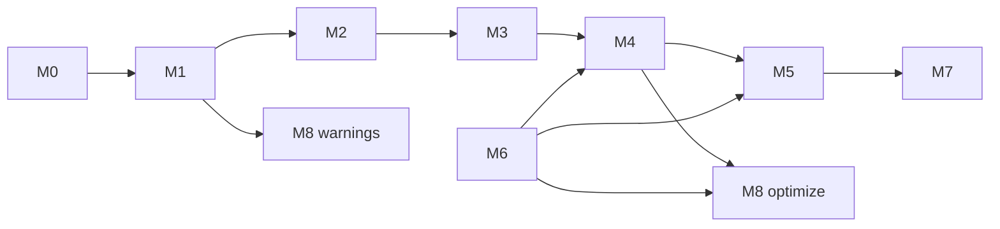

# D-04 — Suite-Driven Roadmap

**Implements:** [F-02 — Build Portable Program Artifacts](../feature/F-02-portable-programs.md)  
**Status:** In progress

> **Withdrawn capability (2026-10-11).** The compiler-owned Effect and State
> mechanisms described below were removed: the trusted `Effect` synthesis, the
> `Prim.State` primitives, the `runWorld`/`runRegion` intrinsics, the Core/CC/MIR
> State analysis, and the runtime storage source-binding contract. The `Effects`
> gate row and the compiler-owned `BE-21` `Effect Unit` entry mechanism no longer
> describe the compiler. The replacement is library-owned native Effect/ST;
> ordinary configured command normalization applies its runner. Measurements
> using either withdrawn mechanism are historical. See the
> [removal handoff](../implementation/backend/effect-state-removal-handoff-2026-10-11.md).

## Purpose

Turn the official PureScript test suite into an operational scoreboard for the
frontend and backend feature matrices below. [DEC-04](../decision/DEC-04-official-test-suite-roadmap.md)
fixes the strategy: the feature matrices define the implementation
inventory, while the suite and the `purs` compiler provide the acceptance
oracle. This document defines the corpus classification, coverage milestones,
and acceptance criteria used to measure those matrices.

The milestones are ordered by dependency, not by suite size. Each milestone is
independently measurable as per-file agreement with `purs`, and each later
milestone reuses the earlier ones.

## Corpus

The vendored corpus is pinned to the PureScript `v0.15.16` release so that the
installed `purs` binary and the sources agree. Counts below are from that
revision and include files in subdirectories:

| Directory | Files | Role |
| --- | --- | --- |
| `tests/purs/layout` | 15 | Lexer/layout goldens with `.out` |
| `tests/purs/passing` | 439 | Must compile and run |
| `tests/purs/failing` | 444 | Must fail with a listed `errorCode` |
| `tests/purs/warning` | 68 | Must compile with listed warnings |
| `tests/purs/optimize` | 10 | Expected optimizer output |

These are source-file counts. The `passing` directory has 365 program roots
and 74 support files. L6/M7 groups each root with its same-stem support
directory, following the official runner; support modules remain compilation
inputs rather than independent commands. Frontend boards keep their per-file
units. A corpus FFI dependency excludes its entire runtime program. See
[runtime program units](../implementation/runtime-program-scoreboard.md).

The vendored copy under `tests/upstream` keeps the four `.purs` directories
only. `optimize` is not vendored, so M8-O reads it from a checkout, and its
goldens are `.out.js` files: M8-O therefore compares optimizer output shape
rather than CoreFn text.

`purs --json-errors` reports a machine-readable `errorCode` per diagnostic.
Parsing occurs before module resolution, so `ErrorParsingModule` classifies
parse behavior even when the support libraries are not installed.

One caveat applies when using a single-file `purs compile` invocation without
the support libraries: for a module whose imports cannot be found, the compiler
reports `ModuleNotFound` from the partially-parsed header without parsing the
rest of the body. The harness therefore also supports classifying `failing`
files by their `@shouldFailWith` annotation (`PSRS_ORACLE=annotations`), which
is the corpus's own ground truth and does not depend on the installed
libraries or compiler revision.

## Exclusions

JavaScript and Node.js FFI are not a compatibility target, per [F-02](../feature/F-02-portable-programs.md).
A suite file is excluded from milestone acceptance when any of the following
holds:

- it contains a `foreign import` declaration;
- it is accompanied by a `.js` FFI implementation used by the same module;
- its expected `errorCode` is FFI-specific (`DeprecatedFFIPrime`,
  `MissingFFIImplementations`, `UnsupportedFFICommonJSImports`,
  `UnsupportedFFICommonJSExports`, `DeprecatedFFICommonJSModule`,
  `UnnecessaryFFIModule`, and similar).

In this corpus that is 26 `passing`, 31 `failing`, and 1 `warning` file. No
tracked `.purs` file ships a sibling `.js` implementation — the corpus's 37
`.js` files are `optimize` goldens — and all 8 `failing` cases that expect an
FFI-specific `errorCode` also declare `foreign import`, so the harness's
`foreign import`-or-sibling-`.js` rule already excludes every file the three
rules above cover. Excluded files are reported separately by the harness and
count as neither agreement nor gaps. The parser may accept `foreign` syntax
opportunistically, but no milestone requires it.

Programs that use the project's PureScript-facing WASI libraries remain
targets; those libraries are implemented by the runtime, not by JavaScript
FFI.

## Milestones

| ID | Milestone | Primary suite subset | Layer |
| --- | --- | --- | --- |
| M0 | Layout and lexing | `layout` (15) | L0 |
| M1 | Surface grammar | parse behavior of all non-excluded files | L1 |
| M2 | Modules, imports, exports, names | resolution `errorCode`s | L2 |
| M3 | Kinds and higher-kinded types | kind `errorCode`s | L3 |
| M4 | Core type checking | type `errorCode`s | L4 |
| M5 | Type classes and instances | class `errorCode`s | L5 |
| M6 | Data, newtypes, records, rows | features required by `passing` | L4–L6 |
| M7 | Runtime and standard library | `passing` program groups (340 non-FFI) | L6 |
| M8 | Warnings and optimization | `warning` (68), `optimize` (10) | — |

### M0 — Layout and lexing

- **Suite:** `tests/purs/layout/*.purs` (15), for example `Shebang.purs`,
  `Delimiter.purs`, `Commas.purs`, `IntType.purs`, `AdoIn.purs`.
- **Goal:** Tokenization and the layout algorithm match PureScript's, including
  Unicode keywords (`∷`, `∀`, `→`), numeric and string literals, backtick
  operators, and `where`/`let`/`do`/`ado` layout.
- **Acceptance:** Our layout output is stable and reviewed against each golden;
  every layout file agrees with the official parse outcome.
- **Prerequisite:** None.

### M1 — Surface grammar

- **Suite:** All non-excluded `passing` + `failing` + `warning` files.
- **Selection rule:** Files the oracle reports as `ErrorParsingModule` (33
  tracked failing tests, for example `UnderscoreModuleName.purs`) must fail to
  parse; every other non-excluded file must parse successfully.
- **Goal:** The full surface grammar: module/import/export lists; value, type,
  `data`, `newtype`, `class`, `instance`, `derive`, `foreign`, fixity, and kind
  signature declarations; `where` blocks; types with `forall`, rows,
  constraints, kind annotations, application, and operators; expressions with
  `case`/`of` and guards, `do`/`ado`, records, sections, and type application;
  and pattern binders.
- **Acceptance:** L1 parse agreement reaches 100% over all four directories
  apart from the recorded DEC-16 intentional differences, enforced by the suite
  scoreboard.
- **Prerequisite:** M0.

**Progress (measured against the vendored `v0.15.16` corpus):** 904/908 parse
agreement with `PSRS_ORACLE=annotations`: `passing` 410/413, `failing` 412/413,
`warning` 67/67, and `layout` 15/15. The four remaining differences are the
[DEC-16](../decision/DEC-16-scalar-strings-and-utf8-storage.md) intentional
differences below, not open defects. Layout now masks case and lambda binders,
guards, declaration heads, and record labels, closes exposed blocks at commas
and closing backticks, and emits layout ends before guard terminators.

The default syntax tests enforce all 15 official layout parse outcomes:
12 parse successfully; `DoLet`, `LetGuards`, and `InstanceChainElse` are rejected
by both parsers. Agreement includes those intentional rejections. Regression
coverage also exercises keyword record labels and lambdas inside guards.

The annotations oracle avoids the Corpus caveat: missing imports can prevent
the installed compiler from parsing a failing file's body.

**L1 intentional differences.** DEC-16 makes the source `String` a sequence of
Unicode scalar values, so the corpus cases that rely on `purs` accepting or
rejecting lone UTF-16 surrogates are differences by design:

| Case | Corpus expectation | This compiler | Why |
| --- | --- | --- | --- |
| `passing/StringEscapes.purs` | accepts a lone surrogate escape | rejects it | A lone surrogate is not a scalar value. |
| `passing/StringEdgeCases/Records.purs` | accepts a lone surrogate escape | rejects it | Same. |
| `passing/StringEdgeCases/Symbols.purs` | accepts a lone surrogate escape | rejects it | Same. |
| `failing/2434.purs` (`'\x10000'`) | rejects the `Char` literal | accepts it | U+10000 is one scalar, so it is one `Char`. |

A paired surrogate escape decodes as one scalar, and a supplementary scalar is
a valid `Char`. Counting these four cases as regressions would require reverting
DEC-16.

Phase 0 (#80) measured L1 parse agreement at 908/908 before DEC-16 withdrew the
requirement to preserve lone UTF-16 surrogates. That scoreboard does not verify
source-string values, and the surrogate cases it counted are now the recorded
intentional differences. DEC-16 is implemented end to end: the lexer pairs
surrogate escapes and rejects unpaired ones, the backend stores GC strings as
canonical UTF-8 bytes, `stringToBytes`/`bytesToString` convert losslessly and
reject malformed input, and a WIT `list<u8>` is an `Array Int` rather than text.

### M2 — Modules, imports, exports, and names

- **Suite:** Failing tests by `errorCode`: `UnknownName` (22),
  `CannotDefinePrimModules` (2), `DeclConflict`
  (11), `TransitiveExportError` (10), `ExportConflict` (7), `ScopeConflict`
  (6), `TransitiveDctorExportError` (2), `OrphanTypeDeclaration` (2),
  `OrphanKindDeclaration` (2), `OverlappingNamesInLet` (4),
  `OverlappingArgNames` (2), `DuplicateValueDeclaration` (2), `DuplicateModule`
  (1), `CycleInModules` (1), `UnknownImport` (1),
  `UnknownImportDataConstructor` (1), `UnknownExport` (1),
  `UnknownExportDataConstructor` (1), `ModuleNotFound` (1),
  `IncorrectAnonymousArgument` (4).
- **Goal:** A module loader and namespace resolution: values, types,
  constructors, classes, imports with `hiding`/`as`, export lists, and
  dependency cycles.
- **Acceptance:** Agreement on the `errorCode`s above, and every `passing`
  module resolves.
- **Prerequisite:** M1.

**Progress (implemented slice):** the front end resolves module graphs,
qualified/unqualified/aliased imports, explicit and `hiding` import lists,
exports, and cross-module value and type references. The virtual `Prim` family
keeps root built-ins on their existing `BuiltinType` identities and declares
official child-module types and classes once on the shared HIR spine, including
kinds and class fundeps. Import availability does not add solver rules. Unary
minus resolves the ordinary in-scope `negate` value. Value, constructor-pattern,
and type operator aliases preserve their target identities through imports and
re-exports; P4 applies fixities, expands sections, and lowers type operators.
After generalization, P5 checks inferred public schemes by stable type identity.
Source modules cannot replace the reserved `Prim` namespace. `Prim.Number` is
not an official child module. The root `Prim.undefined` value has a stable
compiler-owned identity and type, but Core lowering still reports that it has no
runtime representation. Type-level entailment for `Prim.Row`, `Prim.RowList`, `Prim.Symbol`,
`Prim.Int`, and `Prim.TypeError` remains separate from module availability.
The supported guarded equation, guarded case, multi-scrutinee, and local
pattern-binding forms now resolve and lower in a subset. Instance declarations
have stable dictionary identities in HIR; method members stay dictionary-scoped,
explicit exports filter each instance branch by class/head/context visibility,
and imported instance chains preserve their original positions. Instance
member signatures associate with the following equation group and are checked
against the method type specialized by the instance head. Broader pattern
binding support remains incomplete.

**Measured current result (2026-10-22, annotations oracle, vendored corpus, after anonymous arguments):** **76/76** failing cases agree. The move from 72/72 is `IncorrectAnonymousArgument` 4/4: `failing/AnonArgument1.purs`, `failing/AnonArgument2.purs`, `failing/AnonArgument3.purs`, and `failing/OperatorSections2.purs`. A parenthesized operator is a section only when `_` is an immediate operand, so `(_ + 2 * 3)` still resolves and `(_ * 4 + 1)` reports `IncorrectAnonymousArgument` rather than `UnknownName`. The other resolution codes are unchanged, including `UnknownName` 22/22. Passing resolution stayed 403/413; the remaining 10 are 6 P3 resolve and 4 P0 lex, with no harness, missing-library, or unusable-sibling blockers. The same run remeasured L3 at 50/50, L4 at 62/62, and L5 at 101/101 (163 measured cases). Epic #77 stays open.

**Measured (annotations oracle, vendored v0.15.16 corpus, 2026-10-03):**
`PSRS_ORACLE=annotations cargo test -p psrs-driver --test suite
l2_resolution_scoreboard_with_annotations -- --ignored --nocapture` reports M2
failing agreement of **72/72**. Per-code agreement is `CannotDefinePrimModules`
2/2, `CycleInModules` 1/1, `DeclConflict` 11/11, `DuplicateModule` 1/1,
`DuplicateValueDeclaration` 2/2, `ExportConflict` 7/7, `ModuleNotFound` 1/1,
`OrphanKindDeclaration` 2/2, `OrphanTypeDeclaration` 2/2,
`OverlappingArgNames` 2/2, `OverlappingNamesInLet` 4/4, `ScopeConflict` 6/6,
`TransitiveDctorExportError` 2/2, `TransitiveExportError` 10/10,
`UnknownExport` 1/1, `UnknownExportDataConstructor` 1/1, `UnknownImport` 1/1,
`UnknownImportDataConstructor` 1/1, and `UnknownName` 22/22. This resolves the
previous mismatches in `failing/881.purs` and
`failing/InstanceSigsOrphanTypeDeclaration.purs`.

`passing` resolution was measured independently on `6f66524` by each slice, and the figures are not additive.
The `Show` measurement is **253/413**, with 160 first-stage blockers: **57
missing library modules**, 99 other P3 resolution blockers, and 4 P0 lexing
blockers, with **no P2 surface-lowering blocker**. The L6 stage table below
records where the files that do resolve later stop; 177 of them stop at P10.
`Data.Foldable` measured the same counters independently on `6f66524`
(resolution stays 245/413, missing modules 55, other P3 109).
The `Data.Tuple` L2 remeasurement is **245/413**, with 168 first-stage blockers:
**56 missing library modules**, 108 other P3 resolution blockers, 4 P0 lexing
blockers, and **no P2 surface-lowering blocker**. That L2 command does not
report P10. Relative to the clean 5298aad
baseline, the P2 count fell from 61 to zero: all 34 fixed issue-85 pattern
blockers and 22 additional type, kind, instance, and declaration-form cases now
pass P2, and #87 removed the last five — the negative type-level integer
prefixes in `IntToString.purs` and `ParseTypeInt.purs`, and the visible type
applications in `4500.purs`, `4535.purs`, and `VTAsClassHeads.purs`. Those five
moved from a P2 blocker to a missing-library blocker, so the blocked total is
unchanged at 354 and the library surface, not the front end, is now what holds
the whole `passing` suite outside P0. The #88 slice moved 22 cases past P2 from
its earlier 83-case baseline, and all twelve named #88 fixtures lower through
P2. Nineteen sibling modules loaded, and no case imported an unusable sibling.
The board
assembles each case from its own modules and the siblings its imports reach,
with the library on the module path. A case in a category root is never given
siblings, because `tests/upstream/failing` has three files declaring `module
M1`; only the case's own diagnostics decide agreement.

**The `unit` value and `Test.Assert` slice (2026-10-03)** moves
`passing` resolution from 199/413 to 209/413 and the missing-library count from
83 to 62. It is worth decomposing, because one total hides three causes. The
`unit` value is a compiler primitive now (`Intrinsic::Unit`, lowered to the
canonical integer `0` at Core `ExprKind::Unit`), which clears the first blocker
of 11 cases that reported `unknown name`unit``; `Test.Assert` on the on-disk
library clears 21 cases that stopped at `ModuleNotFound: Test.Assert`. The
`Test.Assert` 21 split evenly into the 10 that now resolve and 11 that stop at a
different P3 error, which is why the P3 count rises by 11 while the blocked
total falls. Across both halves, 24 cases stop at another P3 name the library
still owns — 8 on `$`, 2 each on `negate`, `_`, and the deliberately absent
`assertEqual`, 2 on `logShow`, and singles on `Monad`, `Eq`, `Unit`'s import
site, `append`, `show`, `Foo.Bar`, and `<>` — and 8 stop later in the pipeline
(4 at P10 entry selection, 4 at P5 type checking). No case reached execution in
that measurement, so its runtime board stayed 0/413; the `unit` half also moves no case past P0,
because the four DEC-16 surrogate files are unaffected.

`Test.Assert` is landed as the four checks that need no class surface
(`assert`, `assert'`, `assertTrue`, `assertFalse`). A failure writes its message
to standard error and then escapes through the new `Prelude.trap` effect, which
is the only failure signal a compilable corpus case can carry: a non-zero exit
code is a recorded result on the runtime board, not a failure. `assertEqual`
needs `Eq` and `Show` and `assertThrows` needs to observe a trap, so both are
omitted rather than approximated; their obligations are recorded under #94 and
EF-12.

**The `$`/`#` application operators (2026-10-04)** add `Data.Function` to the
library and re-export its four operator/value names from `Prelude`, and move
`passing` resolution from 209/413 to 225/413. `$` was the largest single P3
blocker at 22 cases; all 22 now reach a later stage, and the `Data.Function`
module clears 1 more. Sixteen of the 23 now resolve — 8 then stop at P10 entry
selection, 5 at P5 type checking, 2 at P8, and 1 at P6 — and the other 7 stop at
the next P3 name (`otherwise`, `Eq`, `<>`, `Functor`, `_`, `Monad`, and
`logShow`). Two prerequisites landed with it and are recorded separately: a
re-exported
operator alias no longer requires its target's name, which is what `purs`
checks, and CC's partial-application adapter now converts the parameters it
leaves to the caller to the declaration's shapes, which is what makes an
imported polymorphic function usable under-applied.

**The `Semigroup` class and `<>` (2026-10-04)** add `Data.Semigroup` — the
class, its `append` method, the `<>` alias, and the `String`, `Unit`, and
`Array a` instances — and re-export the three names from `Prelude`. `passing`
resolution moves from 225/413 to **235/413**. `<>` was the largest single P3
name at 15 cases and `append` blocked 2 more; all 17 now stop on a later stage.
The 10 that resolve past L2 decompose by where they land: 5 at P10 entry
selection (`4310.purs`, `4310/Lib.purs`, `Module.purs`, `Module/M1.purs`,
`Module/M2.purs`), 3 at P5 type checking (`Objects.purs`,
`ReExportQualified.purs`, `RowPolyInstanceContext.purs`), 1 at P8
(`FieldPuns.purs`), and 1 at P6 (`EmptyDataDecls.purs`). The other 8 of the 15
`<>` cases stop at the next P3 name — `show` twice, then `identity`, `Functor`,
`Monad`, `Applicative`, `Show`, and `&&`. Two prerequisites land with it and are
recorded separately on the backend: a general sized-array allocator, because the
MIR `ArrayNewDefault` verifier enforces array-conversion invariants and cannot
allocate a computed total length, and `Semigroup String` reuses the checked byte
conversion (`bytesToString (arrayAppend (stringToBytes left) (stringToBytes
right))`) rather than adding a second string writer. This is the first
library-declared class, so it is also the reference pattern for a class with an
operator alias, cross-module instance resolution, and a method body over compiler
primitives.

**The `Show` class (2026-10-04)** adds `Data.Show` — the class, its `show`
method, and the `Boolean`, `Int`, `Number`, `Char`, `String`, `Unit`, and
`Array a` instances — and re-exports the class and method from `Prelude`.
Measured on this master before the slice (Eq, Ord, and Semiring already
landed) and after it, with
`PSRS_ORACLE=annotations cargo test -p psrs-driver --test suite -- --ignored --nocapture`:
L2 `passing` resolution moves from 245/413 to **253/413**, first-stage blockers
from 168 to 160, and other P3 blockers from 107 to 99. The missing-module count
stays 57. Eight files leave L2; `show` and `Show` are no longer first-blocker
names. That after-run is the Show L6 table below, which was still 0/413
executing. It is not the current gate row. `Number`'s digits are not a correctly rounded ECMAScript conversion,
so a file that compares `show` of a non-dyadic fraction with the official text
can still disagree once it runs. `logShow` and `assertEqual` stay with #95.

**`Monoid` and `Foldable` (2026-10-04)** add `Data.Monoid` (`mempty` for
`String`, `Unit`, and `Array a`) and `Data.Foldable` (`foldr`, `foldl`,
`foldMap`, with `Array`, `Maybe`, and `Either a` instances). `fold` is not
declared: it is `foldMap` of the identity under a quantified `Foldable f`, and
projecting that rank-2 method from a dictionary parameter fails CC verification.
On `6f66524`, before this slice, the compile-path missing-module count is 57 and
P3 is 107; lenient `passing` resolution is already **245/413** (the 235 figure
above predates `Data.Eq`, `Data.Ord`, and `Data.Semiring`). The slice moves the
missing-module count from 57 to **55** and P3 from 107 to **109**. Resolution
stays 245/413. Of the seven files whose first blocker was `Data.Foldable` (4) or
`Data.Monoid` (3), five stop on a later missing module (`Data.Traversable` 2,
`Data.Tuple`, `Type.Proxy`, `Data.Monoid.Additive`) and two stop at another P3
error. P10 stays 172, P5 typecheck 40, P5 kind check 17, P8 12, P6 4, and P0 4.
That base is `6f66524` without `Data.Show`.

**`Data.Tuple` (2026-10-04)** adds the module as `type Tuple a b = { _1 :: a,
_2 :: b }`, the closed record FE-06 already lowers a tuple to, plus `fst`,
`snd`, `curry`, `uncurry`, and `swap`. It does not declare `data Tuple a b =
Tuple a b` and it does not add `Eq`, `Ord`, `Show`, or `Functor` instances.
Re-measured with the L2 command above, on 6f66524 before the module and again
after it: `passing` resolution stays **245/413** (the 235 figure in the
`<>` paragraph is older than this tree), the missing-module count moves from
57 to **56**, and the other P3 blockers move from 107 to **108**. M2 failing
agreement stays 72/72. `passing/TypeAnnotationPrecedence.purs` is the file
that leaves `ModuleNotFound`; it then stops at P3 on `<<<` and on the value
`Tuple`, which this module does not declare. The other seven `Data.Tuple`
importers still name another missing module.
Eight `passing` files import `Data.Tuple` itself; `4535.purs` imports
`Data.Tuple.Nested` and is not one of them.
The Show, Foldable, and Tuple figures were measured independently on `6f66524`
and are not additive.


**`Effect.Console.logShow` (2026-10-04)** lands the wrapper over the now-declared
`Show` class and moves `passing` resolution from 253/413 to **270/413**. `logShow`
was the largest single P3 name at 24 cases, 19 of them reported as *"`logShow` is
not exported by the imported module"*; it is `log` of `Data.Show.show`, so the
wrapper adds no I/O and no second stringifier. Of the 24, **17 resolve past L2**
and 7 stop at the next P3 name, which is now visible for the first time:
`Monad` and `compare` 2 each, and `negate`, `not`, and `_` 1 each. The 17 land at
later stages as 10 P10, 4 P5 typecheck, 1 P8, and 2 P6, so P10 moves 177 to 187,
P5 typecheck 42 to 46, P8 13 to 14, and P6 4 to 6. M2 failing agreement stays
72/72 and L1 stays 904/908.

**`Data.Functor` (2026-10-04)** adds `class Functor`, `map`, and `<$>`, with
`Array`, `Maybe`, and `Either` instances in that module and the `Effect`
instance in `Prelude`. `map` on `Effect` is that instance; its body is the
previous effect-only function, so building the action still does not run it.
One `PSRS_REQUIRE_WASMTIME=1 PSRS_ORACLE=annotations` run of all boards, on
the tree after the effect-entry measurement: `passing` resolution moves from
270/413 to **276/413**, and L6/M7 from 124/413 to **125/413**. All 125 exit 0.
The new runtime file is `passing/3549.purs`, whose first blocker was
`Functor`. `failing/3549.purs` now agrees with `KindsDoNotUnify`, so L3 moves
from 35/48 to **36/48** (`KindsDoNotUnify` 16/24). L5 moves from 53/80 to
**53/79** because `failing/NewtypeInstance5.purs` leaves the class board: it
now fails in the newtype checker instead of as `UnknownName`. L1 stays
904/908, L2 failing stays 72/72, and L4 stays 35/50. Runtime first blockers of
the other 288 are missing module 53, P10 63, P3 80, P5 typecheck 49, P5 kind
17, P8 16, P6 6, and P0 4. `Functor` and `<$>` are gone from the first-blocker
names. The 67 `passing` files still first-blocked on a `Prelude` name #94
owns are `Monad` 14, `identity` 9, `_` 8, `negate` 6, `Eq1` 4, `<<<` 4,
`otherwise` 3, `&&` 3, `when` 2, `mod` 2, `compare` 2, and one each of
`between`, `P.identity`, `>>>`, `<*>`, `not`, `Apply`, `||`, `Applicative`,
`-`, and `Foo.Bar`.

**`Test.Assert.assertEqual`/`assertEqual'` are still absent, and the reason is a
compiler defect rather than a missing class.** Both classes are declared, but the
official signature is `forall a. Eq a => Show a => String -> { actual :: a,
expected :: a } -> Effect Unit`, and a constraint whose quantified variable
appears inside a record type is elaborated with the *record* as the constraint's
argument, so `Eq a` is wanted for `{ actual :: a, expected :: a }`. Probes
separate this from record syntax: `forall a. Eq a => a -> Int` is accepted, a
record with quantified fields is accepted on its own, and both field access and a
record pattern on such a record work; only the constraint combined with the record
fails, and a type synonym for the record fails identically. Changing the argument
shape would change the API the corpus calls, so the two functions stay out and the
defect is filed as #137. That leaves 2 `passing` cases blocked on them.

**Latest full-board remeasurement (2026-10-07, annotations oracle):** M2
failing agreement is **72/72**. Shared explicit import qualifiers combine names
by declaration identity; an ambiguous member of a pseudo-module re-export
reports `ScopeConflict`, so `failing/ConflictingQualifiedImports2.purs` agrees
without rejecting the official `Data.List` shared `as Exports` imports.
Passing modules resolve in **403/413** cases; the other 10 stop at P3 (6) or P0
(4), with no harness blockers. Nineteen sibling modules load successfully, and no
case is blocked because the loader cannot use an imported sibling.

### M3 — Kinds and higher-kinded types

- **Suite:** `KindsDoNotUnify` (24), `PartiallyAppliedSynonym` (12),
  `CycleInTypeSynonym` (4), `CycleInKindDeclaration` (2), `UndefinedTypeVariable`
  (4), `InfiniteKind` (2), `OrphanKindDeclaration` is M2 for resolution but kind
  errors are here, `QuantificationCheckFailureInKind` (1), and
  `QuantificationCheckFailureInType` (1). The corpus has no
  `UnsupportedTypeInKind` or `ScopedKindVariable` case. `VisibleQuantificationCheckFailureInType`
  is a separate code. The shipped checker reports it for
  `failing/QuantificationCheckFailure3.purs`. That file contains `foreign import`,
  so the board does not count it.
- **Goal:** Kinds, type synonyms, type constructors, type-level application,
  and kind checking.
- **Acceptance:** Agreement on the `errorCode`s above.
- **Prerequisite:** M2.

**Progress (implemented slice):** kinds are checked once per program by a dedicated
pass (`psrs-kind`, P5) over resolved HIR. HIR and AST now carry kinded `forall`
binders, standalone kind signatures, kind annotations on type parameters,
records/rows, constraints, and type-level literals. The checker infers kinds for
`data`, `newtype`, `type`, and `class` declarations, unifies them through one
solver with an occurs check, and reports `KindsDoNotUnify`, `InfiniteKind`,
`PartiallyAppliedSynonym`, `CycleInTypeSynonym`, `CycleInKindDeclaration`,
`UndefinedTypeVariable`, `QuantificationCheckFailureInKind`,
`QuantificationCheckFailureInType`, and
`VisibleQuantificationCheckFailureInType`. A type-position kind annotation
`(t :: k)` is checked as that kind. `failing/QuantificationCheckFailure3.purs`
reports the visible-quantification code and does not report
`QuantificationCheckFailureInType`. The file contains `foreign import`, so the
L3 board does not count it. One program-level entry point produces the checked kind
and role environment that every module's type check consumes, and each diagnostic
is attributed to the module that declares the offending type; a referenced
declaration with no checked scheme is an `UnknownName` diagnostic rather than a
fresh kind variable. `Kind` has no reserved constant and no dedicated `Row` head,
so one primitive table is the only reading of what kind a primitive has.
An instance head is checked against its class's kind scheme, so a standalone
kind signature on a class is enforced at the instance that uses it; a head that
applies its class to the wrong number of arguments is left to the class
environment, which owns `ClassInstanceArityMismatch`. The driver exposes a
lenient kind check and the `l3` scoreboard; the scoreboard also runs against the
vendored corpus without `purs`.

**Measured current result (2026-10-22, annotations oracle, vendored corpus, after type quantification):** **50/50**. Per code: `CycleInKindDeclaration` 2/2, `InfiniteKind` 2/2, `CycleInTypeSynonym` 4/4, `UndefinedTypeVariable` 4/4, `PartiallyAppliedSynonym` 12/12, `KindsDoNotUnify` 24/24, `QuantificationCheckFailureInKind` 1/1, and `QuantificationCheckFailureInType` 1/1. The denominator moved from 49 to 50 by counting the type code. `failing/QuantificationCheckFailure2.purs` reports it: a kind unknown left inside `forall a. Proxy a` in a constructor field cannot be generalized. A monomorphic binding group still shares parameter kinds, so `failing/MonoKindDataBindingGroup.purs` reports `KindsDoNotUnify`. That run remeasured L4 at 59/59 and L5 at 101/101 (160 measured cases). Remeasured the same day after a kind variable that appears in the declaration's own kind is treated as generalized (`type Natural f g = forall a. f a -> g a` is accepted): L3 stayed 50/50, L4 stayed 59/59, and L5 stayed 101/101 (160 measured cases).

**Previous measurement (2026-10-22, annotations oracle, vendored corpus, after well-scoped kind quantification):** **49/49**. Per code: `CycleInKindDeclaration` 2/2, `InfiniteKind` 2/2, `CycleInTypeSynonym` 4/4, `UndefinedTypeVariable` 4/4, `PartiallyAppliedSynonym` 12/12, `KindsDoNotUnify` 24/24, and `QuantificationCheckFailureInKind` 1/1. The denominator moved from 48 to 49 by counting that code. `failing/QuantificationCheckFailure.purs` reports it: an implicit kind unknown is quantified before the explicit binders, and a later binder whose sort mentions that unknown is rejected. That run remeasured L4 at 59/59 and L5 at 101/101 (160 measured cases).

**Previous measurement (2026-10-22, annotations oracle, vendored corpus, after the infinite `Coercible` code):** **48/48**. Per code is unchanged: `CycleInKindDeclaration` 2/2, `InfiniteKind` 2/2, `CycleInTypeSynonym` 4/4, `UndefinedTypeVariable` 4/4, `PartiallyAppliedSynonym` 12/12, and `KindsDoNotUnify` 24/24. That run remeasured L4 at 59/59 and L5 at 101/101.

**Previous measurement (2026-10-22, annotations oracle, vendored corpus, after nominal and closed-row coercions):** **48/48**. Per code is unchanged: `CycleInKindDeclaration` 2/2, `InfiniteKind` 2/2, `CycleInTypeSynonym` 4/4, `UndefinedTypeVariable` 4/4, `PartiallyAppliedSynonym` 12/12, and `KindsDoNotUnify` 24/24. That run remeasured L4 at 59/59 and L5 at 99/99.

**Previous measurement (2026-10-22, annotations oracle, vendored corpus, after typed holes):** **48/48**. Per code is unchanged: `CycleInKindDeclaration` 2/2, `InfiniteKind` 2/2, `CycleInTypeSynonym` 4/4, `UndefinedTypeVariable` 4/4, `PartiallyAppliedSynonym` 12/12, and `KindsDoNotUnify` 24/24. That run remeasured L4 at 53/59 and L5 at 99/99.

**Previous measurement (2026-10-22, annotations oracle, vendored corpus, after row kinds and quantified kinds):** **48/48**. Per code: `CycleInKindDeclaration` 2/2, `InfiniteKind` 2/2, `CycleInTypeSynonym` 4/4, `UndefinedTypeVariable` 4/4, `PartiallyAppliedSynonym` 12/12, and `KindsDoNotUnify` 24/24. A row literal read as a kind keeps its labels, so `{a :: Int | r}` and `{b :: Int | r}` do not unify when they share `r`, and `3765-kinds` reports `KindsDoNotUnify`. The same run remeasured L4 at 44/50 and L5 at 99/99.

**Previous measurement (2026-10-22, annotations oracle, vendored corpus, after signature kinds):** **47/48**. Per code: `CycleInKindDeclaration` 2/2, `InfiniteKind` 2/2, `CycleInTypeSynonym` 4/4, `UndefinedTypeVariable` 4/4, `PartiallyAppliedSynonym` 12/12, and `KindsDoNotUnify` 23/24. Elaborating a signature now solves the kinds its applications force onto its binders, and instantiation reads that solution back, so `3077` (`TProxy a` at a `Symbol`) and `PolykindInstantiatedInstance` (`(a -> b)` at `Proxy "foo"`) report `KindsDoNotUnify`. The L3 board also reads typecheck diagnostics, which is what makes `CoercibleKindMismatch` agree: the solver already reported that code. The one remaining mismatch is `3765-kinds`, which produces no diagnostic. A row kind is still collapsed to `Row Type`, so `{a :: Int | r}` and `{b :: Int | r}` are not distinguished.

**Previous measurement (2026-10-18, after the instance and diagnostic slices, annotations oracle, vendored corpus):** **44/48**. Per code: `CycleInKindDeclaration` 2/2, `InfiniteKind` 2/2, `CycleInTypeSynonym` 4/4, `UndefinedTypeVariable` 4/4, `PartiallyAppliedSynonym` 12/12, and `KindsDoNotUnify` 20/24. The cross-module instance-head kind check (`004de7ba`, `psrs-kind`) checks an instance head against its class's checked kind scheme whether the class is declared here or imported, and four cases moved from no-diagnostic to agreement: `FoldableInstance1/2/3` and `NewtypeInstance6`. The local-annotation scope rule (`56fe3cda`) gives `2542.purs` its `UndefinedTypeVariable`. The four remaining mismatches are the polykind/expression-kind machinery of #100; `CoercibleKindMismatch`'s kind verdict now exists at the constraint-solver layer (`54d69f92`) but the kind board's entry point never runs the solver, so its row stays until the board grows that entry point or the case moves to the layer that owns it.

**Checkpoint (2026-10-04, remeasured with the full boards):** M3
failing agreement is **39/48**. Per code: `CycleInKindDeclaration` 2/2,
`InfiniteKind` 2/2, `CycleInTypeSynonym` 4/4, `UndefinedTypeVariable` 3/4,
`PartiallyAppliedSynonym` 12/12, and `KindsDoNotUnify` 16/24. The scoreboard
output records each remaining mismatch.
`failing/DiffKindsSameName.purs` now agrees, and it is the case the single
program-level environment was for: kind checking ran twice before, a program-level
pass whose diagnostics were discarded and a per-module pass that gave an imported
declaration a fresh kind variable, so the conflict this case names was absorbed by
the per-module run and reported nowhere. `failing/StandaloneKindSignatures4.purs`
agrees for a separate reason: a standalone kind signature on a `class` reached the
class scheme but nothing applied it to the instance, so `To Int "foo"` was
accepted. The other three standalone-signature cases (`StandaloneKindSignatures1/2/3`,
on `data`, `newtype`, and `type`) already agreed, so the signature itself was never
lost.

**Polykind generalization is not yet generalizing, and a naive version is
measurably worse.** An unannotated `data`/`newtype`/`type` parameter gets a
fresh kind variable in a *monomorphic* scheme, so its first use fixes that
variable and a later use at a different kind is rejected. Quantifying those
variables instead was measured and lowered M3 from 30/48 to 28/48:
`failing/InfiniteKind2.purs` (`data Tree m = Tree (m Tree)`) and
`failing/MonoKindDataBindingGroup.purs` (`data A a = A (B a)` with `type B a = F A`)
depend on a parameter whose kind their own definition determines, and
generalizing it loses the occurs check and the fundep mismatch. The rule has to
be *infer the parameter kind from the declaration's own definition, then quantify
what is left unconstrained*, which needs the declaration check to run before the
scheme is fixed. `failing/PolykindInstantiatedInstance.purs` and
`failing/PolykindGeneralizationLet.purs` stay open until then. More broadly,
every `passing` file that would exercise this is blocked at P3 on
`Effect.Console` or `Effect`, so none of the polykind generalization work is
measurable until Phase 3 provides those modules.

### M4 — Core type checking

- **Suite:** `TypesDoNotUnify` (41), `HoleInferredType` (10), `EscapedSkolem`
  (2), `InfiniteType` (2), `ExpectedType` (2),
  `CannotApplyExpressionOfTypeOnType` (2), `AmbiguousTypeVariables` (1),
  `IntOutOfRange` (1), `IncorrectConstructorArity` (3), `PropertyIsMissing` (2),
  `AdditionalProperty` (1), and related.
- **Goal:** The type checker over ADTs, records, rows, and functions, including
  holes and rigid variables.
- **Acceptance:** Agreement on the `errorCode`s above.
- **Prerequisite:** M3 and M6.

**Measured current result (2026-10-22, annotations oracle, vendored corpus, after closed-record subsumption):** **65/65** failing cases agree. Per-code agreement is `TypesDoNotUnify` 41/41, `PropertyIsMissing` 2/2, `AdditionalProperty` 1/1, `IntOutOfRange` 1/1, `InfiniteType` 2/2, `HoleInferredType` 10/10, `ExpectedType` 2/2, `EscapedSkolem` 2/2, `CannotApplyExpressionOfTypeOnType` 2/2, `AmbiguousTypeVariables` 1/1, and `IncorrectConstructorArity` 3/3. The move from 62/62 is `failing/Object.purs` and `failing/MissingRecordField.purs` (`PropertyIsMissing`) and `failing/ExtraRecordField.purs` (`AdditionalProperty`). A closed record subsumption reports those codes. A duplicate label whose tail can absorb the extra occurrence stays `TypesDoNotUnify` (`failing/3701.purs`). L3 stayed 50/50 and L5 stayed 101/101 (166 measured cases). Epic #77 stays open.

**Previous measurement (2026-10-22, annotations oracle, vendored corpus, after constructor-pattern arity):** **62/62** failing cases agree. Per-code agreement is `TypesDoNotUnify` 41/41, `IntOutOfRange` 1/1, `InfiniteType` 2/2, `HoleInferredType` 10/10, `ExpectedType` 2/2, `EscapedSkolem` 2/2, `CannotApplyExpressionOfTypeOnType` 2/2, `AmbiguousTypeVariables` 1/1, and `IncorrectConstructorArity` 3/3. The move from 59/59 is `failing/1169.purs`, `failing/CaseDoesNotMatchAllConstructorArgs.purs`, and `failing/LetPatterns3.purs`: a constructor pattern whose argument count differs from the constructor type reports `IncorrectConstructorArity`. L3 stayed 50/50 and L5 stayed 101/101 (163 measured cases). Epic #77 stays open.

**Previous measurement (2026-10-22, annotations oracle, vendored corpus, after the infinite `Coercible` code):** **59/59** failing cases agree. Per-code agreement is unchanged: `TypesDoNotUnify` 41/41, `IntOutOfRange` 1/1, `InfiniteType` 2/2, `HoleInferredType` 10/10, `ExpectedType` 2/2, `EscapedSkolem` 2/2, `CannotApplyExpressionOfTypeOnType` 2/2, and `AmbiguousTypeVariables` 1/1. L3 in that run is 48/48 and L5 is 101/101. The L5 move is `PossiblyInfiniteCoercibleInstance` 1/1 and `CannotDeriveNewtypeForData` 1/1. Remeasured the same day after well-scoped kind quantification: L4 stayed 59/59 and L5 stayed 101/101 (160 measured cases). L3 in that run is 49/49. Remeasured again the same day after type quantification: L4 stayed 59/59 and L5 stayed 101/101 (160 measured cases). L3 in that run is 50/50.

**Previous measurement (2026-10-22, annotations oracle, vendored corpus, after nominal and closed-row coercions):** **59/59** failing cases agree. Per-code agreement is `TypesDoNotUnify` 41/41, `IntOutOfRange` 1/1, `InfiniteType` 2/2, `HoleInferredType` 10/10, `ExpectedType` 2/2, `EscapedSkolem` 2/2, `CannotApplyExpressionOfTypeOnType` 2/2, and `AmbiguousTypeVariables` 1/1. The move from 53/59 is the six `Coercible` files (`CoercibleClosedRowsDoNotUnify`, `CoercibleConstrained2`, `CoercibleConstrained3`, `CoercibleNominal`, `CoercibleNominalTypeApp`, `CoercibleNominalWrapped`). A nominal argument that is not equal, and closed rows whose labels do not align, report `TypesDoNotUnify`. No measured L4 mismatch remains. L3 in that run is 48/48 and L5 is 99/99. Epic #77 stays open because `PossiblyInfiniteCoercibleInstance` is outside these denominators.

**Previous measurement (2026-10-22, annotations oracle, vendored corpus, after typed holes):** **53/59** failing cases agree. Per-code agreement is `TypesDoNotUnify` 35/41, `IntOutOfRange` 1/1, `InfiniteType` 2/2, `HoleInferredType` 10/10, `ExpectedType` 2/2, `EscapedSkolem` 2/2, `CannotApplyExpressionOfTypeOnType` 2/2, and `AmbiguousTypeVariables` 1/1. The move from 44/50 is the nine files that previously stopped before the type checker (`TypedHole`, `TypedHole2`, `TypedHole3`, `TypedHole4`, and five `4408*` forms). A typed hole `?name` is one inference variable, and `HoleInferredType` reports the type that variable was solved to. `TypedHole4` carries two annotations, so the code agrees 10/10 while the denominator grows from 50 to 59. The six remaining mismatches are unchanged: the `Coercible` files (`CoercibleClosedRowsDoNotUnify`, `CoercibleConstrained2`, `CoercibleConstrained3`, `CoercibleNominal`, `CoercibleNominalTypeApp`, `CoercibleNominalWrapped`; each produced `NoInstanceFound`). L3 in that run is 48/48 and L5 is 99/99. Epic #77 stays open.

**Previous measurement (2026-10-22, annotations oracle, vendored corpus, after quantified kinds):** **44/50** failing cases agree. Per-code agreement is `TypesDoNotUnify` 35/41, `IntOutOfRange` 1/1, `InfiniteType` 2/2, `ExpectedType` 2/2, `EscapedSkolem` 2/2, `CannotApplyExpressionOfTypeOnType` 2/2, and `AmbiguousTypeVariables` 1/1. The move from 43/50 is `SkolemEscapeKinds`: a `forall` nested in a negative kind position is kept, and a synonym that captures it through an inferred parameter reports `EscapedSkolem`. The six remaining mismatches are the `Coercible` files (`CoercibleClosedRowsDoNotUnify`, `CoercibleConstrained2`, `CoercibleConstrained3`, `CoercibleNominal`, `CoercibleNominalTypeApp`, `CoercibleNominalWrapped`; each produced `NoInstanceFound`). L3 in that run is 48/48 and L5 is 99/99. Nine cases stayed blocked before the type checker in that run.

**Previous measurement (2026-10-22, annotations oracle, vendored corpus, after polykind generalization):** **43/50** failing cases agree. Per-code agreement is `TypesDoNotUnify` 35/41, `IntOutOfRange` 1/1, `InfiniteType` 2/2, `ExpectedType` 2/2, `EscapedSkolem` 1/2, `CannotApplyExpressionOfTypeOnType` 2/2, and `AmbiguousTypeVariables` 1/1. The move from 42/50 is `PolykindGeneralizationLet`: a declaration's scheme now quantifies the kind unknowns its own definition leaves free, and each later use instantiates that scheme, so the kind pass accepts the file and term checking reports `TypesDoNotUnify`. The seven remaining mismatches are the six `Coercible` files (`CoercibleClosedRowsDoNotUnify`, `CoercibleConstrained2`, `CoercibleConstrained3`, `CoercibleNominal`, `CoercibleNominalTypeApp`, `CoercibleNominalWrapped`; each produced `NoInstanceFound`) and `SkolemEscapeKinds` (expected `EscapedSkolem`, produced no code). A later remeasure the same day, after signature kinds, kept this 43/50 figure. L3 in that run is 47/48.

**Previous measurement (2026-10-22, annotations oracle, vendored corpus, after forall binder visibility):** **42/50** failing cases agree. Per-code agreement is `TypesDoNotUnify` 34/41, `IntOutOfRange` 1/1, `InfiniteType` 2/2, `ExpectedType` 2/2, `EscapedSkolem` 1/2, `CannotApplyExpressionOfTypeOnType` 2/2, and `AmbiguousTypeVariables` 1/1. The move from 41/50 is `VisibleTypeApplications1`: a plain `forall a.` binder is invisible and is instantiated before a visible application can select it, so that file now reports `CannotApplyExpressionOfTypeOnType`. The eight remaining mismatches are `CoercibleClosedRowsDoNotUnify`, `CoercibleConstrained2`, `CoercibleConstrained3`, `CoercibleNominal`, `CoercibleNominalTypeApp`, and `CoercibleNominalWrapped` (each expected `TypesDoNotUnify` and produced `NoInstanceFound`; the FE-16 `Proof` verification contract), `PolykindGeneralizationLet` (expected `TypesDoNotUnify`, produced `KindsDoNotUnify`; #100), and `SkolemEscapeKinds` (expected `EscapedSkolem`, produced no code; #100). L3 and L6 were not remeasured in this run.

**Previous measurement (2026-10-18, after the instance and diagnostic slices):** **41/50** failing cases agree; `ExpectedType` is now 2/2 (`1570.purs`, `KindStar.purs`) through the official annotation-position rule (`56fe3cda`: value signatures and local ascriptions run `checkTypeKind`'s kind equation at exactly the two official sites, so an annotation whose written type does not have kind `Type` reports `ExpectedType` instead of `KindsDoNotUnify`). The nine remaining mismatches decompose into: six `Coercible` cases reported as `NoInstanceFound` (the FE-16 `Proof` verification contract), `PolykindGeneralizationLet` and `SkolemEscapeKinds` (both are the polykind/quantified-kind representation boundary, recorded with evidence in the kinds design document), and `VisibleTypeApplications1` (#123).

**Checkpoint (2026-10-04, remeasured with the full boards):**
**39/50** failing cases agree. The scoreboard's aggregate and per-code counts
disagree by one case, so this remeasurement does not publish a per-code
decomposition. `HoleInferredType` has no mapped kind and contributes no case.
The `<>` slice moved the aggregate from 34/50: the cases that `<>` unblocked
now reach type checking, and `TypesDoNotUnify` rose from 29/41 to 32/41 as
three of them reported that code.

#87 moves M4 from 30/47 to 32/50. The denominator grew by three because the
visible type application files now reach type checking instead of stopping at P2,
and two of the three agree. `CannotApplyExpressionOfTypeOnType` becomes a
measured code for the first time: `failing/ClassHeadNoVTA3.purs` now reports it
where it previously reported nothing. Its remaining case,
`failing/VisibleTypeApplications1.purs`, is the known divergence recorded under
FE-17 — `purs` makes a plain `forall a.` binder invisible and rejects
`f @Int`, while this compiler's CST does not yet carry binder visibility.

**Agreement here is by `errorCode`, and one group of ten cases agreed for the wrong
reason until bare rows began to unify.** `CompareInt1.purs` through
`CompareInt10.purs` produced `TypesDoNotUnify` — the annotated code — but by the
route of a defect: `unify` reached `unify_rows` only for a `Record`-to-`Record`
pair, so two identical rows met the catch-all and were reported as a mismatch
between themselves, `expected {left: _T8, right: _T9}, found {left: _T8, right:
_T9}`. That arm now routes any pair where either side is a row through the shared
normalizer, and each of those ten reports the reason `purs` gives: `purs` says
`Could not match type EQ with type GT` while solving `Prim.Int.Compare a0 c1`, and
we now say `type mismatch: expected EQ, found GT`.

That change moved no count, which is the point worth keeping: `30/47` was true
before it and true after it, and the board cannot distinguish a case that agrees
because the compiler is right from one that agrees because a defect happened to
emit the right code. Read the aggregate as a floor on agreement, not as
agreement. The later 35/50 measurement had the same limitation.

The aggregate counts distinct cases, while per-code totals count expected
annotations: `failing/MultipleErrors.purs` declares `TypesDoNotUnify` twice, so
the per-code totals sum to 51 annotations across 50 cases.

The move was 17/38 to 30/47, and that denominator grew because 13 cases stopped
being blocked before type checking; #87 then took it to 32/50 as recorded above.
The ten `TypesDoNotUnify` cases above kept
their count while changing their reason, which is the one improvement here the
board cannot see. Type-level `String` and `Int` literals are
now ordinary nodes on the shared type spine, so a signature may contain them and
they participate in equality, substitution, generalization, and THIR
verification instead of being rejected as an unsupported form.
`CompareInt1.purs` through `CompareInt10.purs` now produce `TypesDoNotUnify` from
ordinary unification where each previously stopped at `P5 typecheck [None]: this
type is not supported yet`, and now do so for the reason `purs` gives rather than
through the identical-row defect described above.
The corresponding class-stage mismatches and earlier blockers are recorded
in M5; adding a relation rule does not by itself establish corpus agreement.

`IntToString1.purs` and `IntToString3.purs` now agree, and they are the first two
cases in the suite closed by a compiler-owned rule rather than by a shared
mechanism. `Prim.Int.ToString` decides the string argument from a known
type-level integer, so `ToString 1 "a"` is rejected by ordinary equality between
the decided `"1"` and the wanted `"a"` — the diagnostic comes from unifying a
decided argument, not from a rule inspecting the wanted string. `Prim.Int.Add` and
`Prim.Int.Mul` run forwards and backwards over three arguments, so `Add 2 7 9`
decides the third argument and `Add l 5 9` decides the second; each declines when
no direction applies. `failing/IntToString2.purs`, whose integer is negative, is
still blocked at P2 surface lowering on the `Proxy (-1)` spelling and is a
P5-independent gap; the rule itself handles a negative literal.

All twelve `Prim.Row`, `Prim.RowList`, `Prim.Symbol`, and `Prim.Int` relations
now have an entry in the rule table: `Symbol.Append`, `Symbol.Cons`,
`Symbol.Compare`, `Int.Compare`, `Int.Add`, `Int.Mul`, `Int.ToString`,
`Row.Cons`, `Row.Nub`, `RowList.RowToList`, `Row.Lacks`, and `Row.Union`.
[Issue #120](https://github.com/biuld/purescript-rs/issues/120) therefore has no
relation left without a rule. What is still open on the row side is the
rigid-tail unification defect recorded under FE-13, not a missing rule.

`TypeCheckError::error_code` now maps `TypeMismatch` to `TypesDoNotUnify`,
`OccursCheck` to `InfiniteType`, `IntegerOutOfRange` to `IntOutOfRange`, and
`AmbiguousConstraint` to `AmbiguousTypeVariables`. Three kinds deliberately
have no code, each decided by reading `purs` rather than by guessing:

| Kind | Why it is unmapped |
| --- | --- |
| `UnconstrainedType` | Our "a monomorphic variable was never determined". `purs` has no error for it: it generalizes the variable or reports the mismatch that left it unsolved, so the honest code is whichever `TypesDoNotUnify` or `UndefinedTypeVariable` applies. `WildcardInferredType` is a *warning* about a wildcard, not an error about a determined variable. |
| `FundepConflict` | Our "a fundep's determined positions disagree". There is no `FunctionalDependencyError` in `purs`' `Errors.hs`; `purs` reports the consequence — the corpus files `RowInInstanceNotDetermined0/1` expect `InvalidInstanceHead`, raised in `TypeChecker.checkTypeClassInstance`. |
| `AmbiguousConstraint` | Mapped to `AmbiguousTypeVariables`, which `purs` throws in `TypeChecker/Types.hs` with the same set of undetermined variables, but at generalization rather than while solving a goal. The mapping is right and the stage differs. |

The 17 M4 mismatches decompose by expected code: 12 `TypesDoNotUnify`, two
`EscapedSkolem`, two `ExpectedType`, and one `AmbiguousTypeVariables`. The
combined L4/L5 run measured 16 cases blocked before type checking, down from 33;
#87 removed the last four of them by clearing the P2 surface-lowering stage.
Those case reclassifications change the denominator and are separate from the
diagnostic mismatches: a case that stopped being blocked now counts here whether
it agrees or mismatches, which is why the aggregate rose by 13 while the mismatch
count fell by 4. Missing libraries belong to Phase 3, the remaining row-side
obligation to FE-13, and accepted mismatches still need type-checking fixes.
### M5 — Type classes and instances

- **Suite:** `NoInstanceFound` (53), `OverlappingInstances` (8),
  `OrphanInstance` (7), `InvalidInstanceHead` (7), `InvalidNewtypeInstance` (6),
  `ClassInstanceArityMismatch` (4), `MissingClassMember` (2),
  `PossiblyInfiniteInstance` (1), `DuplicateTypeClass` (1),
  `DuplicateInstance` (1), `CycleInTypeClassDeclaration` (2), and
  `CannotDeriveInvalidConstructorArg` (7) in the deriving group. The corpus has
  no `CannotDerive` case.
- **Goal:** Class and instance declarations, instance resolution, dictionary
  evidence, and `derive`.
- **Acceptance:** Agreement on the `errorCode`s above.
- **Prerequisite:** M4.

**Measured current result (2026-10-22, annotations oracle, vendored corpus, after the infinite `Coercible` code):** **101/101** failing cases agree. Per-code agreement is `PossiblyInfiniteInstance` 1/1, `PossiblyInfiniteCoercibleInstance` 1/1, `OverlappingInstances` 8/8, `OrphanInstance` 7/7, `NoInstanceFound` 53/53, `MissingClassMember` 2/2, `InvalidNewtypeInstance` 6/6, `InvalidInstanceHead` 7/7, `DuplicateTypeClass` 1/1, `DuplicateInstance` 1/1, `CycleInTypeClassDeclaration` 2/2, `ClassInstanceArityMismatch` 4/4, `CannotDeriveInvalidConstructorArg` 7/7, and `CannotDeriveNewtypeForData` 1/1. The move from 99/99 is those two codes. `PossiblyInfiniteCoercibleInstance.purs` unwraps a newtype and decomposes back into the same wanted. `CannotDeriveNewtypeForData.purs` already reported its code and is now in the denominator. L4 in the same run is 59/59 (160 measured cases). No measured L4 or L5 mismatch remains. Remeasured the same day after a visible type argument is kind-checked against its quantifier: L3 stayed 48/48, L4 stayed 59/59, and L5 stayed 101/101 (160 measured cases). Remeasured again the same day after well-scoped kind quantification: L4 stayed 59/59 and L5 stayed 101/101 (160 measured cases), and L3 moved to 49/49. Remeasured again the same day after type quantification: L4 stayed 59/59 and L5 stayed 101/101 (160 measured cases), and L3 moved to 50/50. A solved type wildcard warns `WildcardInferredType`. The `Coercible` solver kind-checks a picked-up constraint, and a 2026-10-22 remeasure stayed L3 50/50, L4 59/59, and L5 101/101 (160 measured cases). A type-position kind annotation is kept. `failing/QuantificationCheckFailure3.purs` reports `VisibleQuantificationCheckFailureInType` on the shipped checker and does not report `QuantificationCheckFailureInType`. `foreign import` keeps that file off the L3 board. Remeasured 2026-10-22: L3 stayed 50/50, L4 stayed 59/59, and L5 stayed 101/101 (160 measured cases). Epic #77 stays open. `data Wrap :: Box Type -> Type` keeps the application and agrees with `purs` 0.15.16. A constructor pattern whose argument count differs from the constructor type reports `IncorrectConstructorArity`. Remeasured 2026-10-22: L4 is 65/65 (`IncorrectConstructorArity` 3/3, `PropertyIsMissing` 2/2, `AdditionalProperty` 1/1), L3 stayed 50/50, and L5 stayed 101/101 (166 measured cases).

**Previous measurement (2026-10-22, annotations oracle, vendored corpus, after nominal and closed-row coercions):** **99/99** failing cases agree. Per-code agreement is unchanged: `PossiblyInfiniteInstance` 1/1, `OverlappingInstances` 8/8, `OrphanInstance` 7/7, `NoInstanceFound` 53/53, `MissingClassMember` 2/2, `InvalidNewtypeInstance` 6/6, `InvalidInstanceHead` 7/7, `DuplicateTypeClass` 1/1, `DuplicateInstance` 1/1, `CycleInTypeClassDeclaration` 2/2, `ClassInstanceArityMismatch` 4/4, and `CannotDeriveInvalidConstructorArg` 7/7. L4 in the same run is 59/59. No measured L4 or L5 mismatch remains. Epic #77 stays open because `PossiblyInfiniteCoercibleInstance` is outside these denominators.

**Previous measurement (2026-10-22, annotations oracle, vendored corpus, after typed holes):** **99/99** failing cases agree. Per-code agreement is unchanged: `PossiblyInfiniteInstance` 1/1, `OverlappingInstances` 8/8, `OrphanInstance` 7/7, `NoInstanceFound` 53/53, `MissingClassMember` 2/2, `InvalidNewtypeInstance` 6/6, `InvalidInstanceHead` 7/7, `DuplicateTypeClass` 1/1, `DuplicateInstance` 1/1, `CycleInTypeClassDeclaration` 2/2, `ClassInstanceArityMismatch` 4/4, and `CannotDeriveInvalidConstructorArg` 7/7. The nine files that previously stopped before the type checker (five `4408*` forms and four `TypedHole*` forms) now reach it and agree as L4 `HoleInferredType`; they stay outside this denominator. L4 in the same run is 53/59, so epic #77 stays open.

**Previous measurement (2026-10-22, annotations oracle, vendored corpus, after forall binder visibility):** **99/99** failing cases agree. Per-code agreement is `PossiblyInfiniteInstance` 1/1, `OverlappingInstances` 8/8, `OrphanInstance` 7/7, `NoInstanceFound` 53/53, `MissingClassMember` 2/2, `InvalidNewtypeInstance` 6/6, `InvalidInstanceHead` 7/7, `DuplicateTypeClass` 1/1, `DuplicateInstance` 1/1, `CycleInTypeClassDeclaration` 2/2, `ClassInstanceArityMismatch` 4/4, and `CannotDeriveInvalidConstructorArg` 7/7. The move from 98/99 is `ClassHeadNoVTA3`: class parameters are the visible prefix of the method type, and the file now reports only `NoInstanceFound`. No measured L5 mismatch remains. Nine cases stayed blocked before the type checker and outside this denominator in that run: five `4408*` expression forms and four `TypedHole*` forms, all at P2 surface lowering. L4 is 42/50 in the same run, so epic #77 stays open.

**Previous measurement (2026-10-18, after the instance and diagnostic slices, annotations oracle, vendored corpus):** **98/99**
failing cases agree. Per-code agreement is `OverlappingInstances` 8/8,
`NoInstanceFound` 52/53, `MissingClassMember` 2/2,
`InvalidNewtypeInstance` 6/6, `InvalidInstanceHead` 7/7,
`DuplicateInstance` 1/1, `ClassInstanceArityMismatch` 4/4, and
`CannotDeriveInvalidConstructorArg` 7/7, now joined by `OrphanInstance` 7/7
(`298cc585`: an instance is an orphan when its module declares neither the
class nor a type constructor covering every official covering set; the check
runs after head synthesis and before recording, so an orphan instance can
neither overlap nor derive), `DuplicateTypeClass` 1/1 (`fd7bf88a`: the
resolver's declaration conflict distinguishes two classes with one name from
`DeclConflict`), `PossiblyInfiniteInstance` 1/1 (`4a078b95`: the solver's
work-bound exhaustion is the official diagnostic instead of a silent fall
through to `NoInstanceFound`), and `CycleInTypeClassDeclaration` 2/2
(`4a078b95` mapped the existing superclass-cycle check). The denominator grew
from 97 to 99 because those two cycle cases left the blocked rows. The only
remaining mismatch is `ClassHeadNoVTA3.purs` (#123's visible type application
on a class-method head). The shared `covering_sets` are now the official
inclusion-minimal computation (`9a4c2e04`), shared by the overlap check and
the orphan check.

**Checkpoint (2026-10-17, `7dd45e4b` plus the shared coverage and Partial slice, annotations oracle, vendored corpus):** **81/97**
failing cases agree. Per-code agreement is `OverlappingInstances` 8/8,
`NoInstanceFound` 52/53, `MissingClassMember` 2/2,
`InvalidNewtypeInstance` 6/6, `InvalidInstanceHead` 1/7,
`DuplicateInstance` 1/1, `ClassInstanceArityMismatch` 4/4, and
`CannotDeriveInvalidConstructorArg` 7/7. The remaining measured codes are
`PossiblyInfiniteInstance` 0/1, `OrphanInstance` 0/7, and
`DuplicateTypeClass` 0/1. Eleven cases are blocked before a mapped diagnostic:
five P2 expression cases, four P2 hole cases, and two superclass-cycle cases.
The shared coverage/`Partial` slice adds agreement on `2806`, `4466`,
`NonExhaustivePatGuard`, and `Superclasses5`, all `NoInstanceFound`; L1–L4
remain unchanged in the same release remeasurement. The prior same-day result
was 77/97 (`NoInstanceFound` 48/53). The four arity cases report their official
code at the common instance recorder; all structural deriving families have
source and execution evidence.
The 2026-10-06 result was 75/97, with `NoInstanceFound` 46/53. The 2026-10-04 result was 58/81. Denominators reflect cases with their
own mapped diagnostics; newly attributable deriving and arity cases enter the
board rather than being read as regressions.
The historical 51/92 figure below predates `Eq`/`Ord`/`Semiring` and this
slice; the 84 is the set of cases whose annotations are entirely M5 codes on
this tree. The `<>` slice raises `NoInstanceFound`
from 38/53 to 40/53 while the aggregate stays 51/92: two cases that agreed under
another code now agree here, so the total is a floor rather than a sum of the
per-code moves.
The integrated #120 tree moves M5 from 48/91 to 49/91, entirely in
`NoInstanceFound` (37/52 to 38/52): `failing/2567.purs` now checks the
`Fail (Text ...)` obligation in a constrained expression annotation and reports
its custom error instead of `TypesDoNotUnify`.
#87 then moves the denominator from 91 to 92 with no further agreement:
`failing/ClassHeadNoVTA3.purs` now reaches the class stage and reports
`CannotApplyExpressionOfTypeOnType` where it is annotated `NoInstanceFound`,
because a visible type application on a class-method head is not yet resolved.
That is the FE-17 class-head limit, and it is the one place #87's work costs
agreement rather than gaining it.
On that earlier integrated tree, M2 remained 72/72, parse remained 904/908, and
corpus runtime remained 0/413. These six results were remeasured together with
`PSRS_ORACLE=annotations cargo test -p psrs-driver --test suite -- --ignored --nocapture`.

The remaining mismatches are accounted for by those per-code results; they
include incomplete instance and deriving support and earlier-stage library
blockers. The scoreboard output names each case. Relation and report behavior
now has additional installed-`purs` differential evidence: closed and open
`Lacks`/`Union`, duplicate labels, `Row Symbol`, nested instance residuals,
structured `Fail` messages, unresolved `Partial`, and scoped `Warn` propagation
with declaration-owned warning ranges. Required Wasmtime tests execute the
nested `Union` method, constrained forall dictionary use, and erased `Warn`
dictionaries, each producing 42. These targeted executions do not establish
whole-corpus runtime coverage. `Partial` still lacks missing-case metadata, and
the five `Coercible` mismatches remain outside this relation/report slice.
`DerivingFunctor.purs`, `DerivingFoldable.purs`, and
`DerivingTraversable.purs` show that `passing` cases also reach the solver.

**`InvalidInstanceHead` is mapped but none of its seven cases can be measured.**
A type wildcard in a value signature is a fresh unification variable the solver
can solve, and that already worked before this iteration: every shape `purs`
accepts was checked against `purs` 0.15.16 and already accepted here — `_ -> Int`,
`(_ -> _) -> _`, `_ -> _`, a wildcard as a row tail, and a wildcard under
`forall` — while the positions `failing/TypeWildcards1/2/4.purs` name are still
rejected at parse. An instance *head* is the pattern the solver matches against,
so a wildcard there has nothing to solve against, and `failing/TypeWildcards3.purs`
is now reported as `InvalidInstanceHead`, raised where `purs` raises it in
`TypeChecker.checkTypeClassInstance`; a wildcard in an instance *context* stays
legal because the constraint is still solvable. All seven cases that expect this
code — `TypeWildcards3`, `3510`, `TypeSynonyms7`, `InvalidDerivedInstance2`,
`RowInInstanceNotDetermined0/1/2` — currently stop at P3 with `ModuleNotFound`,
and `TypeWildcards3` additionally needs a `Show` this library does not provide.
The code therefore has **no official-suite evidence yet** and rests on unit tests
alone.

All seven cases are **one rule, not a wildcard special case**: an instance head
must be fully determined, and `purs` raises `InvalidInstanceHead` whenever an
argument of the head is not. The triggers differ but the check does not. A
wildcard is `failing/TypeWildcards3.purs`. A free unification variable is
`failing/TypeSynonyms7.purs`, which writes `instance showX :: Show (X r)` for
`type X r = {x :: Int | r}`. A derived instance whose head the derivation cannot
determine is `failing/3510.purs` (`derive instance eqT :: Eq T` for `type T = {}`)
and `failing/InvalidDerivedInstance2.purs` (`derive instance eqRecord :: Eq {}`).
A class argument no fundep determines is
`failing/RowInInstanceNotDetermined0/1/2.purs`, whose comment says "no fundeps".
Only the wildcard trigger is implemented, so the rule is currently narrower than
`purs`'s; the determined-head check belongs with #97's fundep work rather than
being grown here trigger by trigger.

### M6 — Data, newtypes, records, and rows

- **Suite:** Feature subset of the 413 non-FFI `passing` files that uses `data`
  (138 files), `newtype` (34), type synonyms (60), record syntax (62), or row
  syntax (4).
- **Goal:** Algebraic data types, constructors and pattern matching, newtype
  erasure, record and row types, and their runtime layouts.
- **Acceptance:** These `passing` files type-check and lower, and their
  `optimize` counterparts later match.
- **Prerequisite:** M1; supports M4, M5, and M7.

**Progress (implemented slice):** `data` and `newtype` constructors are
registered as polymorphic values and type-check, including application of
constructors with fields. A single-scrutinee `case` with constructor, variable,
and wildcard patterns type-checks, and constructor patterns in function
parameters lower to a temporary parameter plus `case`. The constructor table
flows through THIR and Core. The first runtime slice lowers the nullary
constructors of a non-parameterized data type to immediate integer tags and
`case` over it to tag comparisons, so enum-style programs compile to Wasm and
run under WASI. Nested constructor patterns in aggregate fields now test the
nested constructor before destructuring the corresponding GC object. A valid
single-field `newtype` is now erased in CC: construction
and matching pass through the field value, with no GC allocation; nested
constructor patterns are lowered against that erased field. A first
concrete parameterized ADT slice also uses the selected erased representation:
fields that depend on a type parameter are boxed and recovered through `eqref`,
as demonstrated by `Maybe Int` and `Maybe Number`, whose erased scalar fields
use typed GC boxes before being recovered through `eqref`. A `Wrap Int` case
with an `Array Int` payload also constructs and matches through an erased field.
Concrete scalar and aggregate array literals, length, indexing, and updates
now lower to Wasm GC arrays, including nested arrays, records, field-bearing
data values, and `Number`. Closed concrete record literals, field reads,
updates, and record patterns lower to Wasm GC structs.
Nested constructor and record field patterns use conditional matching. These
patterns are currently limited to concrete record types with no open row tail.
Generic direct calls and erased higher-order adapters work for the tested
scalar and parameterized-value cases. Canonical generic arrays and closed
records now reconstruct their elements and fields across concrete/generic
boundaries, including dependent ADT fields, calls, adapters, and captures.
The [generic aggregate erasure acceptance record](../implementation/backend/generic-aggregate-erasure.md)
separates source tests from verified Typed Core backend fixtures. Open rows,
unknown foreign aggregate layouts, and richer heap or tagged aggregate layouts
remain open. The parameterized ADT representation is
fixed by
[DEC-07](../decision/DEC-07-runtime-representation-for-parameterized-adts.md).
Supported non-parameterized fields use Wasm GC objects under the runtime baseline fixed by
[DEC-05](../decision/DEC-05-wasmtime-feature-set.md).

Array and record GC type indices are reserved before either family is laid out,
so concrete arrays and records can refer to each other without depending on
type-table declaration order.

The first M7 closure slice is now executable: top-level functions and local
lambdas, including scalar-capturing lambdas, can be passed as values, local
function parameters can be invoked with `call_ref`, and the Wasm artifact
validates and runs through the component path. A uniform closure struct stores
the code reference and an immutable capture array.

### M7 — Runtime and standard library

- **Suite:** `tests/purs/passing`, 340 program groups after excluding 25 FFI
  groups. Each root includes its same-stem support sources and must compile
  and run with the expected observable result.
- **Goal:** Module loading, the PureScript-facing standard library (Prelude,
  `Effect`, console, assertions), closure conversion, and a runtime that
  executes the artifacts.
- **Acceptance:** Each passing program compiles and runs; failures are reported
  per program. Runtime output is recorded, not compared with upstream goldens.
- **Prerequisite:** M2–M6.

**Progress (remeasured 2026-10-24, Console timer integration):** **315 of 340**
non-FFI programs compile, validate and run, all exiting zero. The complete
365-root run preserves exactly the preceding annotation/compaction agreement
set, all 25 FFI exclusions and 74 support sources. The frozen four-worker run
completes in 1979.763 seconds (about 33 minutes), with unchanged checking
scopes and runtime limits. Its 25 remaining cases have the same decomposition:
11 P5 typecheck, 3 P5 kind check, 5 P3 resolve, 1 P8 closure conversion,
2 P0 lex, the `TCOMutRec` assertion trap, the `2288` guest timeout, and
BigFunction without a compiler verdict after allocation failure under the
compiler-only 8 GiB bound. The [timer acceptance record](../implementation/backend/console-timers.md)
audits all 439 corpus sources and 1197 archived build inputs. The library lock
advances to `aef5c233bb67ef271d2b32433f2fdcc681903603` /
`fnv1a64-v1:2889a7ea7d8b0dc2`.

No passing corpus root calls the four Console timer/clear names. Their acceptance
comes from four library-owned pinned Console.js comparison cases and five
actual Wasmtime executions, including a six-second interval. All official
Console signatures and pure wrappers remain; `Effect.Aff` and the broader
BE-21 gate remain incomplete. Corpus cases for #160 remain zero.

**Previous progress (remeasured 2026-10-24, written annotation scopes and Core type compaction):**
**315 of 340** non-FFI programs compile, validate and run, all exiting zero.
The written-annotation scope repair recovers `2941`, `CheckTypeClass` and
`ScopedTypeVariables` from 312/340, with no lost agreement. Fresh public-CLI
executions of all three match purs/Node stdout, stderr and exits. All 365 roots
are accounted for, with 25 FFI exclusions and 74 support sources retained as
inputs. The remaining 25 are 11 P5 typecheck, 3 P5 kind check, 5 P3 resolve,
1 P8 closure conversion, 2 P0 lex, the `TCOMutRec` assertion trap, the `2288`
guest timeout and BigFunction without a compiler verdict after allocation
failure under its compiler-only 8 GiB bound. The full four-worker measurement
completes in 2022.533 seconds (33m43s), retaining the same checking environments,
library lock and runtime limits. Core type compaction verifies input and output
without skipping support modules or checks. The
[annotation acceptance](../implementation/frontend/rank-n.md#written-annotation-scopes-2026-10-24)
and [compaction acceptance](../implementation/backend/core-type-compaction.md)
record the frozen harness, complete inventory audit and focused execution
comparisons. The broader runtime gate, RN-12 and FE-18 remain incomplete.

**Previous progress (remeasured 2026-10-24, complete checked support environment):**
**312 of 340** non-FFI programs compile, validate and run, all exiting zero.
Matching the official single-root test runner's complete support environment
recovers `DerivingContravariant`, `DerivingFunctorFromBi`, `DerivingFunctorFromPro`
and `DerivingProfunctor` from 308/340, with no lost agreement. All four full
outputs match the literal official TestUtils/Node execution. All 365 roots are
accounted for, with 25 FFI exclusions and 74 support sources retained as inputs.
The remaining 28 are 14 P5 typecheck, 3 P5 kind check, 5 P3 resolve, 1 P8 closure
conversion, 2 P0 lex, the `TCOMutRec` assertion trap, the `2288` guest timeout and
BigFunction without a compiler verdict after its compiler-only 8 GiB allocation
failure. Library lock and runtime limits are unchanged; the checking environment
for single-source groups deliberately changes to match the official harness.
The [support-environment acceptance record](../implementation/frontend/checked-support-environment.md)
records the complete inventory audit, checked publication and value-sensitive
execution evidence. The broader Phase 5 runtime gate remains incomplete.

**Previous progress (remeasured 2026-10-24, checked value interfaces):** **308 of
340** non-FFI programs compile, validate and run, all exiting zero. Publishing
successful producers' closed semantic value schemes recovers `Import`,
`ImportQualified`, `ModuleDeps`, `ReExportQualified`, `TransitiveImport`, and
`TransitiveImportUnnamedInstance` from 302/340, with no lost agreement. The six
full outputs also match purs/Node. The remaining 32 are 18 P5 typecheck, 3 P5
kind check, 5 P3 resolve, 1 P8 closure conversion, 2 P0 lex, the `TCOMutRec`
assertion trap, the `2288` guest timeout and `BigFunction` without a compiler
verdict after its compiler-only 8 GiB allocation failure. Library lock and runtime
limits are unchanged. See the [checked-interface acceptance record](../implementation/frontend/checked-value-interfaces.md).

**Previous progress (remeasured 2026-10-23, inherited value aliases):** **302 of
340** non-FFI programs compile, validate and execute, all exiting 0. All 365
roots are accounted for, with 25 FFI exclusions. `2803` and
`RowPolyInstanceContext` recover from 300/340; no program loses agreement.
The remaining 38 roots are 24 P5 typecheck, 3 P5 kind check, 5 P3 resolve,
1 P8 closure conversion, 2 P0 lex, 1 assertion trap, 1 guest timeout and
BigFunction's incomplete compiler allocation verdict. The library lock and
runtime limits are unchanged. The [inherited-alias acceptance record](../implementation/frontend/rank-n.md#inherited-local-value-aliases-2026-10-23)
records shared variable synthesis, dictionary abstraction, official comparisons
and distinct-instantiation executions. This does not complete FE-18 or Phase 5.

**Previous progress (remeasured 2026-10-23, record-kind contract repair):** **300 of
340** non-FFI programs compile, validate and execute, all exiting 0. All 365
roots are accounted for, with 25 FFI exclusions. Only `4105` recovers from the
previous 299/340 measurement; no program loses agreement. Remaining roots are
26 P5 typecheck, 3 P5 kind check, 5 P3 resolve, 1 P8 closure conversion, 2 P0 lex,
1 assertion trap, 1 guest timeout and BigFunction's incomplete compiler verdict.
The lock and runtime limits are unchanged. The [record-kind acceptance record](../implementation/frontend/record-kinds.md)
contains the source contracts, differential and execution evidence.

**Previous progress (remeasured 2026-10-23, quantifier-consumption repair):** **299 of
340** non-FFI programs compile, validate and execute, all exiting 0. All 365
roots are accounted for, with 25 FFI exclusions. `3125` and `922` recover from
the Phase 4 measurement and no program loses agreement. Remaining roots are
26 P5 typecheck, 4 P5 kind check, 5 P3 resolve, 1 P8 closure conversion, 2 P0 lex,
1 assertion trap, 1 guest timeout and BigFunction's incomplete compiler verdict.
The lock, 10-second guest timeout, engine stack limit and compiler-only allocation
bound are unchanged. The [rank-N acceptance record](../implementation/frontend/rank-n.md#quantifier-consumption-review-2026-10-23)
records the source contracts, official differential and execution evidence.

**Previous progress (remeasured 2026-10-23, Phase 4 serial frozen release harness):** **297 of
340** non-FFI program groups compile, validate, and run; all 297 exit 0. All
365 roots are accounted for, including 25 FFI exclusions and the explicit
BigFunction incomplete verdict. The 43 remaining roots decompose into 28 P5
typecheck, 4 P5 kind check, 5 P3 resolve, 1 P8 closure conversion, 2 P0 lex,
1 runtime assertion trap, 1 guest timeout, and 1 compiler allocation failure.
The measurement uses the unchanged 10-second guest timeout, 524288-byte engine
stack limit, Wasmtime 48.0.1 and the current locked library. Compared with the
2026-10-21 measurement, 13 programs recover and 3 lose agreement, a net gain of
10. The three losses (`3125`, `4105`, `922`) reproduce on the unmodified starting
HEAD. This review directly verifies four compile recoveries relative to that
HEAD (`3114`, `4500`, `IntToString`, `SolvingReflectable`); the other nine already
compile there and must not be attributed to this change. See the
[complete evidence and remaining scope](../implementation/frontend/phase-4-acceptance.md).

**Previous progress (remeasured 2026-10-20, serial release harness, typed-exception package lock):** **287 of 340** non-FFI programs compile, validate, and run; all 287 exit 0. The agreeing and failing name sets are identical to the earlier bridge measurement: no case was recovered and none regressed. The 53 non-agreeing roots retain the stage split in the gate table. All 365 roots are accounted for, with 25 FFI roots excluded and 74 support sources retained as inputs. This measurement used compiler `58b2424c`, harness `752e1e344c51ebf33113eb00adbc20d5ca94a315f5f5bda42bd5e797fa6ddebb` (`suite-461c5a8e1563a05b`), Wasmtime 48.0.1, the stable exception profile, the unchanged budget calibration and engine stack limit 524288, and the lock `a12e170d8d2922feef2c48a481472e0f2f43ea94` / `fnv1a64-v1:1e15dfb7a7315afa`. `BigFunction.purs` again has no compiler verdict: this run's compilation was terminated by the kernel OOM killer after 88.3 seconds of wall time, having reached 38.7 GB resident memory. [CB-01..CB-15](../implementation/backend/control-exception-bridge.md) separately verify native-exception propagation, exceptional runner/owner cleanup, dynamic scope and native-only budget ownership; the corpus board is regression evidence, not proof of those interactions.

**Earlier progress (2026-10-20, after the Control exception bridge, lock `728a82f94af6e7c54ba10124af54644e8c364d19` / `fnv1a64-v1:5dfa6f2ce6b3092c`):** the same 287 of 340 programs agreed, with the same agreeing and failing name sets. That closing audit requested a 90-second outer timeout for `BigFunction.purs` and observed 165.085 seconds total harness wall including timeout termination; that duration belongs to that run, not to the current measurement.

**Earlier progress (2026-10-17, `273 of 340`)** is recorded below with its own tables; it is a different measurement on a pre-adoption tree and is not restated as current.

The previous **273/413** was a per-file measurement that incorrectly ran
support modules as commands. Its 66 `Data.Symbol.unsafeCoerce` failures are all
entry-less support modules, not 66 executable compiler regressions. The new
program-wide FFI rule also excludes `ForeignKind.purs` through its support
source. The actual command-runner repair executes unchanged `Sequence.purs`,
whose action returns `List Unit`. These counts are different units, not an
additive recovery of 66 programs. See [runtime program units](../implementation/runtime-program-scoreboard.md)
and [checked command instantiation](../implementation/backend/polymorphic-command-runner.md).

**Earlier progress:** **210 of 413**
non-FFI `passing` files compile, validate, and run; all exit 0. Twenty-six FFI
files are excluded. Of the other 203 cases, 201 block before runtime and 2
trap while running. The largest current blockers are P5 typechecking (68), P10
files with no selected `main` (47), P3 resolution (23), and P5 kind checking
(16). This measurement does not emit an empty main or change the 413
denominator. The board compiles each case with the on-disk standard library on
the module path. Separate
vertical execution tests run under mandatory Wasmtime for GC strings, arrays,
closed records, erased newtypes, parameterized ADTs, closures, dictionaries,
effects, the component path, and pattern-matrix behavior including the
value-sensitive `1185.purs` and `2049.purs` shapes.

The 46-case move from the earlier 164 measurement combines the
[abstract-constructor representation policy](backend/fp/polymorphism-and-erasure.md)
and its indirect partial-application path. Recovering a stored closure protocol
and generating an adapter, instead of casting the erased closure onto the
consumer signature, cleared 29 of the 30 P8 CC verifier failures and 17 of the
19 runtime traps; allowing an under-applied local closure or dictionary method
to expose its remaining parameter cleared three more P8 closure-conversion
failures. Five of the recovered cases then surfaced at a later blocker.

Agreement here means the pipeline compiles the file, the component passes Wasm
validation, and the guest runs to completion without trapping. The corpus
vendors no execution goldens and upstream's `passing` suite is a compile-time
suite, so `main`'s return value is recorded as the exit code and stdout is
captured rather than compared; the board reports both per case. A `Test.Assert`
failure must reach the guest as a trap to be visible, which is the only
execution signal the corpus can express. Nothing in the corpus needs argv,
stdin, or a preopened directory, so the runner passes none.

The 203 non-agreements, by the first phase that blocks them or runtime outcome.
These are from the latest `PSRS_REQUIRE_WASMTIME=1 PSRS_ORACLE=annotations` run
of all five boards on 2026-10-05 (Wasmtime 49.0.2, `purs` 0.15.16):

| Blocker | Cases | Recovered by |
| --- | --- | --- |
| P5 typecheck | 68 | Type and class inference gaps behind earlier-stage blockers. |
| P10 Wasm structuring | 47 | No selected `main`. |
| P3 resolve | 23 | Remaining name and import resolution gaps. |
| P5 kind check | 16 | Kind checking gaps. |
| P8 closure conversion | 15 | Unsupported or inconsistent runtime representations. |
| P0 lex | 4 | DEC-16 lone-surrogate cases, also recorded as L1 differences. |
| P7 Core verification | 3 | A typed Core expression has an inconsistent context type. |
| P8 CC verification | 1 | A call whose arguments do not match its signature. |
| Harness loading | 24 | Multi-module corpus inputs the current runner cannot assemble. |
| Runtime trap | 2 | The compiled guest traps under Wasmtime. |
| P2 surface lowering | 0 | No `passing` file stops in surface lowering. |

The tables after the current one are earlier measurements and are **not**
additive with it or with each other; they are kept because the M2 paragraphs
cite them.

Earlier, after the `Effect Unit` command entry:

| Blocker | Cases | Recovered by |
| --- | --- | --- |
| Missing library module | 53 | Phase 3: #94 `Prelude`, #95 `Effect`/`Effect.Console`/`Test.Assert`, #96 `Proxy`/`Partial.Unsafe`, and #124 the unowned `Data.*` modules. |
| P10 Wasm structuring | 63 | No selected `main`. The 124 files that previously stopped because `main` was not a zero-argument `Int` now run and exit 0. |
| P3 resolve | 86 | Another resolution error behind the library gap; the library surface owns most of them. |
| P5 typecheck | 46 | A type error behind the other blockers. |
| P5 kind check | 17 | A kind error behind the other blockers. |
| P8 closure conversion | 14 | A representation behind the other blockers. |
| P0 lex | 4 | The DEC-16 lone-surrogate cases, which are also L1 differences. |
| P6 Core lowering | 6 | `Prim.undefined` has no runtime representation, plus partially applied field constructors. |
| P2 surface lowering | 0 | No `passing` file stops in surface lowering; Phase 2 closed this row. |
| Harness loading | 0 | Nothing: every case assembles. |

Earlier, after `Effect.Console.logShow` (`PSRS_REQUIRE_WASMTIME=1` L6/M7 scoreboard run on
2026-10-04 at `071fb11` plus that slice):

| Blocker | Cases | Recovered by |
| --- | --- | --- |
| Missing library module | 53 | Phase 3: #94 `Prelude`, #95 `Effect`/`Effect.Console`/`Test.Assert`, #96 `Proxy`/`Partial.Unsafe`, and #124 the unowned `Data.*` modules. |
| P10 Wasm structuring | 187 | Reached the backend; 124 have a `main` that is not the zero-argument `Int` entry, and 63 have no selectable `main`. |
| P3 resolve | 86 | Another resolution error behind the library gap; the library surface owns most of them. |
| P5 typecheck | 46 | A type error behind the other blockers. |
| P5 kind check | 17 | A kind error behind the other blockers. |
| P8 closure conversion | 14 | A representation behind the other blockers. |
| P0 lex | 4 | The DEC-16 lone-surrogate cases, which are also L1 differences. |
| P6 Core lowering | 6 | `Prim.undefined` has no runtime representation, plus partially applied field constructors. |
| P2 surface lowering | 0 | No `passing` file stops in surface lowering; Phase 2 closed this row. |
| Harness loading | 0 | Nothing: every case assembles. |

Earlier, after `Show` (`PSRS_ORACLE=annotations` L6/M7 scoreboard run on 2026-10-04):

| Blocker | Cases | Recovered by |
| --- | --- | --- |
| Missing library module | 57 | Phase 3: #94 `Prelude`, #95 `Effect`/`Effect.Console`/`Test.Assert`, #96 tuples, `Proxy`, `Prim`, and #124 the unowned `Data.*` modules; 57 cases stop on a missing module. |
| P10 Wasm structuring | 177 | Reached the backend; 114 have a `main` that is not the zero-argument `Int` entry, and 63 have no selectable `main`. |
| P3 resolve | 99 | Another resolution error behind the library gap; the library surface owns most of them. |
| P5 typecheck | 42 | A type error behind the other blockers. |
| P5 kind check | 17 | A kind error behind the other blockers. |
| P8 closure conversion | 13 | A representation behind the other blockers. |
| P0 lex | 4 | The DEC-16 lone-surrogate cases, which are also L1 differences. |
| P6 Core lowering | 4 | `Prim.undefined` has no runtime representation, plus one partially applied field constructor. |
| P2 surface lowering | 0 | No `passing` file stops in surface lowering; Phase 2 closed this row. |
| Harness loading | 0 | Nothing: every case assembles. |

Earlier again, after `Data.Monoid` and `Data.Foldable` (`PSRS_REQUIRE_WASMTIME=1` compile-path measurement on 2026-10-04 at `6f66524`, taken without `Show`):

| Blocker | Cases | Recovered by |
| --- | --- | --- |
| Missing library module | 55 | Phase 3: #94 `Prelude`, #95 `Effect`/`Effect.Console`/`Test.Assert`, #96 tuples, `Proxy`, `Prim`, and #124 the unowned `Data.*` modules; 55 cases stop on a missing module. |
| P10 Wasm structuring | 172 | Reached the backend. The earlier 97/63 entry-shape split was not re-counted. |
| P3 resolve | 109 | Another resolution error behind the library gap; the library surface owns most of them. |
| P5 typecheck | 40 | A type error behind the other blockers. |
| P5 kind check | 17 | A kind error behind the other blockers. |
| P8 closure conversion | 12 | A representation behind the other blockers. |
| P0 lex | 4 | The DEC-16 lone-surrogate cases, which are also L1 differences. |
| P6 Core lowering | 4 | `Prim.undefined` has no runtime representation, plus one partially applied field constructor. |
| P2 surface lowering | 0 | No `passing` file stops in surface lowering; Phase 2 closed this row. |
| Harness loading | 0 | Nothing: every case assembles. |

The `unit`/`Test.Assert` slice moved the missing-module count from 83 to 62 and
the P3 count from 127 to 138 (its cases resolved one stage further and stopped
on the next library gap); P5 typecheck moved from 31 to 35 and P10 from 141 to
147 for the same reason. The `$` slice then moved resolution from 209/413 to
225/413, P3 from 138 to 123, and P10 from 147 to 155, as recorded in M2. The
`<>` slice then moved resolution from 225/413 to 235/413, P3 from 123 to 113,
P10 from 155 to 160, P5 typecheck from 40 to 43, P8 from 11 to 12, and P6 from 3
to 4. Remeasured on `6f66524` before `Data.Monoid` and `Data.Foldable`, the
compile-path counts are missing-module 57, P10 172, P3 107, P5 typecheck 40, and
P5 kind check 17; lenient resolution is 245/413. This slice then moves
missing-module 57 to 55 and P3 107 to 109, and leaves resolution at 245/413.
The remaining missing-module blockers on that Foldable measurement are
`Partial.Unsafe` (9), `Type.Proxy` (8), then `Unsafe.Coerce`, `Data.Tuple`,
`Data.Symbol`, and `Data.Array` (3 each), `Data.Traversable`, `Data.Predicate`,
`Data.Newtype`, `Data.Generic.Rep`, and `Control.Monad.ST` (2 each), and 16
further modules at one case. Separately, that measurement's largest single
*export* gap inside an existing module is `Effect.Console.logShow` (17 cases),
which needs the `Show` class.
Remeasured independently with `Show` on the same `6f66524` base, the remaining
missing-module blockers are `Partial.Unsafe` (9), `Type.Proxy` (7),
`Data.Foldable` (4), then `Data.Array`, `Unsafe.Coerce`, `Data.Monoid`, and
`Data.Symbol` (3 each), with the rest at one or two cases. `Data.Eq` is no
longer one of them. That measurement's largest single *export* gap inside an
existing module is `Effect.Console.logShow` (18 cases whose message is that the
name is not exported, plus 4 whose message is `unknown name`), which is #95's
wrapper over `Show` and is not defined in this slice.
The figures were measured independently on `6f66524` and are not additive.


The failure path is now landed rather than assumed: `Prelude.trap` is a
`psrs:effect` external whose body is an unreachable path, `Test.Assert` writes a
message and then escapes through it, and the vertical tests assert the trap
rather than an exit code (`PSRS_REQUIRE_WASMTIME=1 cargo test -p psrs-driver
--lib tests::assertions`). That measurement's board was still 0/413. The
current board is the 287/340 program row in the gate table. The 164/413 and 210/413
figures in this section are earlier measurements.

The L2 run reports 19 sibling modules loaded and no case blocked because the
loader could not use an on-disk sibling. Before #86, two such cases were
`passing/RedefinedFixity/M2.purs` and `M3.purs`; their imported `M1.purs` uses an
operator alias. Both now pass module resolution.

`stdlib/lib/trusted` is the union of the three slices. Foldable recorded 22
modules before `Data.Show`; Tuple recorded 21, which is that slice's list
(`Data.Tuple` added to the pre-Monoid modules) and not a recount of the others.
The list is `Prelude` (the `Effect` interface, including `pure`, `bind`,
`runEffect`, and `trap`), `Data.Function`, `Data.Semigroup` (the `Semigroup`
class, `append`, and `<>`), `Data.Monoid` (`mempty`), `Data.Eq`, `Data.Ord`,
`Data.Semiring`, `Data.Show` (`Show` and `show`), `Effect` and `Effect.Console`
(the corpus-facing names over that interface and `WASI.Console`, plus `logShow`
as `log` of `show`), `Test.Assert` (the four checks that need no class surface),
`Data.Maybe`, `Data.Either`, `Data.Tuple` (the closed record `{ _1, _2 }`),
`Data.Foldable` (`foldr`, `foldl`, `foldMap`), and the nine `WASI` modules. The
list is unchanged in count by the `logShow` slice, which added an export rather
than a module. The corpus imports `Effect.Console` 339 times, `Effect` 57
times, `Test.Assert` 29 times, then `Type.Proxy` (17), `Partial.Unsafe` (12),
`Data.Tuple` (8), `Prim.Row` (7), and the `Prim.*` and `Data.*` hierarchies.
At that 2026-10-04 measurement `Test.Assert` exported only `assert`, `assert'`,
`assertTrue`, and `assertFalse`: `assertEqual`/`assertEqual'` were blocked by
#137, which prevented a constraint on a variable that appears inside a record
type from being elaborated, and `assertThrows` needed to observe a throw. The
official source was restored on 2026-10-06 (`18784c0`), `assertThrows` landed
over the exception channel ([DEC-23](../decision/DEC-23-wasm-exception-channel.md)),
and the #137 reproduction passes on current master: the locked `Test.Assert` now
exports and executes the complete official API (`assert`, `assert'`,
`assertEqual`, `assertEqual'`, `assertTrue`, `assertTrue'`, `assertFalse`,
`assertFalse'`, `assertThrows`, `assertThrows'`). In that measurement the largest
single *export* blocker was `Monad` at 13 cases, and the largest single *module*
blocker was `Partial.Unsafe` at 9.

### M8 — Warnings and optimization

- **Suite:** `warning` (68, 67 after FFI exclusion) with warning codes
  `UnusedName` (13), `MissingTypeDeclaration` (8),
  `WildcardInferredType` (8), `UserDefinedWarning` (8),
  `DuplicateExportRef` (7), `MissingKindDeclaration` (5),
  `UnusedExplicitImport` (5), and others; and `optimize` (10) with expected
  optimizer output.
- **Goal:** Warning diagnostics that match warning codes, and optimization
  output that matches the expected optimizer shape.
- **Acceptance:** Warning-code agreement and optimize-output agreement.
- **Prerequisite:** M1 for warnings; M4 and M6 for optimize.

**Progress:** neither half is measured. The corpus's warning annotations are
`@shouldWarnWith` headers, which no harness reads yet, and `optimize` is not
vendored and its goldens are JavaScript output, so M8-O needs a stated
CoreFn-equivalent comparison before it can be scored.

## Dependency graph



## Progress measurement

The suite harness classifies every file with `purs --json-errors` and reports
per-file agreement for the current milestone:

- `parse_source` measures M0–M1.
- `check_source` measures M2–M5.
- Runtime comparison measures M7.
- Warning and optimize comparison measure M8.

The harness is opt-in and skips without `purs` or a checkout, so
`cargo test --workspace` stays self-contained.

```sh
PURESCRIPT_REPO=/path/to/purescript \
  cargo test -p psrs-driver --test suite -- --ignored --nocapture
```

The resolution scoreboard reads the corpus's own `@shouldFailWith` annotations
and does not need `purs` or the support libraries, so it also runs against the
vendored corpus without `PURESCRIPT_REPO`.

Five scoreboards are implemented today, one per submodule of
`crates/psrs-driver/tests/suite`: `parse::l1_parse_scoreboard_against_purs`,
`resolve::l2_resolution_scoreboard_with_annotations`,
`kinds::l3_kind_scoreboard_with_annotations`,
`types::l4_l5_scoreboard_with_annotations`, and
`runtime::l6_runtime_scoreboard`. L4 and L5 share one pass because they share an
entry point, `check_program_types_lenient`: it resolves leniently, then
kind-checks and type checks every module that resolved, so a case blocked on a
missing library module still reaches the type checker for the modules it does
provide. The runtime board needs `wasmtime`, skips cleanly without it, and fails
instead of skipping under `PSRS_REQUIRE_WASMTIME=1`. M8 has no scoreboard yet,
so its row below is recorded from code inspection rather than from a
measurement, and the gate stays open until a harness exists.

Each milestone is complete only when its subset reaches 100% agreement. New
diagnostics must align to an official `errorCode`; message text and `.out`
formatting are not matched.

A board decides whether a case agrees from the diagnostics attributed to that
case's own sources, so a diagnostic must name its source. `DiagnosticOrigin`
carries one of three: a source index into the list the board passed, the
trusted standard library the board's entry point prepends, or the program as a
whole for a failure the backend attributes to no module. Only the first can be
a case's own. A library diagnostic never is, because the library is not in the
case's source list, and a program-wide diagnostic is still the case's program
failing, so `blocker` counts it as that case's stage rather than as a harness
assembly failure. The module a diagnostic names is its `ModuleId`, which is its
position in the source list and not its position among the modules a lenient
pass still holds, because a module that fails resolution leaves a hole in that
list.

## Delivery phases

The milestone table and the dependency graph describe *what* the corpus
requires. The phases below describe the order the work lands in, chosen so that
each phase makes the next one measurable. Every phase is a GitHub epic with
concrete slice issues as sub-issues; this table is the index.

| Phase | Epic | Slices | Why it is placed here |
| --- | --- | --- | --- |
| 0 | [#80](https://github.com/biuld/purescript-rs/issues/80) Lexer and layout agreement | `failing/2434.purs`, `layout/Commas.purs`, `layout/CaseGuards.purs` | Self-contained parse agreement. L1 is measured at 904/908; the four remaining cases are the DEC-16 intentional differences. String values follow [DEC-16](../decision/DEC-16-scalar-strings-and-utf8-storage.md); preserving lone UTF-16 surrogates is not a remaining gate. |
| 1 | [#74](https://github.com/biuld/purescript-rs/issues/74) Make every gate measurable | [#81](https://github.com/biuld/purescript-rs/issues/81) official `errorCode` mapping, [#82](https://github.com/biuld/purescript-rs/issues/82) lenient type check and L4/L5 scoreboards, [#83](https://github.com/biuld/purescript-rs/issues/83) harness module path, [#93](https://github.com/biuld/purescript-rs/issues/93) runtime scoreboard | Nothing else can be verified until L4, L5, L6/M7, and M8-W report numbers. Changes no user-visible behavior. |
| 2 | [#75](https://github.com/biuld/purescript-rs/issues/75) Frontend surface lowering — **complete** | [#84](https://github.com/biuld/purescript-rs/issues/84) ascription, [#85](https://github.com/biuld/purescript-rs/issues/85) patterns, [#86](https://github.com/biuld/purescript-rs/issues/86) operator aliases, [#87](https://github.com/biuld/purescript-rs/issues/87) type wildcards and rows, [#88](https://github.com/biuld/purescript-rs/issues/88) guards and multi-scrutinee `case`, [#89](https://github.com/biuld/purescript-rs/issues/89) `Prim` and unary minus, [#90](https://github.com/biuld/purescript-rs/issues/90) instance resolution | **No `passing` file stops in surface lowering.** From the 61-case `5298aad` baseline, #88 moved 22 past P2, the 34 fixed pattern paths plus 22 type, kind, instance, and declaration forms brought it to 5, and [#87](https://github.com/biuld/purescript-rs/pull/122) removed the last five. All six slices are `Done`. |
| 3 | [#76](https://github.com/biuld/purescript-rs/issues/76) Standard library — **complete** (gate met) | [#94](https://github.com/biuld/purescript-rs/issues/94) `Prelude` (77 measured after the `logShow` slice: the 7 cases that stopped on `logShow` stop instead on a `Prelude` name #94 also owns), [#95](https://github.com/biuld/purescript-rs/issues/95) `Effect`/`Effect.Console`/`Test.Assert` (305), [#96](https://github.com/biuld/purescript-rs/issues/96) `Proxy`/`Partial.Unsafe` (17), [#124](https://github.com/biuld/purescript-rs/issues/124) the `Data` modules no slice owned (27) | **342 of the 354** files L2 originally could not resolve were blocked on a missing library module. #95's first slice landed `Effect` and `Effect.Console`, dropping that to **83** and `passing` resolution from 59/413 to **199/413**; its second slice landed the `unit` value and `Test.Assert`, dropping the missing-module count to **62** and `passing` resolution to **209/413**. #94's first slice then landed `Data.Function` and the `$`/`#` operators, taking resolution to **225/413** and the missing-module count to **61**; its next slice landed `Data.Semigroup` and `<>`, taking resolution to **235/413**. `Eq`, `Ord`, and `Semiring` then landed with the intrinsic layer. The `Show` slice, measured on that master, moves resolution from 245/413 to **253/413**. `Data.Monoid` and `Data.Foldable`, measured independently on `6f66524` before `Show`, leave lenient resolution at **245/413** and move the compile-path missing-module count from 57 to 55. The figures were measured independently on `6f66524` and are not additive. The `Data.Tuple` slice, re-measured with the L2 scoreboard on `6f66524`, leaves resolution at **245/413** and moves the missing-module count from 57 to **56**, with other P3 blockers from 107 to **108**. That measurement is independent of the Show and Foldable figures and is not additive with them. Tuple's row said `logShow` and `assertEqual` were still waiting on the `Show`/`Eq` class surface, and that the GitHub `Corpus cases` field records the measured count; Show later recorded that the classes are declared and that the field was not written. What #95 still owns is `assertEqual` and `assertEqual'`; `logShow` has since landed as `log` of `show`, taking resolution to **270/413**. Depends on Phase 2, now complete: the library itself uses ascriptions, guards, sections, and instances. #94 measures 0 by first blocking stage only because `stdlib/lib/Prelude.purs` resolves; its missing surface is latent, surfacing as the P3 `Monad`, `identity`, `Functor`, and `negate` blockers *behind* the library modules. After the `logShow` slice, the 86 files blocked first at P3 on a name split as 77 to the `Prelude`/class surface #94 owns, 4 to #124 (`Unit` 2, `P.Unit` 1, `between` 1), 3 to #96 (`Partial`), and 2 to #95 (`assertEqual`). The 77 are `Monad` 13, `identity` 9, `_` 8, `negate` 6, `Functor` 6, `Eq1` 4, `<<<` 4, `otherwise` 3, `<$>` 3, `&&` 3, `when` 2, `mod` 2, `compare` 2, and one each of `P.identity`, `Applicative`, `||`, `>>>`, `not`, `-`, and `Foo.Bar`. `show` and `Show` are not in that set, and neither is `logShow` any longer. Show recorded that the GitHub `Corpus cases` field was not written because `gh` is not authenticated on that machine; Foldable's row said the field records the measured count, and that claim was not rechecked here. The `Functor` slice above remeasured the same boards: resolution **276/413**, L6/M7 **125/413**, and 67 `passing` files still first-blocked on a name this issue owns. **Closed 2026-10-18/19:** the fresh recount on `f5abccda` reports L2 `passing` resolution **403/413** with **0 missing-library blockers** and no `passing` file first-blocked on a `Prelude`, `Effect`/`Effect.Console`/`Test.Assert`, `Type.Proxy`/`Partial.Unsafe`/`Prim`, or unowned `Data.*` module; all four `Corpus cases` fields closed at **0**, and L6/M7 re-measured **287/340**. The parenthetical figures in the Slice column are the initial measurements, not the closure state. `Test.Assert.assertEqual`/`assertEqual'` and `assertThrows` now execute; #137's reproduction passes on current master and no longer blocks #95. The residual `Effect.Console` timer foreigns and `Effect.Aff` are not corpus-facing and stay under Phase 5 (BE-21) as [#160](https://github.com/biuld/purescript-rs/issues/160) and [#161](https://github.com/biuld/purescript-rs/issues/161); they do not reopen this gate. |
| 4 | [#77](https://github.com/biuld/purescript-rs/issues/77) L4 and L5 to 100% — **in progress** | [#97](https://github.com/biuld/purescript-rs/issues/97) missing class checks, [#98](https://github.com/biuld/purescript-rs/issues/98) deriving and fundeps, [#99](https://github.com/biuld/purescript-rs/issues/99) hole inference, [#100](https://github.com/biuld/purescript-rs/issues/100) M3 kind gate, [#123](https://github.com/biuld/purescript-rs/issues/123) `forall` binder visibility | Turns "measurable" into "passing". #81 makes 153 cases trackable; the rest need rules. #123's binder-visibility rule, the #100 kind slices, #99's typed holes, the nominal and closed-row coercions, the infinite `Coercible` code, well-scoped kind quantification, and type quantification are measured on 2026-10-22 (L3 50/50, L4 59/59, L5 101/101). `QuantificationCheckFailureInKind` is 1/1 and `QuantificationCheckFailureInType` is 1/1. No measured L4 or L5 mismatch remains. A same-day remeasure after a declaration's own quantified kind variables are not reported as `QuantificationCheckFailureInType` left L3 50/50, L4 59/59, and L5 101/101. Non-FFI role annotations agree 12/12 and are not part of the L3 denominator. The `Coercible` solver kind-checks a picked-up constraint: a decomposed representational pair and an expression ascription report `KindsDoNotUnify` at typecheck, and a phantom polykind coercion is accepted. A solved type wildcard warns `WildcardInferredType`. `passing/WildcardInInstance.purs` type-checks. A same-day remeasure after those tests left L3 50/50, L4 59/59, and L5 101/101. A type-position kind annotation is kept. `failing/QuantificationCheckFailure3.purs` reports `VisibleQuantificationCheckFailureInType` on the shipped checker and does not report `QuantificationCheckFailureInType`. `foreign import` keeps that file off the L3 board. Remeasured 2026-10-22: L3 stayed 50/50, L4 stayed 59/59, and L5 stayed 101/101 (160 measured cases). The epic stays open. `data Wrap :: Box Type -> Type` keeps the application and agrees with `purs` 0.15.16. A constructor pattern whose argument count differs from the constructor type reports `IncorrectConstructorArity`. Remeasured 2026-10-22: L4 is 65/65 (`IncorrectConstructorArity` 3/3, `PropertyIsMissing` 2/2, `AdditionalProperty` 1/1), L3 stayed 50/50, and L5 stayed 101/101 (166 measured cases). |
| 5 | [#78](https://github.com/biuld/purescript-rs/issues/78) Backend on real programs | [#73](https://github.com/biuld/purescript-rs/issues/73) aggregate fixture execution, [#101](https://github.com/biuld/purescript-rs/issues/101) CC/MIR coverage, [#139](https://github.com/biuld/purescript-rs/issues/139) `Effect Unit` command entry | [#139](https://github.com/biuld/purescript-rs/issues/139) is an independent slice taken while Phase 3 and Phase 4 are still open. It does not complete those phases and it does not close #78. The other backend rows stay `Partial` on source coverage. |
| 6 | [#79](https://github.com/biuld/purescript-rs/issues/79) M8 warnings and optimization | [#91](https://github.com/biuld/purescript-rs/issues/91) warning scoreboard, [#92](https://github.com/biuld/purescript-rs/issues/92) optimize comparison | Last, because both need a harness first and neither blocks another phase. |

Two dependencies are worth stating because they are not visible in the table:
Phase 3 cannot start before Phase 2, because the standard library is itself a
large client of the forms Phase 2 lands; and Phase 5 normally waits for Phase
3, because most corpus programs are not end-to-end comparable until the library
exists. #139 is the recorded exception: the command-entry slice above, taken
while Phase 3 and Phase 4 remain open.

Wasm proposal families outside the current target — BC-04 through BC-09,
multi-value signatures, bulk memory, SIMD, exceptions (adopted since, by
[DEC-23](../decision/DEC-23-wasm-exception-channel.md)), threads, memory64, and
multi-memory — are deliberately **not** phases. They have no corpus case and no
language feature requiring them, and adopting one is a target-profile revision
under [DEC-05](../decision/DEC-05-wasmtime-feature-set.md) rather than roadmap
work. Families without an adoption stay `Planned` in the capability matrix.

### Tracking conventions

GitHub is the index for the phases above; this document stays the normative
record. Four mechanisms carry what the document cannot, and each owns exactly
one thing so there is no second source of truth:

- **Milestone per phase**, named `Phase N — <title>`. Closed issues over total
  issues is the phase's completion percentage. No due dates: the phases are
  ordered by dependency, not by a schedule, and inventing dates would make the
  ordering look like a commitment it is not.
- **One `gate:` label per gate the issue unblocks.** This is the cross-cutting
  view the phase order cannot give — "everything blocking L4" is one query. An
  issue may carry several: #81 maps `TypeCheckErrorKind` to official codes and
  unblocks both L4 and L5, so it is labelled both. `gate:L0/L1` is combined
  because layout and parse share a phase.
- **One `area:` label** for `frontend`, `backend`, `harness`, or `stdlib`,
  naming which layer owns the work.
- **The `PureScript→Wasm roadmap` project** (<https://github.com/users/biuld/projects/1>),
  which adds the one thing the three above cannot express. GitHub issues are
  open or closed and nothing else, so a milestone cannot distinguish
  not-started from in-progress; the board's `Status` field can. The board
  carries one custom field, `Corpus cases`, holding the number of official-suite
  files or cases an issue recovers — sortable, so "which single issue unblocks
  the most corpus" has an answer. It deliberately does **not** re-create `Gate`,
  `Area`, or `Phase` as project fields; those are the labels and the milestone,
  and duplicating them would be a second source of truth.

For passing-runtime blockers, `Corpus cases` counts program groups. A support
module contributes only through its parent's first blocker. A zero count does
not prove unexercised library APIs or close their issue: #124's former 66
Symbol blockers were support modules run as commands, and its corrected count
is zero while broader library acceptance remains open. Frontend failing-case
counts retain their source-file and error-code units.

The next #124 API slice verifies public `Data.Symbol.reifySymbol` independently
of that corrected blocker count. The library preserves the pinned pure body
and adapts its private coercion foreign through `Unsafe.Coerce`. Forty official
JS/target value observations, dynamic callback/closure/action execution, failure
propagation and two diagnostic rejections pass; see the
[contextual application acceptance record](../implementation/frontend/contextual-application-results.md).
#124 remains open. #95's blocker has moved: `Test.Assert.checkThrows` is
implemented over the exception channel ([DEC-23](../decision/DEC-23-wasm-exception-channel.md),
adopted 2026-10-18 and revised 2026-10-19), so the missing-foreign rejection is
gone; its one first-blocking program, `TCOMutRec.purs`, now fails at runtime —
its `assertThrows` assertions encode upstream's tail-call classification and
stay a recorded failure row (re-attributed from the P8 missing-foreign row to
a runtime trap), so the program is still not counted as supported.

Dependencies carry the blocking order that is not visible from the phase
number. The phase epics are chained (#74 blocks #75 blocks #76 …) except that
Phase 0 is independent. Below the epics, the edges that matter are
#82 → #97 and #82 → #99 (a scoreboard is what makes a case measurable),
#86 → #85 (operator patterns need operator aliases), #84, #86, #88, and #90 →
#94 (the standard library is a client of the forms Phase 2 lands), #89 → #96,
and #93 → #101 (backend coverage needs the runtime scoreboard to measure).

The `Corpus cases` values are the measured counts from this document's progress
sections, so the two cannot drift silently: `passing` blockers are counted by
first blocking stage, and the failing-suite counts are per `errorCode`.

## Feature matrices and landing gates

These tables track implementation and official-suite acceptance for the
frontend and backend. [DEC-04](../decision/DEC-04-official-test-suite-roadmap.md)
records why the two matrices are maintained.

## Matrix status legend

| Status | Meaning |
| --- | --- |
| Implemented | Supported at the stated boundary and covered by tests. |
| Partial | A restricted slice or an earlier compiler stage is implemented. |
| Planned | No supported implementation yet; the feature remains on the roadmap. |
| Excluded | Deliberately outside the current compatibility target. |

## Official-suite progress and landing gates

The following snapshot is part of this decision and must be updated with the
feature matrices. Counts and harness rules are maintained by
[D-04](D-04-suite-roadmap.md); the rows below record what they mean
for matrix status.

| Gate | Official-suite scope | Current progress | `Implemented` threshold |
| --- | --- | --- | --- |
| L0 | Layout goldens | 15/15 official parse outcomes agree (12 accepted, 3 rejected), enforced by regression tests. | 15/15 agreement, with all layout cases covered by regression tests. |
| L1 | Non-excluded parse behavior | 904/908 agreement using the annotations oracle; `passing` 410/413, `failing` 412/413, `warning` 67/67, `layout` 15/15, with the four remaining cases recorded as DEC-16 intentional differences | 100% agreement apart from the DEC-16 intentional differences. |
| L2 | Module, import, export, and name resolution | **76/76** failing cases; `IncorrectAnonymousArgument` 4/4 and `UnknownName` 22/22. Passing resolution is **403/413**: 6 P3 resolve and 4 P0 lex blockers, with no harness, missing-library, or unusable-sibling blockers. Reconfirmed 2026-10-23 in the [Phase 4 review](../implementation/frontend/phase-4-acceptance.md). | The mapped resolution cases and all required passing-module cases agree. |
| L3 | Kinds and higher-kinded types | **50/50** failing cases. `KindsDoNotUnify` 24/24, `PartiallyAppliedSynonym` 12/12, `CycleInTypeSynonym` 4/4, `CycleInKindDeclaration` 2/2, `InfiniteKind` 2/2, `UndefinedTypeVariable` 4/4, and both quantification codes 1/1. Reconfirmed 2026-10-23. | 100% agreement for the mapped kind cases. |
| L4 | Core type checking | **65/65** failing cases. `TypesDoNotUnify` 41/41, `PropertyIsMissing` 2/2, `AdditionalProperty` 1/1, `IntOutOfRange` 1/1, `InfiniteType` 2/2, `HoleInferredType` 10/10, `ExpectedType` 2/2, `EscapedSkolem` 2/2, `CannotApplyExpressionOfTypeOnType` 2/2, `AmbiguousTypeVariables` 1/1, and `IncorrectConstructorArity` 3/3. Reconfirmed 2026-10-23. | 100% agreement for the mapped type cases. |
| L5 | Classes and instances | **101/101** failing cases. `NoInstanceFound` 53/53, `OverlappingInstances` 8/8, `OrphanInstance` 7/7, `CannotDeriveInvalidConstructorArg` 7/7, `InvalidInstanceHead` 7/7, `InvalidNewtypeInstance` 6/6, `ClassInstanceArityMismatch` 4/4, `MissingClassMember` 2/2, `CycleInTypeClassDeclaration` 2/2, and `PossiblyInfiniteInstance`, `PossiblyInfiniteCoercibleInstance`, `CannotDeriveNewtypeForData`, `DuplicateTypeClass`, and `DuplicateInstance` each 1/1. Reconfirmed 2026-10-23; L4/L5 total 166 measured cases. | 100% agreement for the mapped class cases. |
| L6/M7 | Runtime and standard library | **315/340** non-FFI programs compile, validate and run; all exit 0. Remeasured 2026-10-24 after Console timer integration: all 365 roots, 25 FFI exclusions and 74 support sources are audited, with exactly the preceding annotation/compaction agreement set and no losses. The remaining 25 are 11 P5 typecheck, 3 P5 kind check, 5 P3 resolve, 1 P8 closure conversion, 2 P0 lex, the `TCOMutRec` assertion trap, the `2288` guest timeout and BigFunction without a compiler verdict after allocation failure under its compiler-only 8 GiB bound. The four-worker run takes 1979.763 seconds with unchanged checking scopes and runtime limits. The library lock advances to `aef5c23` / `fnv1a64-v1:2889a7ea7d8b0dc2`; four focused library cases, rather than the corpus, establish the new timer behavior. See [timer acceptance](../implementation/backend/console-timers.md). | Every in-scope program compiles, validates, and runs. |
| M8-W | Warnings | 67 non-FFI warning files are in scope; no warning-code scoreboard exists | Warning-code agreement reaches 100% for the tracked warning corpus. |
| M8-O | Optimization | 10 optimize files are in scope; they are not vendored and their goldens are JavaScript output | Expected optimize/CoreFn output agrees for all tracked optimize files. |

L1–L5 were reconfirmed on 2026-10-18 at master after the instance and diagnostic slices (`54d69f92` instance-head kinds, `56fe3cda` annotation-position codes, `4a078b95` instance heads and cycles, `298cc585` the orphan rule, `fd7bf88a` duplicate type classes, `9a4c2e04` inclusion-minimal covering sets), using the annotations oracle, the vendored corpus, the release harness, and the package `e556bf2f` / `fnv1a64-v1:7d96f1c44d8d52cc`: L2 72/72 and passing resolution 403/413, L3 44/48, L4 41/50, L5 98/99. The parse board was not re-measured on this host (`purs` is unavailable here); its last measurement remains 2026-10-17's L1 904/908. The 2026-10-17 checkpoint at `7dd45e4b` measured L3 39/48, L4 39/50, L5 81/97. The frontend units remain source files; L6/M7 uses program groups as recorded in the gate row. The earlier 273/413, 210/413 and 164/413 runtime records used per-file units and are historical, not additive with the program board. L5's denominator is now 99: the two superclass-cycle cases left the blocked rows when the cycle code was mapped.

L4 and L5 were remeasured on 2026-10-22 with the annotations oracle after forall binder visibility, on the same vendored corpus: L4 42/50 and L5 99/99 (149 measured cases). `CannotApplyExpressionOfTypeOnType` moved from 1/2 to 2/2 (`VisibleTypeApplications1`) and `NoInstanceFound` moved from 52/53 to 53/53 (`ClassHeadNoVTA3`). L2, L3, L1, and L6/M7 were not remeasured in that run, so those rows stay at the earlier figures. Nine cases remain blocked before the type checker.

L3, L4, and L5 were remeasured again on 2026-10-22 after polykind generalization: L3 44/48, L4 43/50, L5 99/99. `TypesDoNotUnify` moved from 34/41 to 35/41 (`PolykindGeneralizationLet`). L3's four mismatches at that point were `3077`, `3765-kinds`, `PolykindInstantiatedInstance`, and `CoercibleKindMismatch`, each producing no kind-pass diagnostic. L1, L2, and L6/M7 were not remeasured.

L3, L4, and L5 were remeasured once more on 2026-10-22 after signature kinds: L3 47/48, L4 43/50, L5 99/99. `KindsDoNotUnify` moved from 20/24 to 23/24 (`3077`, `PolykindInstantiatedInstance`, `CoercibleKindMismatch`). The one L3 mismatch is `3765-kinds` (produced no code). L4's seven mismatches are unchanged. L1, L2, and L6/M7 were not remeasured.

L3, L4, and L5 were remeasured on 2026-10-22 after row kinds and quantified kinds: L3 48/48, L4 44/50, L5 99/99. `KindsDoNotUnify` moved from 23/24 to 24/24 (`3765-kinds`) and `EscapedSkolem` moved from 1/2 to 2/2 (`SkolemEscapeKinds`). The six remaining L4 mismatches are the `Coercible` files, each producing `NoInstanceFound`. L1, L2, and L6/M7 were not remeasured.

L3, L4, and L5 were remeasured on 2026-10-22 after typed holes: L3 48/48, L4 53/59, L5 99/99 (158 measured cases). `HoleInferredType` is 10/10. The nine files that previously stopped before the type checker entered the L4 denominator. The six remaining L4 mismatches are the `Coercible` files, each producing `NoInstanceFound`. L1, L2, and L6/M7 were not remeasured.

L3, L4, and L5 were remeasured on 2026-10-22 after nominal and closed-row coercions: L3 48/48, L4 59/59, L5 99/99 (158 measured cases). `TypesDoNotUnify` moved from 35/41 to 41/41. The six `Coercible` files report `TypesDoNotUnify`. No measured L4 or L5 mismatch remains. L1, L2, and L6/M7 were not remeasured.

L3, L4, and L5 were remeasured on 2026-10-22 after the infinite `Coercible` code: L3 48/48, L4 59/59, L5 101/101 (160 measured cases). `PossiblyInfiniteCoercibleInstance` is 1/1 and `CannotDeriveNewtypeForData` is 1/1. L4 did not move. L1, L2, and L6/M7 were not remeasured.

L3, L4, and L5 were remeasured on 2026-10-22 after well-scoped kind quantification: L3 49/49, L4 59/59, L5 101/101 (160 measured cases). `QuantificationCheckFailureInKind` is 1/1. The denominator moved from 48 to 49. L4 and L5 did not move. L1, L2, and L6/M7 were not remeasured.

L3, L4, and L5 were remeasured on 2026-10-22 after type quantification: L3 50/50, L4 59/59, L5 101/101 (160 measured cases). `QuantificationCheckFailureInType` is 1/1 and `KindsDoNotUnify` stayed 24/24. The denominator moved from 49 to 50. L4 and L5 did not move. L1, L2, and L6/M7 were not remeasured.

L3, L4, and L5 were remeasured on 2026-10-22 after a kind variable quantified by the declaration's own kind is not reported as `QuantificationCheckFailureInType`: L3 stayed 50/50, L4 stayed 59/59, and L5 stayed 101/101 (160 measured cases). Non-FFI role annotations, counted separately from L3, agree 12/12 (`RoleMismatch` 5/5, `RoleDeclarationArityMismatch` 1/1, `UnsupportedRoleDeclaration` 2/2, `OrphanRoleDeclaration` 3/3, `DuplicateRoleDeclaration` 1/1). L1, L2, and L6/M7 were not remeasured.

L3, L4, and L5 were remeasured on 2026-10-22 after a fundep-determined type wildcard stays solvable: L3 stayed 50/50, L4 stayed 59/59, and L5 stayed 101/101 (160 measured cases). `passing/WildcardInInstance.purs` type-checks with the prelude. `WildcardInferredType` is not emitted. L1, L2, and L6/M7 were not remeasured.

L3, L4, and L5 were remeasured on 2026-10-22 after the `Coercible` solver's kind check of a picked-up constraint is covered by shipped tests and a solved type wildcard warns `WildcardInferredType`: L3 stayed 50/50, L4 stayed 59/59, and L5 stayed 101/101 (160 measured cases). A representational `forall (a :: Type) (b :: Symbol). D a -> D b` and the ascription `(coerce :: D Int -> D "hi")` report `KindsDoNotUnify` at typecheck. A phantom `D Int -> D "hi"` is accepted. The local shapes `Ask _ m => m Int` and `test :: _ -> Int` warn `WildcardInferredType` with the solved type `Int`. `passing/WildcardInInstance.purs` type-checks with the prelude. L1, L2, and L6/M7 were not remeasured. Epic #77 stays open because `failing/QuantificationCheckFailure3.purs` reports `VisibleQuantificationCheckFailureInType` under `purs` and `QuantificationCheckFailureInType` here, and `foreign import` keeps that file off the L3 board. `data Wrap :: Box Type -> Type` keeps the application and agrees with `purs` 0.15.16.

L3, L4, and L5 were remeasured on 2026-10-22 after a type-position kind annotation `(t :: k)` is preserved and checked: L3 stayed 50/50, L4 stayed 59/59, and L5 stayed 101/101 (160 measured cases). `failing/QuantificationCheckFailure3.purs` reports `VisibleQuantificationCheckFailureInType` on the shipped checker and does not report `QuantificationCheckFailureInType`. `(Int :: Type)` and `(Proxy :: Type -> Type)` are accepted. `(Int :: Type -> Type)` is `KindsDoNotUnify`. `foreign import` keeps the visible-quantification file off the L3 board. L1, L2, and L6/M7 were not remeasured. Epic #77 stays open.

L3, L4, and L5 were remeasured on 2026-10-22 after a constructor pattern with the wrong argument count reports `IncorrectConstructorArity`: L4 is 62/62 (`IncorrectConstructorArity` 3/3; `1169.purs`, `CaseDoesNotMatchAllConstructorArgs.purs`, and `LetPatterns3.purs`), L3 stayed 50/50, and L5 stayed 101/101 (163 measured cases). L1, L2, and L6/M7 were not remeasured. Epic #77 stays open.

L2, L3, L4, and L5 were remeasured on 2026-10-22 after a leftover expression `_` reports `IncorrectAnonymousArgument`: L2 is 76/76 (`IncorrectAnonymousArgument` 4/4; `AnonArgument1.purs`, `AnonArgument2.purs`, `AnonArgument3.purs`, and `OperatorSections2.purs`), passing resolution stayed 403/413, L3 stayed 50/50, L4 stayed 62/62, and L5 stayed 101/101 (163 measured cases). L1 and L6/M7 were not remeasured. Epic #77 stays open.

L3, L4, and L5 were remeasured on 2026-10-22 after closed-record subsumption reports `PropertyIsMissing` and `AdditionalProperty`: L4 is 65/65 (`PropertyIsMissing` 2/2, `AdditionalProperty` 1/1; `Object.purs`, `MissingRecordField.purs`, and `ExtraRecordField.purs`), `TypesDoNotUnify` stayed 41/41 (`3701.purs` still reports that code), L3 stayed 50/50, and L5 stayed 101/101 (166 measured cases). L1, L2, and L6/M7 were not remeasured. Epic #77 stays open.

### Feature-to-gate crosswalk

This crosswalk makes the suite state part of each matrix row without repeating
the corpus counts in every row. A row with an open gate remains `Partial`, even
when its local implementation tests pass.

| Matrix rows | Required suite gate | Additional evidence |
| --- | --- | --- |
| FE-01 | L0 and L1 | Layout goldens and parser regression tests. |
| FE-02 | L2 | Resolution scoreboard and cross-module tests. |
| FE-03–FE-07 | L1–L2, then the relevant L4/L5 cases | CST/AST/HIR tests plus typed diagnostics. |
| FE-08–FE-13 | L3–L4 and the corresponding L6/M7 passing cases | Type/kind scoreboards and typed Core tests. |
| FE-14–FE-18 | L5 and the corresponding L6/M7 cases | Constraint, instance, and advanced-polymorphism tests. |
| FE-19 | Non-FFI suite cases plus WIT-specific tests | JavaScript FFI remains excluded. |
| FE-20 | L0–L5 diagnostics and M8-W | Error-code and warning-code scoreboards. |
| FE-21 | M8-O and backend Core/MIR tests | Optimize output and semantics-preservation tests. |
| FE-22 | L5 and the corresponding L6/M7 cases | Deriving differential and execution tests; [deriving acceptance record](../implementation/frontend/deriving.md). |
| BE-01–BE-11 | L6/M7 for source-visible behavior | CC/MIR lowering, representation, and execution tests. |
| BE-12 | M8-O | Core/MIR optimization and output comparison. |
| BE-13–BE-16 | L6/M7 for generated artifacts | Wasm feature-profile, validation, WAT, and runtime tests. |
| BE-17–BE-23 | L6/M7 for programs using the capability | WIT registry, canonical ABI, component, and WASI execution tests. |
| BE-24–BE-25 | No current acceptance gate | These are outside or later than the current target. |
| BE-26–BE-27 | L6/M7 | Module-loading and full passing-suite execution scoreboards. |
| BE-28 | No gate | JavaScript/Node.js FFI is excluded. |
| BC-01–BC-12 | No direct source-suite gate | Core Wasm feature tests, profile validation, WIT/component tests, and runtime compatibility tests. |

## Frontend feature matrix

The frontend boundary is Typed Core. Rows are intentionally phrased as
PureScript language features rather than crate or pass names. A syntax feature
that is currently accepted only by CST/AST is therefore `Partial` until it is
resolved, type checked, and represented in Typed Core as required.

| ID | Feature | Current support | Status | Next landing |
| --- | --- | --- | --- | --- |
| FE-01 | Lexing, Unicode tokens, comments, literals, and layout | Lexer and layout agree with the L1 annotations scoreboard at 904/908, including 15/15 layout cases. The four differences are the DEC-16 intentional differences: a supplementary scalar is accepted as one `Char` (`failing/2434.purs`), and an unpaired surrogate escape is rejected in `StringEscapes.purs` and the two `StringEdgeCases` files. A paired surrogate escape decodes as one scalar, and no surrogate becomes U+FFFD. Parse agreement does not verify string values. | Partial | Cover the remaining literal forms the corpus exercises. |
| FE-02 | Module headers, imports, exports, qualified names, aliases, and hiding | Module graph, stable module IDs, value/type/constructor/class imports and exports, fixity aliases, virtual `Prim.*` type/class interfaces, instance dictionary identities, per-branch instance exports, and unary minus through ordinary `negate` resolution work in a subset; the 2026-10-07 annotations run agrees on **72/72** mapped failing cases. `passing` resolution is **403/413**; 6 cases stop at P3 and 4 at P0, with no harness blockers. Shared qualifiers combine disjoint members and preserve canonical declaration identity; ambiguous qualified lookup or pseudo-module re-export reports `ScopeConflict`. A re-exported operator alias carries its target's identity and does not require the target's name unless the target is declared in the re-exporting module. Class-only imports do not import methods into the value namespace; selective imports still receive visible instances through the module dependency graph. P3 checks explicit signatures and declaration dependencies; P5 checks inferred public schemes by stable type identity. `Prim.undefined` has a compiler-owned identity, type, and interface export, but Core lowering still rejects it because no runtime representation is defined. The [primitives topic](frontend/type-system/prim.md) owns the `Prim.*` inventory, the evidence-class dispatch order, relation outcomes, and diagnostic behavior; #120 adds the missing relation and report paths. Broader pattern-binding support remains incomplete. | Partial | Complete pattern-binding support; add the `Prim.undefined` runtime representation and continue official-suite coverage for primitive solving. |
| FE-03 | Value declarations, signatures, recursive groups, pattern bindings, and `where` | Named declarations, signatures, recursive local groups, and top-level SCC inference work; selected local pattern declarations, including `LetPattern`, lower through the pattern pipeline. The full declaration and `where` forms are not end-to-end. | Partial | Complete remaining pattern declarations and local `where` blocks. |
| FE-04 | Declaration forms: `data`, `newtype`, `type`, `class`, `instance`, `derive`, `foreign`, roles, fixities, and kind signatures | Data/newtype roles are inferred and checked, foreign role signatures enter the checked kind environment, and source role errors retain spans. Instance declarations resolve into dictionary-scoped members; signatures associate with consecutive equations, reject orphan/repeated declaration groups, and check against the class method specialized by the instance head. Deriving and several declaration forms remain incomplete. | Partial | Complete the remaining declaration-form semantics; deriving is tracked under FE-22. |
| FE-05 | Expressions: application, operators, lambdas, `if`, `let`, `case`, records, arrays, literals, sections, `do`, and `ado` | Application, value and type operators with resolved fixities, the `Data.Function` application operators `$` and `#` with their official associativity and precedence, unary minus through the ordinary in-scope `negate` value, lambdas, `if`, `let`, `case`, scalar arrays, empty array literals whose element type is determined, records, and selected literals work; `do`/`ado` lower to bind, discard, and `let`. The ascription `e :: T` is checked against its written type and remains explicit through Typed Core. Sections lower through P4 and have runtime coverage. Remaining literal and expression forms are open. | Partial | Complete the remaining literal and expression forms. |
| FE-06 | Patterns: variables, wildcards, constructors, records, literals, tuples, arrays, guards, and binders | Variables, wildcards, multi-field constructors (`passing/1185.purs`), nested named record patterns (`passing/2049.purs`), literals, arrays, typed binders, operator patterns, tuple products, and local pattern declarations reach Typed Core and the shared pattern matrix. The 34 fixed pattern blockers lower through P2; value-sensitive source-shaped executions select the expected fields for both 1185 (85) and 2049 (84), and the matrix suite covers scalar, array, string, char, Number, record, and guard first-match behavior. Guard coverage provenance and guarded Boolean alternative warnings have source and matrix evidence under PM-14; the full L4/L6 feature gates remain open, and no `passing` file stops in surface lowering. | Partial | Complete broader official type/runtime coverage. |
| FE-07 | Operators, sections, fixity declarations, and type/value operators | P2 retains unresolved value, constructor-pattern, and type operator chains and both section forms; P3 binds value/type aliases and attaches fixities; P4 reassociates the chains and expands sections. A section hole is an immediate operand of a parenthesized operator; a leftover expression `_` reports `IncorrectAnonymousArgument` (4/4; remeasured 2026-10-22, L2 76/76). Official operator-alias failures agree and focused runtime cases cover custom associativity, precedence, constructor patterns, and both sections. Builtin `Prim.Function` and `Prim.Int` type-operator aliases retain identity through module re-exports; `Prim.Int` overapplication reaches the kind arity check. Full type checking still depends on cross-module higher-kinded schemes. | Partial | Complete surrounding type/runtime coverage. |
| FE-08 | Primitive types and monomorphic inference | `Int`, `Number` (IEEE-754 binary64), `Boolean`, `Char` (a Unicode scalar as `i32`; source literals accept supplementary scalars and reject surrogate code points under [DEC-16](../decision/DEC-16-scalar-strings-and-utf8-storage.md)), `String` (frontend Rust text; the accepted contract is [DEC-16](../decision/DEC-16-scalar-strings-and-utf8-storage.md)), `Unit`, function types, unification, occurs check, and source-spanned primitive errors work in the compiler slice. The one `Unit` value is a compiler primitive (`unit` and `()` in expression position) lowered to Core as its own expression and to the canonical integer `0` only where the representation is decided; a `()` pattern is still open. Source and Wasmtime pattern cases execute astral `Char` equality. | Partial | The mapped L4 diagnostics agree. Remaining acceptance includes the `()` pattern boundary and source-to-runtime primitive behavior; these are separate from failing-code agreement. |
| FE-09 | Rank-1 polymorphism, generalization, instantiation, signatures, `forall`, and scoped variables | Local and top-level generalization, instantiation, rigid signature variables, and outermost `forall` work through THIR/Core. A declaration without a signature retains residual constraints and abstracts them as dictionary parameters; constraints that cannot be generalized, including residual constraints in recursive groups, are reported. Written expression annotations are checked once within their binder scope; ordinary uses adapt a retained complete value through shared scheme freshening, instantiation and subsumption. Failed speculation restores both solver and lexical scope. Monomorphic and rank-N uses preserve ordinary dictionaries. | Partial | `3125.purs` and `922.purs` now execute after the shared inferred-lambda and monomorphic-pattern consumption repair (2026-10-23). The written-annotation scope repair recovers `2941.purs`, `CheckTypeClass.purs` and `ScopedTypeVariables.purs` in the full 315/340 runtime board; all three also match purs/Node output and exits. `2803.purs` executes after the qualified-local-alias repair. Higher-rank corpus reconciliation remains under FE-18. |
| FE-10 | Type constructors, type application, type synonyms, and saturation | Constructor/application types, built-in and user constructors, and synonym substitution work in a restricted set. | Partial | Mapped synonym-cycle and saturation diagnostics agree under L3. Accepted generic and recursive constructor/synonym programs still require source-to-runtime acceptance evidence; diagnostic agreement alone does not establish that boundary. |
| FE-11 | Kinds, kind signatures, higher-kinded types, kind annotations, and kind variables | Dedicated kind inference/checking covers several declarations, annotations, records/rows, and official kind errors. Kind checking runs once per program and produces the checked kind and role environment every module's type check consumes, with each diagnostic attributed to the module that declares the offending type and a missing scheme reported instead of inferred; one primitive table is the only reading of a primitive's kind, and the `Coercible` solver consumes that shared denotation and kind solver. A declaration's scheme quantifies only the kind unknowns its own definition leaves undetermined. Implicit kind unknowns are recorded before the explicit binders, and a later binder whose sort mentions an unknown that is not yet in scope reports `QuantificationCheckFailureInKind` (1/1). A kind unknown left inside a constructor field or synonym body reports `QuantificationCheckFailureInType` (1/1). Declarations in one binding group share inferred parameter kinds, so `failing/MonoKindDataBindingGroup.purs` still reports `KindsDoNotUnify` (24/24). Both quantification codes are in the 2026-10-22 L3 measurement, 50/50. A later remeasure the same day, after a kind variable the declaration's own kind quantifies is not reported, stayed 50/50. `type Natural f g = forall a. f a -> g a` is accepted. An instance head is checked against its class's kind scheme whether the class is local or imported. | Partial | A type-position kind annotation `(t :: k)` is checked. `failing/QuantificationCheckFailure3.purs` reports `VisibleQuantificationCheckFailureInType` and does not report `QuantificationCheckFailureInType`. `foreign import` keeps that file off the L3 board. Remeasured 2026-10-22, L3 stayed 50/50, L4 stayed 59/59, and L5 stayed 101/101. |
| FE-12 | Algebraic data types, constructors, newtypes, and constructor typing | Data/newtype declarations, constructor schemes, constructor application, and basic case typing work. A constructor pattern whose argument count differs from the constructor type reports `IncorrectConstructorArity` (3/3; remeasured 2026-10-22, L4 65/65). | Partial | Add full recursive/parameterized checking, exhaustiveness, and all pattern forms. |
| FE-13 | Records, row types, row polymorphism, and variants | Closed concrete records, field access/update, partial source record patterns, exact generated product patterns, and row unification work. Open rows and bare erased record values now use one immutable labelled store; known fields and record patterns select by label, and updates retain the unknown tail. The library owns the official `Record.Unsafe` wrappers and searches through checked source-typed record primitives. Runtime acceptance is recorded in [the open-record checklist](../implementation/backend/open-records.md), whose 2026-10-18 integrated review resolved the broader generic/recursive/imported interactions and malformed-IR rejection items and re-measured the L6/M7 board. The row normalizer returns collected fields and tail or an `InvalidShape` diagnostic; it does not treat an unrecognized shape as a closed row. The `Prim.Row` and `Prim.RowList` relations use that normalizer and the shared kind solver. #87 tracks row syntax under FE-17; #120 covers the primitive row constraints under FE-14. Rigid-tail row unification still has known bugs. Labels are scalar sequences under [DEC-16](../decision/DEC-16-scalar-strings-and-utf8-storage.md); the current compiler still uses Rust strings and does not preserve lone surrogates. A label that exists only in an unknown tail is not accessed or updated. Pattern-driven `..rest` binding and variants remain unsupported. | Partial | Fix rigid-tail row unification; complete row syntax and official coverage, then finish the open-record acceptance checklist and implement variants under an explicit layout decision. |
| FE-14 | Constraints, type classes, superclasses, class members, and instances | Source constraint elaboration, contextual and multi-parameter instances, superclass evidence, imported generic dictionaries, ordered source instance chains, and rank-1 polymorphic method signatures execute. Superclass edges use `TypeTemplate` substitution, including constructed arguments such as `C (Array a)`; `a_superclass_edge_over_a_constructed_argument_runs_when_wasmtime_is_available` executes the `Gamma (Array a)` edge through an `Epsilon Int` use. Instance member signatures are associated with consecutive equations, resolve instance-head variables, and are checked against specialized class method types; source and Wasmtime tests cover specialized and more-general signatures plus mismatches. A constrained instance-member annotation specializes to the monomorphic method type: invisible binders are instantiated, the body subsumes that type, and the exposed constraint is solved. An unsolved constraint is `NoInstanceFound`, and a result mismatch is `TypesDoNotUnify`. Duplicate member groups, orphan member signatures, duplicate named instances, and ordinary-value/name collisions use official diagnostics. Explicit export lists filter instance branches by class/head/context visibility while preserving identity and chain positions; imports do not require the class in their selective list to receive visible instances. Class-only imports keep methods out of the ordinary value namespace. Constrained-forall expression ascriptions are checked in a complete rollback probe, then elaborated at their expected use type; ordinary class dictionaries survive both monomorphic and rank-N uses, with actual Wasmtime execution evidence. #120 adds compiler-owned rules for the twelve `Prim.Row`, `Prim.RowList`, `Prim.Symbol`, and `Prim.Int` relations and a report path for `Prim.TypeError.Fail`, `Warn`, and `Partial`. Open-row `Lacks` and `Union` preserve partial evidence and re-enter solving on residual constraints; the outcome contract belongs to each rule, while the shared framework checks returned dictionary arguments and bounds speculative work. `Warn` propagates through explicit scoped dictionaries; otherwise it emits at the enclosing value or instance declaration and discharges, so inferred schemes do not retain a `Warn` context; `Fail` renders a valid `Doc` as a custom error, while malformed `Doc` falls back to `NoInstanceFound`. `Partial` now receives missing-case metadata from the shared coverage engine, so exhausted cases discharge the obligation and annotated non-exhaustive ones report the official wording with a witness. A nominal argument that is not equal, and closed rows whose labels do not align, report `TypesDoNotUnify`. The six files `CoercibleClosedRowsDoNotUnify`, `CoercibleConstrained2`, `CoercibleConstrained3`, `CoercibleNominal`, `CoercibleNominalTypeApp`, and `CoercibleNominalWrapped` agree (L4 59/59 on 2026-10-22). The [primitives topic](frontend/type-system/prim.md) owns these semantics and their measured coverage. A wildcard in an instance head is rejected as `InvalidInstanceHead`; a wildcard in an instance context stays legal because the constraint is still solvable. Scoped method-local constraints and quantified method parameters have evidence in the [rank-N acceptance record](../implementation/frontend/rank-n.md). The standard library now declares its first classes: `Data.Semigroup` defines `Semigroup`, its `append` method, and the `<>` alias, with `String`, `Unit`, and `Array a` instances resolved across the module graph and re-exported from `Prelude`. `Data.Monoid` adds `mempty` for those three types, `Data.Show` adds the `Show` class and `show` for `Boolean`, `Int`, `Number`, `Char`, `String`, `Unit`, and `Array a`, and `Data.Foldable` adds `foldr`, `foldl`, and `foldMap` for `Array`, `Maybe`, and `Either a`. `fold` is not part of that surface yet, because a polymorphic `foldMap` of the identity does not lower. | Partial | Deriving is tracked under FE-22. |
| FE-15 | Functional dependencies | Source fundep improvement uses transitive determining closure and selected branches; independent class arguments still prove apartness. Ambiguity and consistency diagnostics are covered. A type wildcard in a fundep-determined position stays a unification variable. `passing/WildcardInInstance.purs` type-checks with the prelude (2026-10-22). A solved wildcard warns `WildcardInferredType` with the solved type; the local fundep shape warns with `Int`. | Partial | The failing fundep rows agree: `RowInInstanceNotDetermined0/1/2` are part of `InvalidInstanceHead` 7/7, and `AmbiguousTypeVariables` is 1/1. A solved fundep wildcard warns `WildcardInferredType`. |
| FE-16 | Roles and `Coercible` | Role inference/checking (including imported aliases), compiler-owned `Coercible` solving, checked kind compatibility, higher-kinded given rewriting, canonical open-row alignment, constructor-visibility checks, explicit Typed Core evidence boundaries, and backend-planned conversions work for the covered subset. Source and Wasmtime tests cover phantom/nominal/representational roles, parameterized newtype scalar/function/array payloads, and cross-module dictionaries. Scoped method-local constraints on class methods are covered under FE-18. The `Coercible` solver reads primitive kinds through the shared kind checker and kind-checks a constraint when it picks the constraint up. A representational `forall (a :: Type) (b :: Symbol). D a -> D b` and the ascription `(coerce :: D Int -> D "hi")` report `KindsDoNotUnify` at typecheck; a phantom `D Int -> D "hi"` is accepted. The 2026-10-22 remeasure stayed L3 50/50, L4 59/59, and L5 101/101. Non-FFI role annotations agree 12/12 on 2026-10-22 (`RoleMismatch` 5/5, `RoleDeclarationArityMismatch` 1/1, `UnsupportedRoleDeclaration` 2/2, `OrphanRoleDeclaration` 3/3, `DuplicateRoleDeclaration` 1/1) and stay outside the L3 denominator. A nominal argument that is not equal, and closed rows whose labels do not align, report `TypesDoNotUnify`. The six files `CoercibleClosedRowsDoNotUnify`, `CoercibleConstrained2`, `CoercibleConstrained3`, `CoercibleNominal`, `CoercibleNominalTypeApp`, and `CoercibleNominalWrapped` agree (L4 59/59 on 2026-10-22). A flexible unknown, a representational mismatch, and two different constructors stay `NoInstanceFound`. A newtype that unwraps and decomposes back into the same wanted reports `PossiblyInfiniteCoercibleInstance` (1/1). A direct self-wrap stays on ordinary decomposition. L5 in that run is 101/101. | Partial | Closure-capture runtime support remains. See [roles and coercions acceptance](../implementation/frontend/roles-and-coercions.md). |
| FE-17 | Visible type application, typed binders, type wildcards, holes, and advanced annotations | Typed binders preserve and check scoped annotations, and each source type wildcard receives fresh kind/type variables through the shared type spine. Type-level `String` and `Int` literals are ordinary spine nodes: a signature may contain them, they unify by value, and they survive into THIR where the verifier compares them. A wildcard in a value signature is solved by unification and is accepted in every shape `purs` accepts; a wildcard in an instance head is rejected as `InvalidInstanceHead`, while one in an instance context stays legal. The `1664.purs` wildcard binder lowers through P2. A solved type wildcard warns `WildcardInferredType` with the type it was solved to. `HoleInferredType` remains an error. Higher-kinded and `Symbol` visible arguments are kind-checked against the quantifier. The `Type`, `Constraint`, and `Symbol` heads are accepted as ordinary type constructors with their declared primitive kinds. Official's CST has no kind-application node; its kind checker synthesizes `KindApp` while instantiating a polymorphic kind, and this compiler performs that instantiation in the kind solver, so its source type spine needs no `KindApplication` node. The source forms that do name a kind or type explicitly are separate nodes. #87 lands both of the forms that blocked P2: a negative type-level integer prefix is the negative literal on the shared spine, and a visible type application `e @T` is elaborated by the checker, which substitutes the written argument for the operand's outermost quantifier after checking it against that quantifier's kind, and is erased at runtime. No P2 surface-lowering case remains. Binder visibility is one fact on the shared quantifier. A plain `forall a.` binder is invisible and is instantiated before a visible application can select it; `forall @a.` stays visible. `@T` kind-checks the argument against the next visible binder and substitutes it, and quantifiers that application does not select stay quantified. `e @_` makes that binder invisible without substituting, so `f @_ @Int` selects the following one. Class parameters are the visible prefix of a method type. `failing/VisibleTypeApplications1.purs` and `failing/VisibleTypeApplications2.purs` report `CannotApplyExpressionOfTypeOnType`; `failing/ClassHeadNoVTA3.purs` reports `NoInstanceFound`. `passing/VTAsClassHeads.purs` type-checks. The type checker kind-checks a visible argument against its quantifier. A `Symbol`, a higher-kinded argument, and a leading quantified kind match when the kinds agree, and a mismatch is `KindsDoNotUnify`. A visible binder the result type does not mention stays quantified. Each use of a polykinded constructor instantiates its kind variable. `passing/4500.purs` and `passing/4535.purs` now compile, validate and execute with the locked package, printing `Done` with exit 0. The Phase 4 review added checked `Data.Reflectable` dictionaries, source record-field instantiation and a common wanted-solving fixed point. `VisibleTypeApplications.purs` and `VTAsClassHeads.purs` also type-check. See the [acceptance review](../implementation/frontend/phase-4-acceptance.md). A typed hole `?name` is one inference variable. An expression hole has kind `Type`; a hole in a type has a fresh kind, the same as a wildcard. After the module is solved, `HoleInferredType` reports the type that variable was solved to, and the hole is not lowered to THIR. The failing corpus cases agree (`HoleInferredType` 10/10). The later coercion measurement the same day is L4 59/59. The nine files that previously stopped in surface lowering (`TypedHole`, `TypedHole2`, `TypedHole3`, `TypedHole4`, and the five `4408*` forms) now reach the type checker. `CannotApplyExpressionOfTypeOnType` and `CannotSkipTypeApplication` are the mapped codes. The primitive row relations themselves all have rules, and the row-side gap that remains is the rigid-tail unification defect under FE-13. | Partial | A visible type argument is kind-checked against its quantifier in the type checker. A solved type wildcard warns `WildcardInferredType`. The fundep wildcard stays under FE-15. |
| FE-18 | Higher-rank types, subsumption, impredicativity, and higher-rank `forall` | Bidirectional checking preserves nested quantifiers, checks directional function/record subsumption, and rejects escaping skolems and specialized universal arguments. Source and GC execution cases cover rank-2 through rank-4, fields, returned and captured values, recursive annotations, higher-kinded parameters, and nested constraints. See the [rank-N acceptance record](../implementation/frontend/rank-n.md) for verification evidence and the official differential battery. | Partial | Reconcile the complete official higher-rank/skolem corpus, including its library dependencies and separate higher-rank kind requirements; track visible type application and diagnostic agreement. |
| FE-19 | Foreign declarations and target-aware external names | Source-declared WIT bindings are resolved for the supported backend path. `foreign import data` is a nominal opaque type with no constructors; a nullary one maps to a WIT resource. THIR and Core keep it as `Constructor(User(id))` plus `opaque_ids`, distinct from `Int` (`lowers_an_opaque_foreign_type_to_core_without_collapsing_it_to_int`). JavaScript FFI is not a frontend target. CC/MIR handle layout is not done. | Partial | Finish target-aware foreign value rules beyond the supported WIT subset. Resource lifetime and handle layout stay in the backend. |
| FE-20 | Warnings, holes, source spans, and official diagnostic codes | Source spans exist and resolution, kind, type, and class `errorCode`s are measured: L1 904/908, L2 76/76 (`IncorrectAnonymousArgument` 4/4, remeasured 2026-10-22), L3 50/50 (`QuantificationCheckFailureInKind` 1/1, `QuantificationCheckFailureInType` 1/1), L4 65/65, and L5 101/101 (all remeasured 2026-10-22). `PossiblyInfiniteCoercibleInstance` is 1/1 and `CannotDeriveNewtypeForData` is 1/1. L4 per-code agreement is `TypesDoNotUnify` 41/41, `IntOutOfRange` 1/1, `InfiniteType` 2/2, `HoleInferredType` 10/10, `ExpectedType` 2/2, `EscapedSkolem` 2/2, `CannotApplyExpressionOfTypeOnType` 2/2, `AmbiguousTypeVariables` 1/1, `IncorrectConstructorArity` 3/3, `PropertyIsMissing` 2/2, and `AdditionalProperty` 1/1. `MultipleErrors.purs` repeats its annotation, so code-occurrence counts exceed case agreement while case agreement remains 65/65. Pattern-binder diagnostics match the annotated duplicate-name cases; warning coverage and complete diagnostic agreement remain open. Typed-hole diagnostics agree as `HoleInferredType` 10/10 and are recorded under FE-17. | Partial | Track warning-code agreement separately from acceptance errors. |
| FE-21 | Typed Core normalization and CoreFn/optimization compatibility | Typed Core lowering and verification work for the supported subset; official optimize output is not yet a target. | Partial | Add Core optimization passes and an explicit optimize compatibility track. |
| FE-22 | Deriving and newtype-based derivation | Every structural family generates ordinary checked instance members through one identity registry and syntax builder. All mapping families, folds, and traversals consume shared usage/variance analysis, including record fields, given higher-kinded dictionaries, and scoped forall parameters. Source tests cover every deriving diagnostic; differential batteries cover 18 original rules, 17 remaining-family/context/scoped cases, and six diagnostic cases. 25 Wasmtime cases cover all structural classes, Generic tag/field round trips, function Contravariant, polymorphic newtype adapters, applied-variable Eq1/Ord1 dispatch, both fold directions, sequencing, and multi-field traversal. L5 is 101/101 (remeasured 2026-10-22), with deriving-specific `InvalidNewtypeInstance` 6/6, `CannotDeriveInvalidConstructorArg` 7/7, and `CannotDeriveNewtypeForData` 1/1; the derived instance heads of `3510` and `InvalidDerivedInstance2` now agree through the shared determined-head rule. | Partial | Reconcile the remaining deriving differential evidence under the official shared declaration checks. See the [deriving design](frontend/type-system/deriving.md) and [acceptance record](../implementation/frontend/deriving.md). |

The frontend landing order is:

```text
FE-01 -> FE-02..FE-07 -> FE-08..FE-13 -> FE-14..FE-17 -> FE-18..FE-22
```

This is a dependency guide, not a requirement to finish every row in a block
before starting the next one. Each row must move from syntax/representation to
typed, source-spanned behavior before it is considered landed.

## Backend feature matrix

The backend starts from Typed Core. CC and MIR are the backend IR family;
Wasm is the target encoding, and WIT/WASI are the platform integration layers.

| ID | Feature | Current support | Status | Next landing |
| --- | --- | --- | --- | --- |
| BE-01 | ANF and explicit evaluation order | Direct-style CC/ANF lowering is implemented and tested for the bootstrap expression set. | Partial | Extend the lowering to every frontend expression form and pass the L6/M7 gate. |
| BE-02 | Closure conversion, captures, direct calls, and closure calls | Top-level functions, local lambdas, scalar and concrete aggregate captures, generic calls, annotated rank-N parameters and fields, captured polymorphic values, returned closure boundaries, and explicit adapters between concrete and erased higher-order closures work. | Partial | Reconcile remaining partial applications and the complete official runtime gate. |
| BE-03 | MIR/CFG, block parameters, terminators, and verification | Typed basic blocks, explicit instructions/terminators, runtime layouts, and MIR verification work; a verified tag `Switch` is supported for nullary ADT dispatch. | Partial | Extend control flow beyond enum-tag switches and current merge diamonds, then grow the instruction set for remaining language/runtime constructs and pass the L6/M7 gate. |
| BE-04 | Primitive runtime representation and calling conventions | `Int`, `Number` as Wasm `f64`, `Boolean`, `Char` as an integer-valued scalar, `String`, `Unit`, direct calls, and the current closure ABI work in compiler/runtime tests. The currently exposed integer, number, boolean, and character primitive subset lowers from Typed Core through CC. | Partial | Add official-suite evidence, remaining primitive/literal semantics, richer values, and stable ABI coverage before changing the status. |
| BE-05 | Nullary ADT tags and case lowering | Nullary constructors use integer tags; enum-style case dispatch lowers through verified MIR `Switch` to Wasm `br_table` and is validated and executed under WASI. | Partial | Extend case lowering beyond nullary enums, integrate with the complete pattern model, and pass the L6/M7 gate. |
| BE-06 | Field-bearing ADTs and constructor-pattern lowering | Non-parameterized constructors use Wasm GC structs; nested constructor patterns lower in a restricted form. CC coverage analysis handles constructor and record matrices, including nested fields and recursive ADTs, reports non-exhaustive witnesses, and exposes source-spanned redundancy warnings. | Partial | Complete shared decision lowering and recursive, polymorphic, and mixed-field layouts. |
| BE-07 | Newtype erasure | Single-field newtypes have no wrapper allocation. Construction, matching, and checked coercions adapt declared storage templates through the existing value-conversion protocol; scalar, function, and array payloads execute. | Partial | Complete derived instances and the remaining relevant L6/M7 cases. |
| BE-08 | Parameterized ADT representation and erasure | Parameter-dependent scalar fields use typed GC boxes; dependent array and closed-record payloads reconstruct across generic/concrete boundaries. [GA-01..GA-20](../implementation/backend/generic-aggregate-erasure.md) have focused verifier and runtime evidence. | Partial | Extend parameterized ADT coverage beyond the accepted generic aggregate slice and pass the relevant official-suite gate. |
| BE-09 | Records and row values | Closed concrete and canonical generic records support field conversion, access, patterns, and pure updates in the accepted backend slice. | Partial | Add open rows and variants, expand source-path coverage, and pass the relevant official-suite gate. |
| BE-10 | Arrays and aggregate values | Concrete and canonical generic arrays support recursive element conversion, literals, length, indexing, pure updates, and `arrayAppend` (concatenation) through Wasm GC arrays; required aggregate cases have runtime evidence. A monomorphic empty array literal type-checks and executes (`runs_an_empty_integer_array_literal`). `arrayAppend` allocates with the general `ArrayNewSized` primitive and copies each operand element-wise, because the MIR `ArrayNewDefault` verifier enforces array-conversion invariants. | Partial | Expand source-path coverage and the official-suite gate. |
| BE-11 | Strings, linear memory, data segments, and allocation | Target ([DEC-10](../decision/DEC-10-canonical-abi-buffer-lifetime.md)): strings are GC values, linear memory is transient canonical scratch, `cabi_realloc` is a reclaiming allocator, and exports get `post-return`. The accepted string target is [DEC-16](../decision/DEC-16-scalar-strings-and-utf8-storage.md): GC UTF-8 bytes, strict validation, and no transcoding. GC literals are now `(array (mut i8))` canonical UTF-8 emitted via passive segments and `array.new_data`, and the boundary validates text strictly instead of transcoding it, so the deviation is closed. `cabi_realloc` is now a reclaiming aligned allocator with free-list reuse and coalescing; call-local and import-result buffers are freed at the boundary, the heap-state region and allocator provenance are verified, and `post-return` synthesis is implemented and fixture-verified: a buffer result frees its data buffer and return area, and an `own<T>` result drops its handle. No source export names a non-scalar result, so the production lists stay empty. Resource handles lower as table indexes: `resource.drop` for an owned value the function consumes, borrow release when the creating call returns, and verifier rejection of a second drop or a use after the borrow scope. [LM-01..LM-05](../implementation/backend/linear-memory-and-canonical-abi.md) and [ALC-01..ALC-07](../implementation/backend/canonical-buffer-allocation.md) are updated. | Partial | Wire a non-scalar component export, and broaden returned aggregate handling. |
| BE-12 | Core optimization and MIR optimization | P7 Typed Core performs local simplification, bounded lambda and named-global inlining, field projection from statically known records (including dictionary-shaped records), bounded same-module specialization, and inert dead-binding elimination. P10 MIR performs small direct inlining, unreachable-block pruning, constant propagation, terminator simplification, value forwarding, dead pure-instruction elimination, and reachable-import projection; both verify transformed IR. [OPT-01..OPT-14](../implementation/backend/optimization.md) are Verified. | Partial | Connect both optimization stages to M8-O, add broader semantics-preservation evidence, and extend cross-module specialization only with explicit linkage rules. |
| BE-13 | Structured Wasm encoding and binary emission | Thin structured control-flow encoding delegates leaf instructions to `wasm-encoder`. One region emitter structures every reducible CFG (diamonds, loops, multiple exits, sparse `Switch`), irreducible input uses the dispatcher, and tail calls encode `return_call`/`return_call_ref` under an enabled profile. [ENC-01..ENC-11](../implementation/backend/wasm-encoding.md) are Verified. | Partial | Cover the remaining MIR instruction forms and pass the L6/M7 gate. |
| BE-14 | Wasm validation and WAT output | Generated core modules are validated with `wasmparser` from the target's own feature flags and printed with `wasmprinter`; the backend execution harness validates before running. [ENC-07](../implementation/backend/wasm-encoding.md) is Verified. | Partial | Pass the L6/M7 gate. |
| BE-15 | Wasm GC, reference types, typed function references, and `call_ref` | GC/reference operations and `call_ref` are emitted for the current closure and aggregate slice; the profile gate rejects disabled targets, and MIR subtyping verification enforces finality, mutability, width/depth, variance, and nullability. | Partial | Add per-operation validation and execution coverage for the complete selected subset. |
| BE-16 | Wasm feature profile and pinned runtime | `TargetCapabilities` defines the stable profile and `wasmparser` validates from the same explicit flags; optional Wasmtime proposals are disabled by default. Tail calls have a lowering gated on `tail_call` with enabled/disabled execution evidence ([ENC-08/09/11](../implementation/backend/wasm-encoding.md)). | Partial | Add fallback lowerings or keep each remaining optional capability explicitly out of the target. |
| BE-17 | WIT vendoring, parsing, name resolution, and canonical signatures | Vendored WASI WIT is loaded into a registry and resolves interfaces, functions, resources, lists, and results. | Partial | Expand the accepted source and result type mapping and pass the L6/M7 capability gate. |
| BE-18 | Generic source-declared WIT imports | Compatible `Int`/`Boolean`/`Number` scalars, handles, and `list<u8>`/`string` imports lower through the canonical ABI with signature validation. A WIT `string` is a source `String` and a WIT `list<u8>` is `Array Int`, so the two no longer share a source type ([DEC-16](../decision/DEC-16-scalar-strings-and-utf8-storage.md)). Closed, directly flattened WIT records can contain nested `list<u8>` fields. | Partial | Add other aggregate WIT values, richer results, and user-library loading. |
| BE-19 | WIT aggregate values and resources | Resource handles lower under [DEC-14](../decision/DEC-14-resource-handle-ownership.md): the compiler drops no handle on its own and exposes `resource.drop` to source, so the standard library owns the lifetime discipline; byte lists and closed WIT records with nested byte-list fields are classified and lowered in WIT field order. Indirect parameter tuples are allocated through `cabi_realloc`. Non-byte `list<T>` of scalars, `bool`, `char`, strings, nullary enums, flags, resource handles, and directly flattened records of scalar or string fields is copied between a source GC array and the canonical buffer, with a driver execution test for `list<string>` and synthesized Wasm fixtures for `list<record>`, `list<flags>`, and `list<handle>` ([ABI-08](../implementation/backend/linear-memory-and-canonical-abi.md) In progress). `option`, `result`, and non-unit `variant` are classified and validated against `Data.Maybe.Maybe`, `Data.Either.Either`, and a source data type, CC derives their variant representation and a concrete payload tree, and MIR branches on each tag and rebuilds the source value recursively for a scalar payload of any width (`s8`..`u64`, `f32`/`f64`), a byte or non-byte list, `flags`, a closed record, and a nested `option`/`result`/`variant`, recursing through record fields and a `list<record>`/`list<flags>` element, with synthesized Wasm fixtures ([DEC-13](../decision/DEC-13-wit-to-source-type-mapping.md)); a large aggregate return area is allocated through `cabi_realloc`, a handle in a result is an ordinary value the standard library drops explicitly, and an indirect parameter record carries a mapped aggregate. Ten [synthesized execution tests](../implementation/backend/linear-memory-and-canonical-abi.md#synthesized-aggregate-execution-2026-10-24) run 17 self-contained component calls for option/result/variant, record and list parameters and results, observing tags and payloads with the production allocator; broader nested and source-path coverage remains. The aggregate ABI is generated from one normalized canonical type ([compositional canonical ABI lowering](backend/wasm/canonical-abi-compositional.md)); the descriptor types and per-shape plans are removed. `list<option<T>>`/`list<result>`/`list<variant>` elements, nested `list<list<T>>`, multi-word flags as list elements and in aggregates, non-byte `list<T, N>`, and `list<own<T>>` results are classified and lowered, and a unit-success `result<_, E>` maps to `Either E Unit` (the error on `Left`) and sizes its return area from the error payload. | Partial | Add general aggregate layouts beyond the list-and-handle subset. |
| BE-20 | Component Model packaging and capability-based imports | `wit-component` lifts the core module to a WASI 0.2 component and prunes unused imports. | Partial | Add component import/export regression cases beyond the CLI path and pass the L6/M7 gate. |
| BE-21 | WASI CLI entry, exit, stdout, and stderr | `wasi:cli/run`, exit codes, console output and error output work in the component path. An Int entry returns its value as the exit code. The former compiler-owned Effect entry was removed on 2026-10-11; the configured ordinary `PSRS.Command.run :: forall a. Effect a -> Int` executes once and discards its result. `Sequence.purs` executes with exact `Done` output and exit zero. Official synchronous Effect.Exception is implemented with [EX-01..EX-18](../implementation/backend/effect-exception.md) evidence; uncaught channel errors exit 1 with empty output. The current runtime board is 287/340 programs, remeasured 2026-10-21 against package `618bede`, with the same agreeing/failing sets as stage 2. | Partial | Pass the L6/M7 gate. |
| BE-22 | WASI clocks and randomness | Monotonic time and random bytes are wired through WASI and tested. | Partial | Expose the remaining clock/random library surface and pass the L6/M7 gate. |
| BE-23 | WASI arguments, environment, and filesystem | Source wrappers for arguments, environment, and filesystem execute ([WASI-07](../implementation/backend/wasi-platform.md) Verified). This feature row was not remeasured with the 2026-10-16 native-effect fingerprint, and the L6/M7 gate is still open. | Partial | Pass the L6/M7 gate. |
| BE-24 | WASI sockets and HTTP | Not part of the current synchronous portable-program target. | Excluded | Revisit as a separate platform scope after the core target is stable. |
| BE-25 | WASI 0.3 async streams and futures | The current compiler targets synchronous WASI 0.2. | Planned | Revisit only with an explicit platform decision and async language/library plan. |
| BE-26 | Standard library and user module loading | User modules are discovered from the entry files' directories and linked transitively ([WASI-09](../implementation/backend/wasi-platform.md) Verified); the PureScript-facing standard library is loaded from `stdlib/lib` in trusted-prefix order ([WASI-10](../implementation/backend/wasi-platform.md) Verified). | Partial | Pass the L6/M7 module-loading scoreboard. |
| BE-27 | Wasm/WASI execution and official passing-suite runtime coverage | The release `l6_runtime_scoreboard` compiles, validates, and executes program groups under required Wasmtime. The latest 2026-10-24 timer-integration measurement is **315/340**, all exiting zero, with the exact preceding agreement and FFI-exclusion sets. All 365 roots and 74 support sources are accounted for; the four-worker run completes in 1979.763 seconds with unchanged checking scopes and runtime limits. The [timer acceptance](../implementation/backend/console-timers.md) records the frozen harness, package lock, complete artifact audit and the unchanged decomposition of 25 remaining cases, including BigFunction without a compiler verdict under its existing 8 GiB allocation bound. The row stays Partial because L6 is incomplete and the board records output without comparing goldens; timer behavior has separate pinned-JS conformance evidence. | Partial | Resolve the remaining compile and runtime blockers, then remeasure the full board. |
| BE-28 | JavaScript/Node.js FFI compatibility | Not emitted or executed by this backend. | Excluded | No work planned under this decision. |

### Topic implementation acceptance

Detailed topic checklists refine the feature rows without replacing their
broader landing gates. A stable design or existing implementation is not an
acceptance result.

| Topic | Related rows | Acceptance status | Execution checklist |
| --- | --- | --- | --- |
| CC IR | BE-01, BE-02 | Topic acceptance complete: CC-01..CC-13 have implementation, verifier, and required execution evidence. Broader feature rows retain their separate gates. | [CC-01..CC-13](../implementation/backend/cc-ir.md) |
| MIR | BE-03; supporting BE-13, BE-15 | Topic acceptance complete: MIR-01..MIR-12 have implementation, verifier, and required execution evidence. Broader feature rows retain their separate gates. | [MIR-01..MIR-12](../implementation/backend/mir.md) |
| Control flow and tail calls | BE-03, BE-05, BE-13, BE-16 | Topic acceptance complete: CF-01..CF-13 have implementation, verifier, and required execution evidence. Broader feature rows retain their separate gates. | [CF-01..CF-13](../implementation/backend/control-flow-and-tail-calls.md) |
| Data representation | BE-05..BE-10, BE-15 | Re-baselined by DEC-10: DR-01..DR-12 are Verified, including GC string layout, capture, and erased recovery. | [DR-01..DR-12](../implementation/backend/data-representation.md) |
| Polymorphism and erasure | BE-02, BE-08; FE-09 input | Re-baselined by DEC-10: PE-01..PE-11 are Verified, including GC-string erasure and capture. | [PE-01..PE-11](../implementation/backend/polymorphism-and-erasure.md) |
| Scalars and primitives | BE-04; FE-08 input | Re-baselined by DEC-10: SP-01..SP-12 are Verified, including the GC-string representation. | [SP-01..SP-12](../implementation/backend/scalars-and-primitives.md) |
| Pattern matching | BE-05, BE-06; supporting BE-08, BE-09 | PM-01..PM-15 have implementation, verifier, and required execution evidence. PM-14 includes source-spanned Boolean redundancy and guarded fallthrough; broader feature rows retain their separate gates. | [PM-01..PM-15](../implementation/backend/pattern-matching.md) |
| Delimited control and generic handlers | BE-02, BE-03, BE-05, BE-06, BE-12; supporting BE-21, BE-26 | Partial: the eight operations implement typed contract v2 with persistent queues and one guest context executor. Mandatory Wasmtime covers clause/return-clause scope, deep/shallow library policies, forwarding, abandonment, aggregate/GC captures, multi-shot replay, replay-local expiry, normal target-completion expiry and long request sequences. Parent-chain probes and post-GC live-heap measurements cover long deep and mixed-forwarding loops while independent non-tail extents remain distinct. Core owns shared checked carrier/callable contracts; immutable CC quotations and live optimized MIR witnesses retain source/target domains and reject incompatible locally proven operands. CC verifies factory operands against those witnesses. Predeclared semantic helper identities reject check/close swaps in CC and MIR calls, including tail calls; mandatory execution also covers 100,000 requests with tail-call capability disabled. Source carrier parameters, results and joins now share the preplanned nominal computation/owner shapes; control entry operands use their declared storage roles without an unconditional payload erasure round trip. Nominal machine storage fields and helper calls reject cross-wired queues, extents and ownership cells in CC/MIR, and CC/MIR check raw capture roles against local closure targets. CC/MIR also check that finish completion closes and restores fields from the same record, rejecting missing close and same-shaped boundary swaps. A predeclared raw-resumption binding now checks the dispatch checkpoint capture, raw capture slots, Resume construction and the saved checkpoint check before replay; MIR requires the check to dominate replay. CC/MIR now also check saved finish validation, original callback sharing and fresh live activation cells within rebuild iterations, including parent/restoration/advancement and terminal replay product identities. Target finishes now preserve one source context and enter its caller; finish copies preserve original extent/parent and append order. Replay entry checks current execution/dispatch ancestry and empty accumulators, with traversal/handoff/callback rebuild preserving active/parent state. Source context constructors now retain current Handle clauses, caller and saved work, with fresh or shared-finish lifetime operands; their transitions enter the inner computation with an empty queue and the new context/extent. Root Run factories now check empty queues, coherent root dispatch/execution extents and normal cleanup, preserving allocation evidence through Start inlining and rejecting sequential extent/status reuse while admitting exclusive initialization. Labelled Control rows over pinned VariantF execute deep forwarding and shallow residual policies. Complete pinned Run/Free dependency sources are imported unchanged; representative pure Run State, Choose and combined Reader/State/Writer/Except programs execute with observed values and log order. CC/MIR now check dispatch coverage and selected-case projections, required scoped clause application results and current operands, and Bind/Resume transition identities; scoped MIR applications must execute on the actual branch path. The [Control exception bridge](../implementation/backend/control-exception-bridge.md) verifies CB-01..CB-15 on 2026-10-20: escaped channel exceptions close the runner root, acquired owners become Consumed, and the original exception propagates; captured queues own no native budget charge. Native catches retain dynamic scope and engine-trap cleanup remains unverified. Complete remaining execution-step, dispatch selection and frame/context provenance, foreign capture, engine-trap cleanup and broader upstream-library API acceptance remain unverified. AE-11 host IO is Verified on 2026-10-16 in that checklist; the provenance items in this cell were not closed by that measurement. | [AE/AC checklist](../implementation/backend/algebraic-effects.md) |
| Effects | BE-21; supporting BE-02, BE-26 | The former compiler-owned Effect protocol was withdrawn. Ordinary `PSRS.Effect.Native` owns Effect/ST interpretation; NE-01..NE-13 and AE-11 retain their historical acceptance. `checkThrows` uses the native exception channel; [CB-01..CB-15](../implementation/backend/control-exception-bridge.md) separately verify Control cleanup. Ordinary `PSRS.Control.Except` has [EE-01..EE-17](../implementation/backend/exceptions-as-effects.md) evidence, including 23 executed programs (five intended traps), three type rejections and seven official Run JS observations. The [official Effect.Exception consumer](backend/fp/effect-exception.md) now has EX-01..EX-18 evidence: abstract message-only Error, default name, stackless Show, selective native throw/catch, ordinary try/Unsafe/MonadError, ten mandatory public executions and seven official JS goldens. Source catches exclude exhaustion and traps; source stack traces remain future work. [Stage 1/2 review](../implementation/backend/stages-1-2-review-2026-10-21.md) corrected protected-self-call tail conversion and a catch-path test oracle; its full 26-observation typed-Except rerun passes. Console timers now execute as ordinary library code over exact monotonic-clock words and checked monomorphic static storage; four pinned-JS cases and five actual Wasmtime executions verify lifecycle, streams, precision and a six-second interval ([#160 acceptance](../implementation/backend/console-timers.md)). Effect.Aff remains unimplemented ([#161](https://github.com/biuld/purescript-rs/issues/161)). The full timer-integration board remains 315/340 with no gained or lost agreement and unchanged exclusions; broader runtime acceptance keeps BE-21 Partial. Current package lock: `aef5c233bb67ef271d2b32433f2fdcc681903603` / `fnv1a64-v1:2889a7ea7d8b0dc2`; stage 2 used `a12e170` / `fnv1a64-v1:1e15dfb7a7315afa`. | [NE checklist](../implementation/backend/native-effect-and-st.md), [AE-11](../implementation/backend/algebraic-effects.md), [EX checklist](../implementation/backend/effect-exception.md) |
| Type classes and dictionaries | BE-02, BE-09; FE-14/15 input | Backend acceptance complete from verified Typed Core fixtures: DICT-01..DICT-11 have implementation, verifier, and required execution evidence. Source constrained calls, contextual/imported generic instances, superclasses, fundeps, and ordered instance chains execute; FE-14/15 remain partial for remaining source class/fundep coverage and official-suite acceptance. Class-method local constraints are covered under FE-18; deriving is tracked under FE-22. | [DICT-01..DICT-11](../implementation/backend/type-classes-and-dictionaries.md) |
| Generic aggregate erasure | BE-08, BE-09, BE-10; supporting BE-02, BE-03, BE-13, BE-15 | Topic acceptance complete: all GA-01..GA-20 checks have implementation, verifier and required execution evidence. Broader feature rows retain their separate gates. | [Requirements, repair evidence, and validation](../implementation/backend/generic-aggregate-erasure.md) |
| Optimization | BE-12 | Topic acceptance complete: OPT-01..OPT-14 have implementation, verifier, and required execution evidence. The official M8-O gate stays on the broader BE-12 row. | [OPT-01..OPT-14](../implementation/backend/optimization.md) |
| Wasm encoding, validation, and capability | BE-13, BE-14, BE-16; supporting BE-15 | Topic acceptance complete: ENC-01..ENC-11 have implementation, verifier, and required execution evidence. Broader feature rows retain their separate gates. | [ENC-01..ENC-11](../implementation/backend/wasm-encoding.md) |
| Linear memory and canonical ABI | BE-11, BE-17..BE-20 | Re-baselined by DEC-10 and split: LM-02, LM-04, LM-05, ABI-01, ABI-02, ABI-03, ABI-06, and ABI-07 Verified; LM-01 In progress for the one-memory profile; `own`/`borrow` handle drop is lowered; ABI-08's non-byte `list<T>` of scalars, `bool`, `char`, strings, nullary enums, flags, resource handles, and directly flattened records of scalar or string fields is lowered with a driver execution test and synthesized Wasm fixtures. `option`, `result`, and non-unit `variant` are recognized on the resolved-type path ([DEC-13](../decision/DEC-13-wit-to-source-type-mapping.md)) — classification, Core conformance validation, CC's variant representation and payload tree, and MIR recursive tag-branch lowering for a scalar payload of any width (`s8`..`u64`, `f32`/`f64`), a byte or non-byte list, `flags`, a closed record, and a nested `option`/`result`/`variant` are implemented, recursing through record fields and a `list<record>`/`list<flags>` element, and a large aggregate return area is allocated through `cabi_realloc`; under [DEC-14](../decision/DEC-14-resource-handle-ownership.md) the compiler drops no handle on its own and exposes `resource.drop` to source — and a tuple maps to a closed record. A wrapper may still pass one of those forms as primitive arguments whose flattening matches; multi-value returns stay unsupported. The allocator, buffer free, and post-return moved to canonical buffer allocation. The aggregate ABI now runs on one normalized canonical type ([compositional canonical ABI lowering](backend/wasm/canonical-abi-compositional.md)); the descriptor vocabulary and per-shape free plans are deleted. ABI-08's remaining list shapes (`list<option>`/`list<result>`/`list<variant>`, nested lists, multi-word flags, non-byte `list<T, N>`, `list<own<T>>` results) and the unit-success result maps to `Either E Unit` (the error on `Left`) with its return area sized from the error payload. BE-19 stays `Partial`. | [LM/ABI rows](../implementation/backend/linear-memory-and-canonical-abi.md) |
| Canonical buffer allocation and lifetime | BE-11, BE-17..BE-20 | New topic split from linear memory by DEC-10: ALC-01..ALC-07 Verified (reclaiming allocator, call-local and import-result free, heap-state region, allocator provenance, and buffer/return-area post-return). ALC-06 is verified with a synthesized non-scalar export fixture because no source export names one yet. | [ALC-01..ALC-07](../implementation/backend/canonical-buffer-allocation.md) |
| WASI platform and module loading | BE-21..BE-23, BE-26 | Re-baselined by DEC-10: WASI-01/02/03/04/05/06, WASI-07, WASI-09, and WASI-10 Verified. WASI-07 covers arguments, environment, and filesystem. WASI-08 remains. | [WASI rows](../implementation/backend/wasi-platform.md) |

The backend landing order is:

```text
BE-01..BE-04 -> BE-05..BE-11 -> BE-13..BE-16 -> BE-17..BE-23 -> BE-12, BE-25..BE-27
```

The backend capability checklist is tracked at a smaller granularity than the
language-facing rows above. `BC` rows describe the target contract and must not
be read as claims that every opcode in an enabled proposal is already emitted.

## Backend target capability matrix

| ID | Capability slice | Current support | Status | Next landing |
| --- | --- | --- | --- | --- |
| BC-01 | Wasm MVP values, function types, locals, imports/exports, memory, tables, code, and data sections | The encoder covers the sections needed by the current component path, including the linear closure function table; globals, start, passive segments, and custom sections are not modeled. | Partial | Add explicit module-section records and section-level encode/validate tests for the remaining sections. |
| BC-02 | MVP calls, structured control, locals, numeric operations, and memory operations | Direct calls, `if`, integer/floating scalar locals, the current arithmetic/comparison subset, typed linear `i32`/`f64` loads and stores, `memory.size`, and `memory.grow` are emitted. Every reducible CFG (diamonds, loops, nested loops, multiple exits, sparse `Switch`) is structured by one region emitter, and tail calls lower to `return_call`/`return_call_ref` under an enabled `tail_call` profile; numeric/memory families remain incomplete. | Partial | Split remaining opcode coverage into independently tested lowering slices. |
| BC-03 | Linear memory and data-segment ABI | Passive data segments hold GC string literals. The accepted `String` storage is canonical UTF-8 and is implemented that way; the boundary validates text strictly instead of transcoding it ([DEC-16](../decision/DEC-16-scalar-strings-and-utf8-storage.md)). The WASI `cabi_realloc` allocator and the canonical return area share one wasm32 memory. `cabi_realloc` is a reclaiming aligned allocator: it reuses and coalesces freed blocks, checks alignment, address arithmetic, the old range and stored length prefix, and growth failure, and copies preserved bytes. Static MIR access-extent verification covers the scratch and heap-state regions and requires `cabi_realloc` provenance for dynamic stores. Linear memory is the canonical ABI boundary, not a language heap ([DEC-09](../decision/DEC-09-gc-only-language-heap.md)). | Partial | Add a target-selected pointer width and broader ABI coverage. |
| BC-04 | Tier-1 scalar proposals: mutable globals, sign extension, saturating float-to-int, and extended const | The target profile exposes these capabilities, but the MIR/emitter does not yet have dedicated nodes or end-to-end tests for all of them. | Partial | Add explicit MIR operations, constant folding, and validator tests. |
| BC-05 | Multi-value function/block signatures | The thin encoder can carry multiple function results, but MIR functions and structured regions currently have one result. | Partial | Extend MIR signatures, block parameters/results, stack typing, and tuple lowering. |
| BC-06 | Bulk memory and passive element/data segments | Not emitted by the current lowering. | Planned | Add passive segment ownership and `memory.init/copy/fill` lowering. |
| BC-07 | Reference types, typed function references, and Wasm GC | GC structs/arrays, nullable references, casts, `i31`, `ref.func`, and `call_ref` support the current closure/aggregate representation. The verifier enforces finality, mutability, width/depth, function variance, and nullability subtyping, and every reachable layout is validated and executed. | Partial | Add per-instruction Wasmtime tests for the remaining operations. |
| BC-08 | SIMD, relaxed SIMD, tail calls, exceptions, multi-memory, memory64, and wide arithmetic | Tail calls have a lowering (`return_call`/`return_call_ref`) gated on the `tail_call` flag (enabled in the stable profile), with enabled/disabled execution evidence. Exceptions now have the adoption shape as well: the channel and stack-exhaustion budget are lowered ([DEC-23](../decision/DEC-23-wasm-exception-channel.md), [the implementation checklist](../implementation/backend/exception-handling.md), EH-01..EH-16), the stable profile enables them with the measured calibration (`STACK_BUDGET = 262144`, weights 32 + 16 × locals, engine limit pinned `-W max-wasm-stack=524288`), disabled-profile rejection keeps running, and the flip plus the board remeasure are recorded in the gate row. Opaque exception references, catch-all-ref, throw-ref and Control cleanup guards additionally have [CB-01..CB-15 evidence](../implementation/backend/control-exception-bridge.md) on 2026-10-20, including disabled-profile rejection. The remaining proposal families have no lowering and stay disabled. | Partial | Adopt each remaining family independently with a flag, fallback or rejection behavior, and execution evidence. |
| BC-09 | Threads, shared memory, and stack switching | Not part of the single-threaded runtime or language ABI. | Planned | Design a concurrency/effect model before enabling Core or WASI threading. |
| BC-10 | Component Model MVP, WIT, canonical lift/lower, resources, and realloc/post-return | WASI 0.2 command componentization, WIT registry lookup, scalar/handle/byte-list mappings, directly flattened closed records with nested byte-list fields, `cabi_realloc`, and `own`/`borrow` handle drop work in a restricted slice. Buffer and `own<T>` export-result `post-return` synthesis is implemented and fixture-verified; no source export names a non-scalar result yet. General aggregates remain incomplete. | Partial | Add records beyond the byte-list subset, tuples, variants, option/result, and component round trips. |
| BC-11 | WASI version targets | WASI 0.2 Component Model is the stable target; Preview 1 is excluded and WASI 0.3 async is deferred. | Partial | Keep version selection in target capabilities and add an explicit Preview 1 compatibility target only if needed. |
| BC-12 | WASI service capabilities | CLI exit/stdout/stderr, monotonic clocks, and random imports are wired; filesystem, sockets, HTTP, TLS, and async streams are not. | Partial | Add one capability/interface family at a time with source library, canonical ABI, sandbox, and runtime tests. |

### CC/MIR stage crosswalk

The BC rows above are capability families. This crosswalk is the smaller
implementation unit used when deciding whether a row can move from `Partial`
to `Implemented`.

| Stage | Owns today | Does not own yet | Gate for a capability claim |
| --- | --- | --- | --- |
| CC | Evaluation order, symbolic representation/signature handles, closure captures, direct versus indirect calls, current erased-value adapters, expression-level `if`, cycle-safe coverage/usefulness analysis for supported constructor and record matrices, and `TagSwitch` requests for nullary sums. Non-exhaustive witnesses and source-spanned redundant-row warnings are reported. | The complete shared decision DAG, general control flow, and multi-result values. | Every represented operation and pattern path has type/shape verification and focused tests, and CC stays independent of the selected P9 planner. |
| MIR | Typed CFG, P9 GC layout planning for aggregates, closures, and variants, block parameters for current merge diamonds, verified `Switch` for nullary-ADT tags, canonical import calls, GC/reference operations, and the canonical ABI boundary over linear memory. P10 runs representation-preserving MIR optimization before Wasm structuring and re-verifies after each pass. | Dynamic representation operations, loops and general switch structures beyond enum-tag dispatch, multi-value signatures, globals, bulk memory, and proposal-specific instructions. | The verifier checks dominance, exact call/reference signatures, switch selector/case/target validity, and aggregate compatibility; any static memory-extent claim has corresponding verification, and the GC path has binary plus execution evidence. |
| WIT/ABI lowering | WASI WIT lookup and the scalar/handle/byte-list canonical ABI subset, including direct flattening of closed records with nested byte-list fields. | General record layouts beyond the byte-list subset, variants, options, results, resources, ownership, and version-polymorphic ABI. | Source signature validation, canonical lift/lower, component metadata, and runtime tests agree for the selected service family. |

P7 optimizes verified Typed Core before CC lowering; it owns source-type-aware
local rewrites and does not change target layouts. P10 optimizes P9-lowered,
verified MIR before Wasm structuring without changing its concrete layouts or
signatures, and re-verifies its output after each pass. Both pipelines have
focused tests, but they do not establish M8-O CoreFn compatibility. Dictionary
evidence currently reaches Core through the THIR-to-Core conversion tests and
is erased to ordinary Core values, calls, and field projections; source class
solving is not part of this backend coverage.

The former CC type-table pass-through has been removed: P9 resolves reachable
abstract handles, with the GC planner constructing the concrete MIR `RecGroup`.
Under [DEC-09](../decision/DEC-09-gc-only-language-heap.md) there is a single
language-heap planner; linear memory carries only canonical ABI bytes. The
`BE-03`, `BE-12`, `BE-15`, and `BC-07` rows remain `Partial` while general
control-flow forms, M8-O compatibility, dynamic representation operations,
broader ABI operations, and the remaining proposal slices are still open.

The capability landing order is:

```text
BC-01..BC-03 -> BC-04..BC-07 -> BC-10..BC-12 -> BC-08..BC-09
```

This matrix is intentionally aligned with the external Wasmtime checklist:
Core Wasm proposals, Component Model gates, WASI version strategy, and WASI
service families are separate rows. A Wasmtime stability tier is evidence about
the host runtime, not a compiler implementation status.

The frontend and backend are developed in parallel, but a runtime feature is
not counted as an official passing case until the frontend can produce the
required Typed Core and the backend can validate and execute the resulting
artifact.

## Official suite and scoreboard

The suite is the acceptance oracle, not the feature inventory. The scoreboard
reports frontend and backend progress separately:

| Track | Measures | Primary evidence |
| --- | --- | --- |
| Frontend | Layout, parse, resolve, kinds, type, class, warning, and diagnostic agreement with `purs`. | `layout`, `passing`, `failing`, and `warning` cases classified by official `errorCode`. |
| Backend | CC/MIR verifier results, Wasm validation, WIT signature agreement, component construction, and observable execution. | Backend unit tests, WAT/validation tests, WIT ABI tests, WASI runtime tests, and the executable subset of `passing`. |
| End to end | A source feature plus its runtime representation behaves like the oracle. | Per-file compile/run agreement for supported non-FFI cases. |

The existing error-code layers remain useful as scoreboard dimensions:

```text
L0 layout -> L1 parse -> L2 resolve -> L3 kinds -> L4 types -> L5 classes -> L6 runtime
```

They no longer define the implementation roadmap by themselves. A feature row
in the matrices links to the relevant suite cases and may contribute to more
than one layer.

The pinned corpus currently contains layout goldens, passing programs, failing
programs with expected `errorCode`s, warning cases, and optimize cases. Exact
counts and harness behavior belong in [D-04](D-04-suite-roadmap.md),
which is the operational design for classification and scoreboards.

### Exclusions

JavaScript and Node.js FFI are outside the current target. Suite files that
declare JavaScript `foreign import`s, ship a JavaScript FFI implementation, or
expect an FFI-specific diagnostic are reported separately and count as neither
agreement nor gaps. A compatible source-declared WIT import and programs using
the project's PureScript-facing WASI libraries remain in scope.

The default workspace test suite must remain self-contained. Tests requiring
`purs`, a PureScript checkout, or a WASI runtime are opt-in or skip when the
external dependency is unavailable.


## Error-code appendix

Codes not listed above belong to the milestone whose layer matches their
semantics; the harness tracks unmapped codes so the mapping can grow. Notable
remaining groups:

- FFI and roles: `DeprecatedFFIPrime`, `MissingFFIImplementations`,
  `InvalidCoercibleInstanceDeclaration`. FFI codes are excluded per the
  Exclusions section. Non-FFI role annotations are measured separately from
  the L3 denominator. On 2026-10-22 the annotations oracle agrees 12/12:
  `RoleMismatch` 5/5, `RoleDeclarationArityMismatch` 1/1,
  `UnsupportedRoleDeclaration` 2/2, `OrphanRoleDeclaration` 3/3, and
  `DuplicateRoleDeclaration` 1/1. Files that contain `foreign import` stay
  out of that count.
- Deriving: `CannotDeriveInvalidConstructorArg`, `CannotDeriveNewtypeForData`.
- Parse-adjacent: `MultipleValueOpFixities`, `MultipleTypeOpFixities`,
  `MixedAssociativityError`, `InvalidOperatorInBinder`.
- Module system: `CannotDefinePrimModules`, `DuplicateModule`, `CycleInModules`.

## Out of scope

- Matching diagnostic message text or `.out` byte content.
- IDE, docs, publish, sourcemaps, and graph test directories.
- Node.js and JavaScript FFI compatibility, per F-02.
