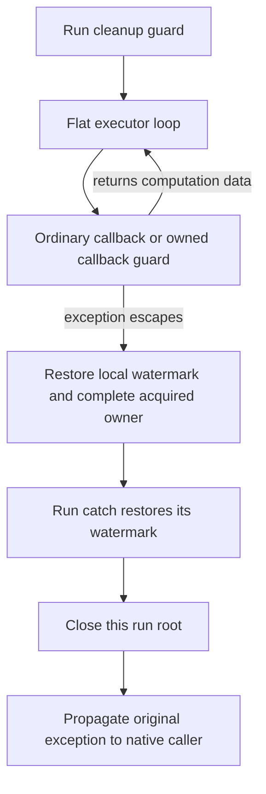

# Control and Native Exception Composition

**Feature:** [F-02](../../../feature/F-02-portable-programs.md)\
**Status:** Draft design, 2026-10-19. The bridge is implemented in the current
checkout; acceptance evidence is recorded in the execution checklist for
[#156](https://github.com/biuld/purescript-rs/issues/156).\
**Prerequisites:** [Control machine](control-machine.md),
[handler scopes](control-elimination-and-handler-scopes.md),
[exception channel](exception-handling-and-stack-exhaustion.md),
[IR boundaries](../00-ir-boundaries.md), and
[DEC-21](../../../decision/DEC-21-control-machine-construction-boundary.md).\
**Summary:** A native exception escaping a Control runner aborts that invocation,
expires its captured continuations, and propagates the original exception.
One-shot callback acquisition terminates on both normal and exceptional exits.
Only native activations own stack-budget charges; persistent continuation data
owns none. Native catches remain dynamically scoped.

## Scope

This topic owns the bridge between native exceptional control flow and the
existing effect-agnostic software machine: runner exit, one-shot acquisition,
lifetime expiry, budget settlement, and construction/verification contracts.
It does not introduce an exception operation into `Control`, give ordinary
`handle` an exception clause, or implement official `Effect.Exception` foreigns.
Those are separate consumers; neither is required for transparent propagation.
The [execution checklist](../../../implementation/backend/control-exception-bridge.md)
records implementation obligations without changing existing gate measurements.

## Background

The actual machine is an explicit monadic interpreter. It stores `Cons`,
`Append`, `Finish`, and contexts as GC data; ordinary user callbacks execute on
the native stack. Capturing a queue does not capture a native frame or an EH
region. See the existing machine's [flat driver](control-machine.md#the-flat-driver).

The 2026-10-19 handoff proposed subtracting retained queue weights at cancellation
and restoring `saved − ΣW_f(live remaining chain)` at interception. Inspection
of `wasm/lower/budget.rs`, `cc/lower/control/plan/driver.rs`, and
`cc/lower/control/plan/helpers.rs` does not support that premise: normal returns
and tail transfers settle native activations; saved queues contain no outstanding
native charges. This design replaces that proposal with the native accounting
invariant below. It retains the real lifecycle gaps: exceptional runner exit
skips root closure, and exceptional callback exit can leave an owner Running.

Native EH carries a caught exception reference and can propagate it unchanged.
An exception reference is distinct from the aggregate/erased reference hierarchy;
it cannot be cast into the machine's ordinary erased source payload slot.
`catch_all_ref` suffices for cleanup without decoding any tag or payload.

## Model

### Native charges

Let `A` be the live instrumented native activations at a quiescent instruction
boundary. Let `D` be the depth global, and `w(a)` the activation's fixed `W_f`.

```text
D = Σ(a in A) w(a)
charge(saved queue) = charge(context) = charge(owner) = 0
entry(f):       D += W_f; check budget
normal exit(f): D -= W_f
tail transfer:  D -= W_f before entering the replacement callee
```

After a native throw, unwound activations temporarily remain charged until the
catch's first restore. This transient state must not run guest code. The failing
prologue's increment is included even though that function never entered its
body. A catcher restoring its saved watermark settles that increment as well.

For a guard whose containing activation survives the throw, let `P` be its live
native prefix at entry and `U` the charged suffix discarded by unwinding.

```text
saved = Σ(a in P) w(a)
D immediately before catch restoration = saved + Σ(a in U) w(a)
D after catch restoration = saved
```

No activation in `P` can return while its descendant guard is executing. Calls
that returned inside the protected region have already decremented. Tail
transfers cannot remove the guard's activation while retaining its catch.
These facts justify the existing `D = saved` rule, including machine execution.
The correction for live *heap* frames is zero. A future native-stack-capture
design would need a different contract; it must not reuse this proof.

### Lifetime and acquisition

A runner owns its fresh root extent `r`. Every extent created by its execution
or replay has `r` in its parent ancestry. Checking an extent traverses that
ancestry. Closing `r` therefore expires abandoned children and saved checkpoints
without traversing shared queues or closing unrelated roots. Replay in another
live runner checks the saved checkpoint but parents fresh activations under the
current runner; this distinction remains mandatory.

One-shot status remains Pending, Running, Consumed, or Cancelled. Successful
acquisition, even if its callback throws, spends the owner:

| Event | Status after event | Callback slot |
| --- | --- | --- |
| explicit cancel from Pending | Cancelled | cleared |
| acquire from Pending, before guest callback | Running | cleared; callback rooted in a local |
| acquired callback returns | Consumed | cleared |
| acquired callback throws a channel exception | Consumed | cleared |
| acquire or cancel from another status | existing rejection trap | unchanged |

Consumption covers the callback application that constructs the next computation,
not all later interpretation of that computation. Pending owners are not
automatically cancelled when a runner exits: `once` may wrap an arbitrary
callback, not necessarily a captured continuation of that runner. If it does
capture a checkpoint, root expiry prevents use of that expired checkpoint.

### Outcomes

`Publish(pair)` is a successful runner answer. `Abort(exception)` is an
exceptional runner exit with no answer pair; it closes the root then propagates
the same exception. Existing `Reject` outcomes remain traps for invalid tags,
expired checkpoints, or illegal one-shot use. They are not converted into
catchable exceptions. Abort guarantees machine lifecycle consistency, not
rollback of source state, IO, or mutations already performed by callbacks.

## Design

### Guard ownership

The `run` helper installs one native cleanup guard around execution and normal
root closure. It allocates a root before entry to this guard but exposes neither
root nor continuation before the guard is armed. An exception during root
allocation has no published lifetime to expire. Root construction must have no
guest callbacks or observable publication.

All `Handle` installs and interpreted `Resume`/`OwnedResume` steps are driven
inside that same executor call and guard. They are heap transitions, not nested
native delimiter calls. They do not need one `try_table` per heap context or a
guard re-created at every back edge. Raw continuation invocation only constructs
data after its lifetime check. Interpreting that data must occur under a guarded
runner, including resumption in a different still-live runner.

An exception escaping a callback aborts the current runner, even if several
ordinary `handle` contexts exist. No operation or return clause is called while
unwinding. A synchronously nested `run` owns a distinct guard and root: its abort
expires only its own root before propagation. An ordinary native catch in the
outer callback may handle it and continue the outer runner.



The local owner path exists only for an acquired callback. Other callbacks
unwind directly to the run catch. A throw caught inside a callback never takes
the run-abort path.

Owned callback application also has a local cleanup guard. Arm it before
changing Pending to Running; on exceptional exit it marks the acquired owner
Consumed and propagates. The Pending guard remains outside acquisition cleanup:
failed acquisition must not consume a previously Running or Cancelled owner.
The protected region ends before the executor's next self transition, preserving
flat-loop execution. All curried callback applications and result recovery that
belong to acquisition are inside its cleanup region.

### Cleanup operations

The catch path first restores the native budget, then performs only direct
writes to already-validated private status cells, then propagates. Root close
and owner completion in cleanup expand to the same logical cell writes as their
normal operations. They must not call an instrumented helper: its prologue
could exhaust again while cleaning up at a near-limit watermark. Cleanup does
not allocate, invoke callbacks, walk queues, invoke host services, or change D.
Well-formed private cells make these stores non-throwing. Invalid IR or engine
traps retain their separate failure contract.

This avoids an extent registry, GC finalizers, and charge tables. Root ancestry
already gives abandonment expiry; native epilogues already settle normally
returned activations. Explicit cancel clears an owner slot and changes status,
with zero extra budget subtraction. Dropping a raw continuation needs no cancel
for budget correctness; persistent multi-shot sharing remains valid.

### IR contracts

The following shared contracts implement the bridge.

| Boundary | Producer obligation | Consumer obligation |
| --- | --- | --- |
| checked Core → P8 | existing typed Control evidence; no new source exception type | synthesize cleanup from named machine roles, without source-name recognition |
| checked construction plan → CC | explicit protected body, bound exception, ordered normal/exception cleanup, terminal propagation | independently check actual emitted protected regions, operands, stores, and exits |
| CC → MIR | target-neutral opaque exception reference and structured protection | map to Wasm exception-reference types and ordinary Try/ThrowRef CFG; retain source ranges |
| MIR → structured Wasm | typed catch edges and complete native unwind CFG | structure catch-ref targets, restore watermark before handler code, emit throw_ref |

CC gains a logical `RefShape::Exception` disjoint from `Erased`, and a generic
`Protect` expression with a body region, a catch-only exception binder, and a
handler region. A region has an explicit exit `Yield(value)` or
`Propagate(exception)`; the latter diverges and creates no fabricated value.
These are general exception operations, not Control-only opcodes. Handler
results that yield must match the protected expression's result shape.
Only definitions dominating the region entry are visible on both paths;
body-local results cannot be read in the handler. Exception tokens cannot enter
ordinary source payload erasure, numeric operations, or the canonical ABI.

The construction plan has a protected operation with a named exceptional action,
a scoped normal result, and ordered cleanup. Generic CC binds the opaque token;
the plan operation always propagates that same token after cleanup. It names the same existing root/owner cell identities on both paths.
The action registry records exceptional callback prefixes and Abort separately
from Publish and Reject. DEC-21's independent boundary check walks these forms;
an action ID or a helper name is not evidence. Normal close and exceptional
close must share the logical Close operation, whose cleanup expansion is the
direct status store rather than a call. No blanket helper exemption is allowed.

MIR adds `HeapType::Exn` and
`ThrowRef { exception, span }`. A non-null exception
reference is required for ThrowRef. Replace the split named/all catch fields
with one ordered clause list shared by verification and emission:

```text
Catch(tag, target) | CatchAll(target) | CatchAllRef(target)
CatchAllRef target parameters: [(ref exn)]
```

The existing catch forms retain their payload arity. Catch-all forms are final;
duplicate or shadowed clauses are rejected. Named `CatchRef` with payload plus
exception reference is not required by the bridge and remains explicitly
unsupported until multi-result labels are supported. This does not constrain
the source exception model: the bridge forwards every tag opaquely.

`Try` also carries `continuation: Option<BlockId>`, a semantic normal-exit
boundary. P9 lowers a CC Protect with `Some(resultJoin)`. This boundary is
required even when the handler only propagates: then the normal result join
is dominated by the body entry, so dominance alone would incorrectly extend
protection over all later computation. For owner acquisition that would also
prevent the next executor transition from loopifying. `None` supplies no additional normal boundary; inferred joins and native exits
then bound protection, as in the original direct-MIR fixtures; it is
not a missing-metadata fallback for a CC Protect.

Region discovery and the conservative unwind graph include a Try-to-continuation
summary edge. It marks a possible normal completion, not an actual direct
runtime branch or argument transfer. Actual results arrive through explicit
Jump operands. The summary keeps an otherwise unreachable exit marker valid
and makes it outside protection without leaking body-local definitions into a
catch. Validate that the continuation exists and is distinct from the try block,
protected entry and owned handler blocks. This is exception scope evidence,
not the discarded general Branch merge hint.

Extend the shared `mir/try_region.rs` partition and unwind-successor operation
for ThrowRef and the new clause variant. Every CFG consumer uses that operation,
including availability, constant propagation, reachability, and structuring.
Catch targets are not ordinary branch entry points, and exception binders are
available only on the matching unwind edge. Unknown-tag ThrowRef must conservatively
reach every potentially matching enclosing catch, including propagation out of
the function; it must not guess one tag or silently omit an outer handler.
ThrowRef therefore does not copy Throw's single explicit handler field. The
shared operation derives its possible unwind exits from the enclosing region
chain and ordered clauses: collect unshadowed named catches, stop at the first
catch-all, and otherwise retain caller propagation. Region discovery must use
the shared conservative Try-to-handler edges rather than recursively depend on
this derived ThrowRef relation. A handler's throw starts outside its owning Try
but remains inside any enclosing native protection.
The partition must therefore exclude a region's own handlers from that region,
not exclude every handler from all outer regions. Retain an inner handler in
its enclosing protected region when its native catch is still armed. This is
a required correction to shared region ownership, with nested-handler tests;
a ThrowRef-specific side table cannot repair an incorrect partition.
For an existing known-tag Throw, the same enclosing-region search selects the
first matching clause, skipping inner regions that do not catch that tag. Its
explicit handler must agree with that result; None is valid only when the search
propagates to the caller. Being inside a non-matching region alone is not a
reason to reject caller propagation or choose an unrelated handler.

Structured Wasm adds `CatchAllRef` and retains the existing one-result label
model: one non-null exception reference is its only branch result. Encode
`throw_ref` as a leaf; extend type/subtyping and stack verification for Exn
without treating it as Any/Eq. Nullable Wasm locals may implement storage only
with a proven initialized, non-null read. Capabilities infer `exceptions` from
the new operations and types. A disabled target rejects required protection at
P9; it must not strip cleanup guards. Once the bridge is installed, generated
Control runners require this capability, which the stable profile enables.

## Algorithms

Pseudocode uses generic protection; its catch entry includes the automatic
watermark restore, owned by native EH lowering rather than the machine plan.

```text
run(s, h, c):
    r = freshRoot()                  # private, no published captures
    protect:
        answer = executor(s, h, c, Empty, r, Root(r))
        closeCell(r)                 # normal exit, no callback
        yield answer
    catch exception:
        closeCell(r)                 # inline; no helper call
        propagate exception

acquireAndApply(owner, v):            # inline region in flat executor
    require owner.status == Pending  # existing trap on failure
    protect:
        owner.status = Running
        callback = owner.callback
        clear owner.callback
        next = callback(v)
        owner.status = Consumed
        yield next
    catch exception:
        owner.status = Consumed      # slot already cleared before guest code
        propagate exception
    # executor advances only after leaving protection
```

If no callback has begun, construction between Running and clearing must have
no throwing operations: projections and direct reads/writes operate on checked
owner cells. If expansion introduces a call there, the checker must reject it
or move it before acquisition, rather than weaken exceptional cleanup.

## Code map

Paths are relative to `crates/psrs-backend/src/`.

| Owner | Entry points and responsibility |
| --- | --- |
| `control/execution/`, `cc/lower/control/plan/model/` | RunAbort and AcquiredCallbackExit inventory, independent normal/exceptional lifecycle model |
| `cc/representation.rs`, `cc/assignment.rs` | Exception shape and generic protected-region/exit definitions |
| `cc/lower/control/plan/` | checked Run and owned-acquisition cleanup, exceptional-prefix checks, expansion and actual-body comparison |
| `cc/verify/` | exception binder scope, disjoint shapes, diverging exits, branch results |
| `types.rs`, `mir/lower/`, `mir/verify/` | Exn type, explicit Protect conversion, ThrowRef and catch-edge validation |
| `mir/try_region.rs`, `mir/unwind.rs`, `mir/opt/` | one region/unwind relation; optimization preservation and tail legality |
| `wasm/mod.rs`, `wasm/lower/`, `wasm/verify/` | catch_all_ref, throw_ref, catch target types and restore-before-cleanup |

Required logical interfaces are `protect(body, exceptionBinder, handler)`,
`propagate(exception)`, and the shared `closeCell(extent)` / owner completion
operation; concrete Rust signatures follow the owning IR's value/region types.
No runtime frame interpreter, mutable global current-run pointer, or external
host exception ABI is introduced.

## Invariants and verification

1. Native charge ownership is per activation; no heap node owns a charge.
   Catch restoration precedes cleanup; cancellation never adjusts D directly.
2. Every escaped runner exception closes that invocation's root before
   propagation; normal exit closes it before publication. Every activation
   extent has the correct runner ancestry, including replay and coalescing.
3. Every acquired owner is Consumed before normal return or channel propagation;
   its callback slot is cleared before any guest callback. Reentrant use sees
   Running and retains the existing rejection behavior.
4. Propagation preserves the caught token, tag, and payload without reconstruction.
   No Abort path yields a pair or runs pending user callbacks.
5. A heap context is not a native EH region. Ordinary `handle` cannot catch a
   channel throw, and continuation capture does not extend a native catch.
6. Construction verification proves selected lifecycle actions and actual CC
   expansion. Ordinary P9/P10 transformations remain trusted under DEC-21;
   their type/CFG checks do not prove semantic equivalence. Mutation tests and
   optimized target executions are separately required.

The native channel does not catch engine traps, allocation failure, WASI exit,
or arbitrary host termination. Reuse after such exits remains the existing
embedder/resource-recovery obligation; this design claims channel-exception
cleanup only. Budget exhaustion uses that channel and is covered.

## Worked example

Runner R has a raw continuation captured under child extent e, with ancestry
`e → R.root`. Its owned wrapper begins acquisition, clears the callback slot,
and invokes a callback that exhausts the native budget. The owned-region catch
restores its native prefix, marks the owner Consumed, and rethrows the caught
token. R's guard restores its own prefix, closes R.root, and rethrows that same
token to an outer guard. Every native suffix charge is removed by its catching
watermark; no saved queue is charged or traversed. A retained raw continuation
fails its checkpoint check because e's root is closed. The owner rejects reuse
as Consumed. An outer native catch can continue and run a fresh computation.

If a callback instead catches the exception before it leaves R, neither R's
abort cleanup nor its root closure runs. Normal work continues. A callback that
constructs a raw Resume inside a native catch and returns it has ended that
catch before the executor interprets the Resume; later throws cannot return to
that expired native catch. The runner guard still covers interpretation.

## Boundaries and interfaces

The bridge preserves current source signatures and library ownership. It adds
internal exception control flow and changes exceptional lifecycle behavior,
not the successful value semantics or tail-finalization equivalence rules.
The independent stdlib keeps its official sources and explicit unsupported
foreign declarations until their separate implementation lands.

Exception-as-effect handlers must introduce a checked operation and typed
recovery boundary. They cannot reinterpret every native throw as a source
request or turn ordinary `handle` into a native catch. Official
`Effect.Exception` uses direct dynamic native protection and the bridge when a
throw exits a runner. Both require their own public Error representation,
source-fidelity and behavior evidence. Neither depends on the other consumer.
Automatic rollback of state or resources would require a separate explicit
transaction/resource contract.

## Open questions and future work

- Design the two consumer APIs and their Error representation. Recovery *inside*
  the same logical runner needs its own typed recovery context and lifecycle
  cut; root-abort propagation is not evidence for selective recovery.
- Named catch-ref clauses with payloads need the multi-result-label contract.
- Native stack capture or asynchronous suspension would invalidate the
  no-saved-native-charge premise and needs a separate accounting design.
- Engine-trap recovery and foreign borrowed-resource cleanup remain outside
  the catchable channel contract.

## References

- [WebAssembly exception-handling explainer](https://github.com/WebAssembly/exception-handling/blob/main/proposals/exception-handling/Exceptions.md),
  catch-ref delivery, original-exception propagation, and trap boundaries;
  consulted 2026-10-19.
- [WebAssembly reference types](https://webassembly.github.io/spec/core/syntax/types.html#reference-types),
  including the distinct exception-reference heap type; consulted 2026-10-19.
- [DEC-19](../../../decision/DEC-19-compiler-generated-resumable-frames.md),
  [DEC-20](../../../decision/DEC-20-typed-control-elimination.md),
  [DEC-21](../../../decision/DEC-21-control-machine-construction-boundary.md), and
  [DEC-23](../../../decision/DEC-23-wasm-exception-channel.md).
