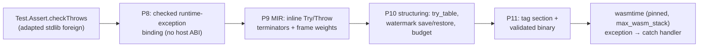

# Exception Handling and Stack Exhaustion

**Feature:** F-02  
**Status:** Implemented 2026-10-19. EH-01..EH-15 are Verified in the [implementation checklist](../../../implementation/backend/exception-handling.md); the stable default profile enables the channel, and the corpus claim is revised per [DEC-23](../../../decision/DEC-23-wasm-exception-channel.md)'s 2026-10-19 amendment — `TCOMutRec` stays a recorded failure row.  
**Prerequisites:** [MIR](mir.md), [control flow and tail calls](control-flow-and-tail-calls.md), [delimited control and resumable frames](delimited-control-and-resumable-frames.md), [Wasm encoding](../wasm/encoding-and-structuring.md), the [capability profile](../wasm/capability-profile.md), [DEC-05](../../../decision/DEC-05-wasmtime-feature-set.md), [DEC-09](../../../decision/DEC-09-gc-only-language-heap.md), and [DEC-19](../../../decision/DEC-19-compiler-generated-resumable-frames.md). Read [IR boundaries](../00-ir-boundaries.md) first.  
**Summary:** This topic adopts the standardized WebAssembly exception-handling proposal as a *minimal* target channel — compiler-defined tags, `try_table`, `catch`/`catch_all`, `throw` — below Typed Core, and pairs it with a compiler-managed stack-exhaustion budget that converts imminent native stack exhaustion into a compiler-produced exception before the engine's trap. The driving consumer is upstream `Test.Assert.checkThrows`, whose contract is "true if the argument throws when applied" and which on the JavaScript target observes the stack-overflow `RangeError` of `tests/upstream/passing/TCOMutRec.purs`.

## Scope

This document owns the channel's representation and lowering: the MIR extension (tags, `Try`/`Throw` terminators, try regions and their interaction with the structuring machinery); the structured Wasm extension (`Op::Try`, catch clauses, the tag section, the depth global); the stack-exhaustion budget (weights, prologue/epilogue accounting, the stack-watermark contract, and coordination with the pinned engine stack limit); the capability-profile contract for the `exceptions` gate under [DEC-05](../../../decision/DEC-05-wasmtime-feature-set.md); and the checked binding surface and end-to-end lowering path of the first primitive on the channel, `Test.Assert.checkThrows`.



It does not own the terminator set's general contract ([MIR](mir.md)), the reducible structuring and tail-call algorithms ([control flow and tail calls](control-flow-and-tail-calls.md)), value layouts ([data representation](data-representation.md)), the resumable-frame control machine ([delimited control](delimited-control-and-resumable-frames.md), [control machine](control-machine.md)), binary sections beyond the tag section ([Wasm encoding](../wasm/encoding-and-structuring.md)), or the board status ([D-04](../../D-04-suite-roadmap.md)), which moves only with implementation evidence.

## Background

**The driving case.** Upstream `TCOMutRec.purs` defines four mutually recursive functions (`ntco1`–`ntco4`) that PureScript's tail-call analysis deliberately cannot optimize. `main` calls each at depth 100 — which returns normally — and then wraps each at depth 100000 in `assertThrows \_ -> ntcoN 100000`. Upstream runs on JavaScript, where unbounded non-tail recursion raises the engine's stack-overflow `RangeError`, and `assertThrows` observes it. Upstream `Test.Assert`'s contract for the foreign `checkThrows :: forall a. (Unit -> a) -> Effect Boolean` is "true if the argument throws when applied", *including* stack exhaustion. The corpus has exactly one consumer of that contract: all four `assertThrows` calls in TCOMutRec observe stack exhaustion.

**WebAssembly exception handling.** WebAssembly 3.0 (2025-09) standardized the proposal. A **tag** declares an exception kind with a payload type `[t*] -> []`; `throw $tag` raises an exception carrying the payload values; `try_table blocktype catch* instr* end` executes a region whose catch clauses name conditions and **labels** — `catch $tag $l` requires the label's result type to equal the tag's payload and delivers the payload as that label's branch arguments, while `catch_all $l` requires an empty label and delivers nothing — and catch-clause labels resolve in the context *enclosing* the `try_table`. Catching is **dynamic**: the innermost *executing* `try_table` on the native stack receives the exception, regardless of which function's code threw it. An `exnref` value circulates a caught exception (`catch_ref`/`catch_all_ref`, `throw_ref`); the final proposal has no separate `rethrow` instruction — re-raising is `throw_ref`.

**Traps are not exceptions.** A Wasm trap (`unreachable`, out-of-bounds access, `call stack exhausted`) is not an exception: no catch clause observes it and execution terminates. Stack exhaustion on this target is therefore a trap today, and a channel that only forwards engine behavior cannot reproduce the upstream contract.

**The pre-conversion pattern.** Established engines convert imminent stack exhaustion into a language-level exception *before* the hardware limit: V8's StackGuard, SpiderMonkey's check-stack hooks, and the JVM's `StackOverflowError` reserve headroom below the real limit, detect that a frame would cross it, and raise a catchable error instead of dying. This design applies the same pattern: a compiler-inserted budget check throws a compiler-defined tag on the EH channel shortly before the engine would trap.

**The approximation, stated honestly.** The budget sits strictly below the engine's real limit by a headroom covering the gap between the compile-time weight estimate and real native frame sizes, exception construction (one instruction for a payload-less tag), handler execution, and one unaccounted host frame. Consequences: a program recursing slightly beyond the budget gets the compiler's exception — the same *observable contract* as upstream (`assertThrows` sees a throw) at a shallower *depth*; depth fidelity is not claimed. If the budget were at or above the engine limit, the check would never fire: the engine traps `call stack exhausted` first, no catch clause observes the trap, and `checkThrows` observes a trap instead of a throw — the corpus case fails *visibly* (non-zero exit), not silently; the coordination protocol below prevents that. If weights under-estimate frame sizes beyond the headroom, the same trap can occur below the budget; the calibration protocol is the evidence that this cannot happen on the pinned target.

**Why the reached depth is a runtime quantity.** Compile time can compute structure — per-function weights, a recursion classification, the constants — but not the reached depth. Non-tail recursion depth is input-dependent: TCOMutRec calls the *same* `ntco1` at depth 100, which must return, and at depth 100000, which must throw. Static maximum-depth prediction is the halting problem's boundary, and it would be semantically wrong anyway: non-tail recursion terminating within the stack limit is PureScript's actual JavaScript-target semantics, not an error to optimize away. The budget is a runtime mechanism; compile time fixes only its structure.

## Model

### MIR extension

MIR gains a module-level tag table and two terminators. Nothing above MIR changes: CST, AST, HIR, THIR, and Typed Core never mention tags, exceptions, or the budget ([IR boundaries](../00-ir-boundaries.md)).

```text
TagId = module-local tag identity (distinct from FunctionId, DefinedTypeId, ...)
Tag   = { name: String, payload: [ValueType], span }

Module     = { ...existing fields..., tags: [Tag] }
Terminator = ...existing variants...
           | Throw { tag: TagId, arguments: [ValueId],
                     handler: Option(BlockId), span }
           | Try   { protected: BlockId, catches: [(TagId, BlockId)],
                     catch_all: Option(BlockId), span }
```

- `Try` acts as an ordinary control transfer on its normal path: control proceeds to `protected` as a parameterless `Jump` would; the catch clauses declare the region's *unwinding* behavior.
- A **handler block** receives its caught payload as block parameters: a tag clause's handler has parameters typed exactly as the tag's payload; a `catch_all` handler has none. A handler has no normal predecessors: every predecessor edge is the unwind edge of a `Throw` naming it, or a catch clause of the one `Try` that owns it.
- `Throw` names its tag, payload arguments, and optionally the handler block it unwinds to *within its own function*; `handler: None` unwinds out of this function's frames to the caller's handler.
- A tag has at most one payload value: the structured unwind block carries a single result, matching the thin encoding's single `result: Option(ValType)` rule; a multi-value payload needs the multi-value block work and is rejected with an explicit diagnostic.

**Region semantics.** The semantics is dynamic; the CFG makes it statically checkable. The **protected region** of a `Try` (try block `t`, protected entry `p`) is the set of blocks dominated by `p`, minus blocks claimed by an inner `Try` whose protected entry is dominated by `p`, minus every handler block — exactly the dominance property the structurer already computes for loops. A `Throw` in block `b` unwinds to the innermost try region whose protected entry dominates `b`; every path to `b` passes through `p`, so that `try_table` is on the native stack when `b` executes and no other region can be innermost — this is what `Throw`'s explicit `handler` field must name. Control leaves a protected region by ordinary means (`Return`, a branch to an outside label, a loop back-edge targeting the protected entry), ending the `try_table`'s dynamic extent; a later re-entry re-arms it.

### Structured Wasm extension

The thin encoding gains one structured node, a tag index domain, and the tag section. The pinned `wasm-encoder` 0.245.1 provides `TagSection`, `TagType`, `Instruction::TryTable`, `Instruction::Throw`, and the catch-clause immediates; per [DEC-02](../../../decision/DEC-02-thin-structured-wasm-encoding.md) the encoding models the *region shape*, not the opcode set.

```text
Op          = ... | Try { body: Body, clauses: [CatchClause], span }
CatchClause = Catch    { tag: TagIndex, label: u32 }   // depth-relative label
            | CatchAll { label: u32 }
Module      = { ...existing fields..., tags: [TagDef] }
TagDef      = { attribute: 0, type_index: TypeIndex }
TagIndex    — a final index domain, distinct from all other index types
```

The **tag section** (id 13) is emitted between the memory and global sections per the WebAssembly 3.0 binary format; tags may be imported or exported in general, but this design defines only module-local compiler tags and neither imports nor exports one. A `CatchClause`'s `label` is resolved at the `try_table`'s emission point against the active-label stack *not counting* the `try_table`'s own label; the current emission always targets the synthesized unwind block immediately enclosing the `try_table`, so the depth is `0`, but the field stays explicit so the verifier checks it like a `br` depth. The **depth global** is one additional mutable `i32` global, initialized to `0`, allocated after the literal-interning globals — invisible to source, not exported, and not part of the language heap ([linear memory boundary](../wasm/linear-memory-and-canonical-abi-boundary.md)).

### Budget model

The budget is a counter of *estimated native stack bytes* maintained in the depth global: `W_f = FRAME_WEIGHT_FIXED + FRAME_WEIGHT_PER_LOCAL × locals(f)` (`locals(f)` is the lowered function's local count), and `STACK_BUDGET` is the profile-fixed limit in the same units. `W_f` is recorded on each MIR function as `frame_weight` at P9. The runtime's only substantive role is *determinism of the relation* `STACK_BUDGET < engine limit`:

- the harness pins the engine's stack limit where it controls the engine — the `wasmtime::Config::max_wasm_stack` Rust API, or the equivalent CLI option `-W max-wasm-stack=N` (present in the pinned wasmtime 48 CLI, verified against `wasmtime run -W help`) where it spawns the CLI;
- the board protocol records the engine's *default* limit for the pinned wasmtime baseline (wasmtime's `Config` documents `max_wasm_stack` defaulting to 512 KiB) and never relies on it silently: an execution helper running budget-dependent evidence passes the limit explicitly;
- leaving the limit to host defaults is the recorded hazard: a different engine version or embedder moves the real limit under a fixed budget, in either direction — the compiler's throw may stop firing (budget above the limit) or fire long before the engine's own limit would matter.

The depth reached is measured at runtime; compile time computes only `W_f`, a recursion classification (the same category as the static tail-call classification of `mir/lower/tail.rs`), and the constants.

### Composition with the control machine

[DEC-19](../../../decision/DEC-19-compiler-generated-resumable-frames.md)'s resumable frames are GC heap objects driven by a compiler-generated trampoline loop: suspending and resuming a delimited continuation allocates and walks heap data and consumes **no** additional native stack per resumption — the trampoline is one Wasm frame. The budget counter sees one frame for a whole machine execution and the control machine adds no accounting of its own: no double accounting; the mechanisms are orthogonal. Callback invocations out of the trampoline are ordinary calls and are accounted normally. What does *not* compose yet: machine handlers do not intercept exception-channel throws — a throw through a delimiter unwinds native frames and discards the delimited computation without the machine's Publish/Reject bookkeeping. That composition belongs to the future `Effect.Exception` work; this slice's contract is that the budget is correct in the presence of machine executions and that the machine's own terminal outcomes keep their existing (trap/storage) mechanisms.

## Design

### Channel minimality

- **Compiler-defined tags**, payload drawn from the existing MIR `ValueType` set — scalars and GC references ([DEC-09](../../../decision/DEC-09-gc-only-language-heap.md)). A GC reference payload is engine-managed during propagation, so the collector finds it without guest cooperation. The driving consumer needs exactly one tag, `psrs:stack-exhaustion`, with an *empty* payload: `checkThrows` observes only that a throw happened.
- **`try_table` with `catch_all` and `catch` clauses, and `throw`.** `catch_all` is what the `checkThrows` guard uses (the upstream contract is tag-agnostic); named `catch` clauses are part of the same MIR and encoding model and are exercised by a direct-MIR fixture, because a future tag vocabulary builds on them. **Deferred, recorded as such:** `exnref`, the `catch_ref`/`catch_all_ref` clauses, and `throw_ref` — the minimal contract needs none of them; `Effect.Exception`'s catch-and-rethrow surface will drive them.

### Structuring: what `try_table` adds

The structuring machinery of [control flow and tail calls](control-flow-and-tail-calls.md) extends as follows; the reducible stackifier stays the single emission path and the irreducible dispatcher the only other one:

1. **A third unit kind.** `UnitPlan` gains `Try { try_block, protected: Box(RegionPlan), handler: BlockId }` — a composite unit covering the try block, the protected sub-region, and the handler, occupying one slot in the enclosing region's topological order. Handler blocks are not units of their own; the composite unit emits the handler inline after the unwind block.
2. **The synthesized unwind block.** The unit's emission opens one synthesized `Op::Block` whose result type is the caught payload (empty for `catch_all`), immediately enclosing the `try_table`; every catch clause of that try targets it. On a catch, the payload is delivered as that block's result values, so the handler's code — which follows the block's `end` — sees the payload on the operand stack and copies it into the handler block's parameter locals, exactly the way jump arguments are copied.
3. **Anonymous label entries.** The active-label stack gains the synthesized unwind block and the `try_table`'s own internal label. No emitted branch targets either; they exist so branch depths to outer labels stay correct. The protected sub-region is emitted with these labels active.
4. **Nesting and totality.** Protected regions nest or are disjoint, checked like natural-loop nesting. A back edge may target a protected entry (the `try_table` is re-armed each iteration) but never a try block. A function whose CFG is irreducible *and* contains a try region is rejected with a diagnostic: no frontend lowering produces irreducible control flow today, and composing the dispatcher's state machine with `try_table` is recorded as future work rather than designed half-way.

### Tail calls inside try regions

Wasm pops the caller's frame at a `return_call`, discarding every handler armed in that frame — including this function's `try_table`. A `Throw` whose statically attributed innermost region was discarded would then unwind past it, contradicting the MIR semantics. Therefore: **no `ReturnCall`/`ReturnCallRef` terminator may exist in a protected block.** The tail-call rewrite (`mir/lower/tail.rs`) must skip calls in protected blocks, and the MIR verifier rejects a forced tail terminator in a protected region. Tail calls outside the region, and tail calls inside callees (which replace *callee* frames, leaving the guard's frame intact), are unaffected. Loopification of self-recursion inside a protected region is unaffected: a loop allocates no frame.

### The stack-exhaustion budget

Policy: **install the check on every function.** Each lowered function gains a fixed handful of leaf instructions, independent of function size:

```text
prologue:  depth += W_f;  if depth > STACK_BUDGET then throw $psrs:stack-exhaustion
epilogue:  depth -= W_f                  // before every `return`
tail:      depth -= W_f                  // before every `return_call`/`return_call_ref`
trap:      nothing                       // a trap ends execution; the leak is unobservable
```

The prologue's overflow path is emitted at the structuring layer as a small conditional whose body is `throw $tag` — the budget path needs no MIR terminator of its own, and the throw uses out-of-function unwinding (the function's own try regions are armed only after the prologue). The epilogue runs on every normal return path; the tail-path decrement keeps the counter aligned when a `return_call` replaces the caller's frame; a trapping block needs no epilogue.

Weight and budget constants are fixed by the profile. The provisional design values are `FRAME_WEIGHT_FIXED = 32` bytes, `FRAME_WEIGHT_PER_LOCAL = 16` bytes, and a budget derived from the pinned engine limit minus a headroom that covers cumulative weight-estimate error, exception construction, handler execution, and one unaccounted host frame. These are design targets, not measured facts; the coordination fixture below is the protocol that validates (and, if needed, revises) them before the default profile flips.

**Which-functions policy.** Installing on every function costs a constant, small per-frame overhead and needs no whole-program call graph. The alternative — installing only on functions that may participate in a recursion cycle — requires a conservative call-graph approximation, and dynamic dispatch through typed function references forces conservative edges: an under-approximation leaves a deep-recursion path unchecked, the engine traps instead of throwing, and `checkThrows` observes the wrong thing *silently on that path*. The uniform policy is the design; the cycle-membership variant is recorded as a possible optimization whose soundness obligation (proving every potentially-deep path is checked) is stated but not discharged.

**Watermark contract.** An EH throw unwinds frames *without* running their epilogues, so the counter would leak high and stay stuck — every later depth check would fire early, corrupting unrelated executions. The try/catch lowering therefore carries a stack-watermark save/restore:

```text
at try_table entry:  saved = depth          // fresh i32 local per try region
in the handler:      depth = saved          // settles every unwound frame at once
```

This is an invariant of the MIR try/catch representation and its structuring, verified below. It composes: nested try regions each save and restore their own watermark; an unwinding discarding inner try regions discards their stale saved values; frames pushed after the save that returned normally already decremented; frames still live at the throw are exactly the delta between the saved and current values.

### Capability profile and rejection behavior

Per [DEC-05](../../../decision/DEC-05-wasmtime-feature-set.md) — a proposal is not `Implemented` because the runtime accepts it:

- the existing `exceptions` boolean field gates the family: emitting any tag, `try_table`, or `throw`, and installing the budget mechanism, requires `target.exceptions`;
- the MIR capability verifier gains an `exceptions` entry in its required set, set when the module declares a tag or contains a `Throw`/`Try` terminator, and the module is rejected with a source-associated diagnostic when the gate is disabled — there is **no fallback ABI**;
- the structured encoding's tag section, `Op::Try`, and catch clauses are validated by the same `wasm_features(target)`-derived validator, which already maps the `exceptions` field;
- the stable default profile now enables `exceptions` — the flip is the adoption's final profile revision (2026-10-19, after EH-01..EH-15's adoption evidence and the board remeasure of EH-17), and it updates the [DEC-05](../../../decision/DEC-05-wasmtime-feature-set.md) amendment and the [capability profile](../wasm/capability-profile.md) default table. Explicitly disabled targets keep rejecting a module that needs the channel.

## Algorithms

### Try-region partition

```text
plan_try_regions(function):
    tries    = blocks whose terminator is Try
    handlers = union of every clause's handler block
    dominators(function)                        // existing analysis
    for each try T (outermost first):
        protected(T) = { b : protected_entry(T) dominates b }
                       minus protected(T') for inner tries T'
                       minus handlers
        check: protected regions of distinct tries are nested or disjoint
        check: no back edge targets a try block
    return the try units inserted into the region plan
```

The partition reuses the dominator computation `mir/verify/function.rs` and `wasm/lower/structure/cfg/mod.rs` already perform; the only new rule is the carve-out by inner tries and the exclusion of handler blocks.

### Emitting a try unit

```text
emit_try_unit(unit, labels, body):
    payload = [] or the owning tag clause's payload types
    saved   = fresh i32 local
    unwind  = synthesized block label with result payload
    body.push(local.get depth; local.set saved)
    body.push(Op::Block { result: payload, body:
        Op::Try { clauses = [each clause targeting the unwind label],
                  body = emit_region(unit.protected,
                                     labels + [unwind, try_table-label]) }
        + [br to the normal join label]      // try_table completing normally
    })
    // catch path lands here, payload on the stack (if any):
    body.push(local.get saved; global.set depth)     // watermark restore FIRST
    body.push(local.set handler-parameter for each payload value)
    emit the handler block's instructions and terminator   // normal label machinery
```

The handler's terminator and every protected block's normal terminator target labels from the enclosing region exactly as any other unit does — including the join block shared by the normal and exceptional paths.

### Budget emission

```text
emit_function(f):
    if target.exceptions:
        prepend prologue(f) to the entry block's emission
        before every `return` leaf sequence:          emit epilogue(f)
        before every `return_call`/`return_call_ref`: emit tail-decrement(f)
    emit the existing structured body

prologue(f) = global.get depth; i32.const W_f; i32.add; global.set depth;
              global.get depth; i32.const STACK_BUDGET; i32.gt_s;
              if [ throw $psrs:stack-exhaustion ]
epilogue(f) = global.get depth; i32.const W_f; i32.sub; global.set depth
```

The synthesized `run` entry additionally wraps its call to `main` in a `try_table (catch_all $top)` whose handler restores `depth` to the value saved at entry and calls `exit-with-code 1`: an exception no guest handler observes leaves the artifact through a deterministic exit code instead of an engine-specific host error. The entry's own epilogue is unreachable on that path (`exit-with-code` never returns), which is why the restore, not the epilogue, is the handler's first action.

### Edge cases

- **Trapping blocks.** A block whose emission ends in a trap never reaches its terminator; the structurer already skips terminator emission there, and the counter leak is unobservable because the trap ends execution.
- **Throw in the prologue.** The budget throw is emitted before any try region of the same function is armed, so it always uses out-of-function unwinding.
- **Nested and loop-carried try regions.** Each region carries its own saved watermark; a try whose protected entry is a natural-loop header re-arms its `try_table` each iteration, and the save/restore runs per iteration.
- **Multiple returns and shared joins.** Every return path decrements; the normal and exceptional paths converge on the join block, whose emission is untouched.
- **Guarded computation that traps.** Traps propagate past every catch clause: a `checkThrows` argument whose failure is a trap (bounds, `unreachable`) is observed as a trap, matching the target's non-catchability contract.
- **Disabled profile.** No budget code, no tags, no try/throw: a module requiring the channel is rejected at the MIR gate; everything else compiles exactly as before.

## Code map

The code map is the design target the implementation slices conform to; verified existing anchors are cited with their current responsibility.

```text
psrs-backend/src/
  mir/
    mod.rs                  # Terminator gains Throw/Try; Module gains tags;
                            # Function gains frame_weight; Tag/TagId defined
    budget.rs               # NEW: weight formula and STACK_BUDGET/weight
                            # constants — the profile-fixed calibration surface
    instruction/            # untouched: the budget emits at structuring,
                            # and the channel adds no instruction
    lower/
      tail.rs               # mark_tail: skip calls in protected blocks
      exception.rs          # NEW: discharge calls to `psrs:runtime-exception`
                            # bindings into inline Try/Throw regions
      storage_call.rs       # existing precedent for provider-dispatched call
                            # lowering (StorageOperation, returns_normally)
    verify/
      mod.rs                # verify_module_with_capabilities unchanged shape
      capability.rs         # RequiredCapabilities gains `exceptions`
      function.rs           # dominance, unwind-edge, handler, and region checks
  wasm/
    mod.rs                  # Op gains Try; Module gains tags + TagIndex
    encode.rs               # tag section (id 13) between memory and global
    verify.rs               # tag indices, try depths, catch-clause checks
    lower/
      mod.rs                # index allocation for tags; entry catch_all synthesis
      structure/
        cfg/mod.rs          # RegionPlan gains the try unit; partition + nesting
        region.rs           # emit_try_unit; Label gains the anonymous entries
        dispatcher.rs       # unchanged for reducible try-free functions
  capability.rs              # exceptions gate shape unchanged; the default
                             # flips only with adoption evidence
  bindings/
    runtime/
      exception.rs           # NEW: checked source contract for the
                            # `psrs:runtime-exception` provider (no host ABI)
      target.rs              # plan_import: the exception provider plans no import
      mod.rs                 # validate: admit the new provider family
psrs-driver/src/
  tests/mod.rs               # run_* helpers pin `-W max-wasm-stack` for
                             # budget-dependent evidence
  tests/tail_calls.rs        # precedent for enabled/disabled profile execution
```

Required types and entry points:

- `mir/mod.rs` — `Terminator::Throw { tag, arguments, handler: Option<BlockId>, span }`, `Terminator::Try { protected, catches, catch_all, span }`, `Tag`, `TagId`, `Module::tags`, `Function::frame_weight: u32`.
- `mir/budget.rs` — `FRAME_WEIGHT_FIXED`, `FRAME_WEIGHT_PER_LOCAL`, `STACK_BUDGET`, and `fn frame_weight(locals: usize) -> u32`.
- `mir/lower/exception.rs` — the discharge of a call to a `psrs:runtime-exception` binding into the inline try region; it must reject the call when `target.exceptions` is disabled, with the binding's span.
- `wasm/lower/structure/cfg/mod.rs` — `UnitPlan::Try` and the partition rules; `wasm/lower/structure/region.rs` — `emit_try_unit` and the watermark save/restore; `wasm/mod.rs` — `Op::Try`, `CatchClause`, `TagDef`, `TagIndex`.
- `wasm/encode.rs` — the tag section between memory and global; `wasm/verify.rs` — tag index range, catch-clause label depth resolution, and unwind-block result agreement with each clause's payload.
- `mir/verify/capability.rs` — `RequiredCapabilities.exceptions` and the rejection diagnostic.

## Invariants and verification

- **MIR verifier.** Every `Throw`'s tag exists; its arguments match the tag's payload in arity and type (at most one payload value); its handler, when present, is the innermost enclosing region's matching handler, and when absent, the throw block must not lie in any protected region. Every `Try`'s protected entry and handlers exist; handler blocks have no normal predecessors; a handler belongs to exactly one `Try`; protected regions nest or are disjoint; no back edge targets a try block; no protected block ends in a forced `ReturnCall*`. Dominance is rechecked on the CFG that includes unwind edges.
- **Capability gate.** A module declaring a tag or containing `Throw`/`Try` is rejected when `target.exceptions` is disabled, before any encoding ([capability profile](../wasm/capability-profile.md)).
- **Structured verifier.** Tag indices are in range; every catch clause's label depth resolves to an active label whose result type equals the clause's payload (empty for `catch_all`); the try_table's internal label is counted in branch-depth simulation. The encoded module is validated by wasmparser under the profile's feature set, then executed under the pinned runtime.
- **Watermark invariant.** Every emitted `try_table` is immediately preceded by a watermark save into a fresh local, and every catch path it arms begins with the restore. Verified by an execution fixture: a loop of throw/catch iterations followed by a deep recursion that must still reach the budget point — a leaked counter would fire the budget early and produce the wrong result.
- **Coordination invariant.** On the pinned engine with the pinned `max_wasm_stack`, deep non-tail recursion produces the compiler's stack-exhaustion exception and never the engine's `call stack exhausted` trap. The fixture recurses past `STACK_BUDGET` under `checkThrows` and asserts the caught result; its failure mode (a trap) is exactly the budget-above-limit hazard, so the fixture is the protocol that validates the budget, weight, and headroom constants.
- **Enabled and disabled evidence.** Per [DEC-05](../../../decision/DEC-05-wasmtime-feature-set.md): execution tests under the enabled profile; the rejection diagnostic plus unchanged behavior for the rest of the corpus under a disabled profile; regression tests for the encoding; and observable execution evidence. A feature with runtime support but missing pieces remains `Available`.

## Worked example

`TCOMutRec`'s `assertThrows \_ -> ntco1 100000`, end to end.

**Stdlib surface** (a target adaptation recorded under the [stdlib source-fidelity contract](../../../workflow/stdlib-vendoring.md); the official foreign declaration states the public contract and the target implements it through a checked primitive):

```purescript
-- upstream: foreign import checkThrows :: forall a. (Unit -> a) -> Effect Boolean
checkThrows :: forall a. (Unit -> a) -> Effect Boolean
checkThrows fn = unsafeCoerce (Target.perform \_ -> checkThrowsImpl fn)

foreign import "psrs:runtime-exception#checkThrows" checkThrowsImpl
  :: forall a. (Unit -> a) -> Boolean
```

`Target.perform` defers the guarded application to the moment the effect is interpreted — matching the official contract, where the guard runs when the `Effect` runs, not when it is constructed. The interpreter's `perform` leaf applies `\ _ -> checkThrowsImpl fn` from inside its own frame, so the guard's try region is armed while the deep recursion executes below it.

**Binding.** The resolver classifies the namespace through the existing `psrs:runtime-` prefix rule as an `ExternalKind::Runtime` binding; the backend's runtime-binding validation accepts the new provider with its checked source contract — one callable parameter (payload-erased, like the storage contract's `Any` payload) and a `Boolean` result — and `plan_import` plans **no** import: the provider has no host ABI.

**MIR.** The closure `\ _ -> checkThrowsImpl fn` is a function whose body P9 lowers by discharging the binding call inline:

```text
B0:  Try { protected: B1, catch_all: B2 }
B1:  r = Call checkThrowsImpl [fn]        ; the guarded application
     Jump B3 [false]                      ; returned normally → did not throw
B2:  Jump B3 [true]                       ; handler: no payload parameters
B3:  Return b                             ; b is the join's Boolean parameter
```

The guarded call site is an ordinary call: the budget prologue of the *callee* frames is what fires. Deep inside, `ntco1`'s frames each ran `depth += W_f; if depth > STACK_BUDGET then throw`; the first frame whose prologue crosses the budget throws `$psrs:stack-exhaustion` with no payload.

**Structured Wasm.** The closure function structures as (payload-less `catch_all`):

```wat
;; prologue: global.get $depth; i32.const $W; i32.add; global.set $depth;
;;            global.get $depth; i32.const $budget; i32.gt_s; if; throw $tag; end
local.get  $depth
local.set  $saved                     ;; watermark save at try_table entry
block $unwind                         ;; result: [] (catch_all)
  try_table (catch_all $unwind)
    ;; protected: call checkThrowsImpl; br $join
  end
  br $join                            ;; try_table completing normally
end
;; catch path: payload-less
global.get $saved
global.set $depth                     ;; watermark restore — first action
;; handler body: br $join with `true`
;; $join: push false/true as the Boolean result; epilogue: depth -= $W; return
```

`throw $psrs:stack-exhaustion` unwinds every frame between the firing prologue and this `try_table` — the engine pops them, no epilogue runs — and the catch path's first action restores the depth to the saved watermark, settling all unwound frames at once. The guard returns `true`; `assertThrows` continues to `assert'` with `result = true`, and the program exits 0.

**Evidence.** The mechanism above is verified end to end through the real frontend, but with a revised corpus claim (DEC-23's 2026-10-19 amendment). The channel's proof is the direct-MIR and driver guard fixtures: a guard around a genuinely non-tail `rec` at depth 100000 exhausts the budget inside the guarded call, the catch delivers `true`, and the program exits 0 (the coordination and `check_throws_observes_the_budget_exception_end_to_end` fixtures, EH-15/EH-16). The corpus case's four depth-100 `assertEqual` halves do run and print their results inside the budget margin. Its four depth-100000 `assertThrows` halves do **not** throw on this target, because this backend's mandated closure-tail reuse (`mark_tail` → `ReturnCallRef`) runs the arity-mismatched `ntcoN` recursion in constant stack — the guard observes no throw and `assert'` takes its storage-trap failure. Those assertions encode upstream's TCO classification (the case's own comment anticipates it) and stay a recorded failure row: TCOMutRec is the adoption's recorded, explained gap (see Boundaries), not a passing case.

## Boundaries and interfaces

- **From the standard library.** `Test.Assert.checkThrows` becomes an adapted stdlib surface under the [vendoring contract](../../../workflow/stdlib-vendoring.md): the official declaration's public type is preserved, the adaptation is recorded with its target justification, and behavior evidence covers normal, boundary, and failure cases. The upstream file's other foreigns — `assert'`'s failure taking `PSRS.Effect.Native`'s storage trap through `Target.abort` — keep their current target contract in this slice.
- **To the capability profile.** The `exceptions` field's gate meaning, the required-capability inference, and the validator mapping are contract additions to [capability profile](../wasm/capability-profile.md); the default profile flips only with the adoption evidence.
- **To the encoding.** `Op::Try`, catch clauses, `TagDef`/`TagIndex`, and the tag section join the thin encoding per [DEC-02](../../../decision/DEC-02-thin-structured-wasm-encoding.md); [Wasm encoding](../wasm/encoding-and-structuring.md) records them as part of the module skeleton.
- **To the control machine.** Orthogonal accounting (stated in the Model); exception interception by machine handlers is explicitly out of scope and future work.
- **Pattern-match failure, today.** The decision compiler emits a `Trap` terminator / `unreachable` only where the coverage analysis has proved the decision total ([pattern matching](pattern-matching.md)), so an unmatched pattern is a non-catchable trap, not an exception. Making pattern-match failure observable on the channel has no corpus consumer today and is optional future work.
- **Corpus boundaries.** TCOMutRec is the channel's only current consumer, and it is the adoption's **recorded, explained gap**: the channel is implemented and verified end to end, but the case's four `assertThrows` assertions observe upstream's tail-call *classification* (upstream loopifies arity-matched named mutual-recursion groups and leaves arity-mismatched closure-mediated cycles growing the stack), which this target does not reproduce — this backend's mandated closure-tail reuse runs those cycles in constant stack, so the guard sees no throw and the case fails visibly at its first `assert'` failure. Reproducing the assertions would need cross-function machinery the MIR does not have (collapsing a mutual recursion group into one function's loop) and is a normative decision for a future recursion-classification topic, not this adoption's scope. `tests/upstream/passing/4179.purs` also uses `assertThrows`, but through an FFI support module and against verbatim `ReferenceError` message strings from JavaScript's deferred module-initialization (TDZ) semantics; it is one of the FFI program groups the board excludes, and reproducing it would need those initialization semantics — recorded as future work, not designed half-way. `Effect.Exception`'s full throw/catch surface is future work for which this channel is the foundation.

## Open questions and future work

- **Budget calibration.** The weight constants, the headroom, and the resulting budget are provisional; the coordination fixture is the protocol, and values are recorded only when the fixture has run under the pinned engine and limit. Open: whether the calibration should also pin a *larger* engine limit (via the harness flag) to widen the headroom, or stay on the engine default the board protocol records.
- **Weight formula refinement.** The chosen first approximation of native frame size is `FRAME_WEIGHT_FIXED + FRAME_WEIGHT_PER_LOCAL × locals`. Alternatives (uniform frame count; spill-slot-aware estimates after structuring) trade fidelity against coupling; revisit only with fixture evidence that the headroom is being wasted or exhausted.
- **Payload vocabulary.** The stack-exhaustion tag carries no payload. The payload *type* vocabulary for future tags (a message-carrying GC value, an exception record) is open and belongs with `Effect.Exception`'s design; tags accept any single `ValueType` payload in the model today.
- **`rethrow` and `exnref`.** Deferred with the rest of the catch-ref family; needed only when a consumer must re-raise a caught exception.
- **Multi-payload tags.** Rejected until the multi-value block work; the diagnostic names the gap.
- **TDZ initialization semantics (4179).** Deferred-initialization reference errors are a frontend/runtime semantics topic, not an exception-channel topic; recorded as future work.
- **Re-pointing `assert'` failures.** No corpus consumer today; would change the failure protocol of `assert`/`assert'`/`assertEqual` from the non-returning storage trap to the channel. Recorded as optional future work.
- **Irreducible control flow with try regions.** Rejected by this design; compose the dispatcher with `try_table` only if a lowering ever produces it.
- **Threads and configurability.** The depth global is per-instance; a threaded profile would need per-thread accounting (threads stay disabled). The budget is a profile-fixed constant; a WIT or initialization configuration surface is future work only.

## References

- WebAssembly 3.0 specification: the exception-handling proposal (`tag`, `try_table`, `catch`, `catch_all`, `throw`, `exnref`), standardized 2025-09; binary format section order (tag section id 13 between memory and global).
- V8 StackGuard, SpiderMonkey stack checks, and the JVM `StackOverflowError`: the pre-conversion pattern for stack exhaustion.
- [DEC-05](../../../decision/DEC-05-wasmtime-feature-set.md) and [DEC-23](../../../decision/DEC-23-wasm-exception-channel.md): the adoption decision and the amendment of the disabled list.
- [capability profile](../wasm/capability-profile.md), [Wasm encoding](../wasm/encoding-and-structuring.md), [MIR](mir.md), [control flow and tail calls](control-flow-and-tail-calls.md), [delimited control and resumable frames](delimited-control-and-resumable-frames.md).
- [stdlib source fidelity](../../../workflow/stdlib-vendoring.md): the adaptation contract for `Test.Assert.checkThrows`.
- wasmtime `Config::max_wasm_stack` and the CLI's `-W max-wasm-stack` / `-W exceptions` options; the pinned wasmtime 48 baseline.
- Upstream `Test.Assert` and the corpus case `tests/upstream/passing/TCOMutRec.purs`.

