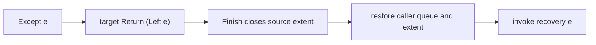

# Exceptions as Library Effects

**Feature:** [F-02](../../../feature/F-02-portable-programs.md)\
**Status:** Stable, 2026-10-20. The ordinary library implementation follows this
contract; final acceptance is tracked in the execution checklist.\
**Prerequisites:** [Library effects](algebraic-effects-and-handlers.md),
[handler scopes](control-elimination-and-handler-scopes.md),
[Control machine](control-machine.md), and
[native exception bridge](control-exception-bridge.md).\
**Summary:** Represent an explicit, abortive failure as an ordinary `Except e`
request. Eliminate it to `Either e a` using the existing scoped handler, then
run recovery after that handler has completed. Residual effects, state policy
and fallible leaf adapters stay in the library; native exceptions continue to
follow the separate bridge contract.

## Scope

This topic owns typed failure requests, labelled elimination, recovery scope,
continuation lifetime at recovery, and composition with other library handlers.
It is implemented by `PSRS.Control.Except` in the independent `psrs-stdlib` package.
It neither changes the eight `Prim.Control` operations nor introduces a second
exception mechanism in Core, CC or MIR.

Official `Effect.Exception` is a separate consumer of native EH. Its `Error`,
throw/catch foreign bindings, diagnostics and native-to-source decoding are not
implemented by this library. In particular, `Except e` is not a catch for every
failure that might occur while interpreting a computation. Automatic resource
release, IO rollback, engine-trap recovery and asynchronous cancellation require
their own contracts.

The [execution checklist](../../../implementation/backend/exceptions-as-effects.md)
separates design probes from acceptance. No corpus count or verified backend
coverage changes merely because this design is added.

## Background

The pinned package already contains unchanged `Run.Except` v5.0.0. Its operation
`Except e a` contains an `e` and no answer of type `a`; its interpreters discard
the failed remainder and return a result or invoke recovery. Run executes its
own library representation. The target module implements the corresponding
policy over compiler Control, without replacing Run or Free.

Control `handle` has distinct source and target domains. Both operation and
return clauses execute outside source dispatch, but the source lifetime remains
live until the target answer completes. These are separate facts. An operation
clause that directly invokes recovery would therefore keep the failed source
checkpoint live throughout recovery. The library must establish a completion
boundary before invoking user recovery.

Native EH follows native dynamic scope; a captured Control computation retains
neither a native activation nor an installed catch. The bridge closes a runner
on an escaping channel exception. That root-abort behavior does not implement
selective recovery in the same runner.

## Model

Reuse the unchanged `Run.Except.Except` type and its Functor instance, rather
than creating a second operation datatype. Its answer parameter is phantom:

```purescript
-- Existing upstream declaration; do not edit it.
newtype Except :: forall k. Type -> k -> Type
newtype Except e a = Except e

-- Existing target row carrier, instantiated at k = Type.
type Computation r a = Control (VariantF r) a
```

`e` is any ordinary, well-typed source value. Applications may choose a domain
ADT, a string, or a future implemented Error type. The library needs no Eq
instance, string conversion, global Error ABI or native exception reference.
Sharing and mutable fields within `e` follow ordinary value semantics.

### Public interface

The module re-exports `Except(..)` and supplies `_except :: Proxy "except"`.
The labelled operations use the same constraints as existing row wrappers:

```purescript
throwAt :: forall sym e tail row a.
  IsSymbol sym => Row.Cons sym (Except e) tail row =>
  Proxy sym -> e -> Computation row a

runExceptAt :: forall sym e tail row a.
  IsSymbol sym => Row.Cons sym (Except e) tail row =>
  Proxy sym -> Computation row a -> Computation tail (Either e a)

catchAt :: forall sym e tail row a.
  IsSymbol sym => Row.Cons sym (Except e) tail row =>
  Proxy sym -> (e -> Computation tail a) ->
  Computation row a -> Computation tail a

rethrowAt :: forall sym e tail row a.
  IsSymbol sym => Row.Cons sym (Except e) tail row =>
  Proxy sym -> Either e a -> Computation row a

fromResultAt :: forall sym e tail row a.
  IsSymbol sym => Row.Cons sym (Except e) tail row =>
  Proxy sym -> (Unit -> Either e a) -> Computation row a
```

Default-label `throw`, `runExcept`, `catch`, `rethrow` and `fromResult` specialize
these functions at `_except`, with source row `(except :: Except e | r)` and
residual row `r`. For example:

```purescript
catch :: forall e r a.
  (e -> Computation r a) ->
  Computation (except :: Except e | r) a -> Computation r a
```

`throw` is a module-qualified library name, not new syntax. Clients sequence
Control through its existing `pure` and `bind`; this module does not assume
new Monad instances or change type inference. Different labels can carry
different error types. Removing one slot does not discharge other labels.

### Outcomes

| Event | Effect-layer outcome | Machine outcome |
| --- | --- | --- |
| Normal source completion `a` | `Right a` | Finish source scope before passing the result to caller work |
| Selected `Except e` request | `Left e`; do not resume its request continuation | Complete that handler's target and close its source scope |
| Another labelled request | Forward once, then continue searching on resumption | Use the existing raw replay and activation rules |
| Native channel exception | No fabricated `Left` | Propagate through bridge cleanup unless an explicit native guard catches it |
| Invalid resumption or owner use | No source error value | Existing rejection trap |

An abortive operation has no successful request answer. Polymorphic `throwAt`
does not construct a dummy `a` or invoke its raw continuation with Unit.

## Design

### Elimination first, recovery second

`runExceptAt` produces an inert scoped `Handle`. Its return clause constructs
`Right`; its selected operation clause constructs `Left` and abandons the raw
continuation. Its residual clause forwards the residual request, then reinstalls
the same elimination around the resumed source. Forwarding preserves request
payloads, order and the answer type; it does not coerce a source row into its
residual row.

`catchAt` places a caller `Bind` around `runExceptAt`. That Bind is outside the
source handler. For a selected failure, the ordering is:



This is a lifetime cut implemented by ordinary handler completion. A retained
continuation whose checkpoint is inside the completed scope rejects during
recovery, even though the enclosing run remains live. Independent outer
checkpoints retain their existing lifetime. This does not require a new native
catch, Recover machine frame, global handler stack or exception-specific Close.

Recovery executes in the residual domain. A failure it explicitly performs is
handled by an enclosing installation available in that domain, not by the
completed handler. No implicit row widening or recursive self-catch is added.
A recovery computation with a selected label still present must explicitly
handle or forward it under the ordinary row rules.

### Replay and ownership

Forwarded operations retain the existing multi-shot semantics. Each resumed
branch gets the machine's replay-local activation extents; one branch returning
`Left` does not consume a separate, still-live saved checkpoint. Completion of
the owning delimiter expires that checkpoint by the existing ancestry rule.
The library does not close shared ancestors early to implement failure.

The exception interpreter never exposes the selected request's raw resumption
to user recovery. Error values may themselves contain ordinary closures or
owners; their subsequent uses remain subject to normal lifetime checks.
Abandonment does not cancel every reachable one-shot owner. A callback that
normally returns an Except computation has already completed its acquisition;
an unrelated Pending owner remains Pending until its own resume or cancel.
Native callback throws retain the bridge's Consumed-before-propagation rule.

### State and observable effects

Failure discards the selected source remainder, including pending user callbacks.
It does not reverse effects already interpreted. With `c` setting state to 1
and then failing with `e`, handler order determines the result:

| Nesting, using a pure state handler initialized at 0 | Observation |
| --- | --- |
| `runState 0 (runExcept c)` | state 1 and `Left e`; state is outside failure elimination |
| `runExcept (runState 0 c)` | `Left e`, without a state answer; that branch's pure state result is abandoned |
| Restart the second form in recovery with `runState 0` | Recovery starts with the explicitly supplied state 0 |

Here `runState` denotes the existing explicit-state library policy, not a new
primitive or automatic snapshot. A mutable cell referenced by that state is
still shared. Writer data handled inside the discarded branch can be absent
from its returned answer; bytes already sent to a console remain sent. Calling
this composition a transaction must specify these boundaries and exclude
shared mutation and IO unless a separate handler supplies rollback.

### Leaf adapters and native exceptions

`rethrowAt` translates an already available `Either`. Its argument obeys normal
strict evaluation. `fromResultAt` instead delays a fallible leaf until the
computation is interpreted. It executes the leaf once per interpretation or
replay, then translates its returned Either. The leaf may be a pure function or
an explicitly checked foreign operation that reports failure as a typed result.
There is no exactly-once guarantee across multi-shot replay.

A native exception during leaf evaluation, source argument evaluation, request
construction or recovery is not an Except request. In particular, native
stack-budget exhaustion is not assigned an arbitrary `e`. It escapes through
the existing runner guard, closing that runner and propagating the original
token. Native guards inside callbacks keep their existing dynamic scope.
The distinction between exceptions and traps also follows the
[Wasm EH contract](https://github.com/WebAssembly/exception-handling/blob/main/proposals/exception-handling/Exceptions.md#traps).

A future native-to-effect adapter can explicitly compose `fromResultAt` with a
checked leaf decoder returning `Either Error a`. That decoder must catch only
its declared source-error tag, preserve unrelated throws and specify payload
identity. It belongs with the official native Error/throw/catch consumer.
Neither `checkThrows` nor opaque Exn casts can supply such a decoder.

### Alternatives

- Direct recovery in the selected operation clause was rejected: source dispatch
  is absent but its checkpoint is still live until that target completes.
- A compiler `ControlThrow`/`ControlCatch` pair was rejected: existing Perform,
  Handle and Bind already express typed abort and the required completion cut.
- Converting all native throws at run entry was rejected: it lacks an `e`
  decoder and a typed selective recovery boundary, and would confuse resource
  exhaustion with an application request.
- Replacing official `Run.Except` or implementing its whole interpreter as an
  intrinsic was rejected: its representation and pure algorithms stay upstream.

## Algorithms

The following equations use the existing `PSRS.Control` functions and upstream
VariantF `on`. They are ordinary library definitions, not compiler rewrites:

```purescript
throwAt label e = performAt label (Except e)

runExceptAt label computation = C.handle
  (\value -> C.pure (Right value))
  (\request raw -> on label
    (\(Except e) -> C.pure (Left e))
    (\other -> C.bind (C.perform other)
      (\answer -> runExceptAt label (raw answer)))
    request)
  computation

catchAt label recover computation =
  C.bind (runExceptAt label computation) (\result -> case result of
    Left e -> recover e
    Right value -> C.pure value)

rethrowAt label result = case result of
  Left e -> throwAt label e
  Right value -> C.pure value

fromResultAt label leaf =
  C.bind (C.pure unit) (\_ -> rethrowAt label (leaf unit))
```

No callback runs merely because these constructors return computation data.
Evaluation of their ordinary arguments remains strict. Re-entering the same
completed scope requires an explicit new handler and new computation, not a
reactivated native catch or a reopened extent cell.

## Code map

| Owner | Required responsibility and interface |
| --- | --- |
| `psrs-stdlib/lib/Run/Except.purs` | Unchanged upstream Except datatype, Functor and official Run APIs |
| `psrs-stdlib/lib/PSRS/Control/Except.purs` | Labelled/default operations, `runExceptAt`, completion-before-recovery `catchAt`, Either and delayed-leaf adapters |
| `psrs-stdlib/conformance/control/` | Public typed failures, forwarding, handler order, scope, replay, owner and leaf observations |
| `psrs-stdlib/tools/` and package docs | Executable-level comparisons, source-fidelity audit and evidence; no compiler IR dependencies |
| Compiler `stdlib.lock.json` | Pin the separately landed library revision and measured package fingerprint |
| `crates/psrs-driver/src/tests/` | Optimized source integration, lifetime rejection and native-channel separation regressions |
| Existing Core contracts, CC machine construction and `mir/` | Preserve generic carrier/callable types, Finish ordering, replay ancestry and exception disjointness; repair shared contracts if new evidence finds a defect |

The intended compiler delta is integration tests and a package lock, unless a
general compiler defect is found. No class, module-name or constructor-name
recognition may select exception behavior. The bridge's checked schema remains
the single owner of machine lifecycle operations.

## Invariants and verification

1. The selected request has a typed `e`; its phantom answer is never fabricated.
2. Only the selected row slot is eliminated. Each residual request is forwarded
   once per encounter; repeated execution requires an actual replay.
3. `Left`/`Right` reaches caller work only after the corresponding source Finish.
   Recovery must not execute in that Finish's protected lifetime.
4. Failed-source callbacks do not run. Outer caller work continues with the
   handler's target answer. Tail finish coalescing is legal only under the
   existing completion-equivalence rule; it cannot cross a live user Bind.
5. Replay-local closure does not close another live branch or the saved template.
   Owner acquisition/cancellation rules do not change.
6. Source rows describe explicit requests, not absence of native throws or traps.
   Native Exn is neither stored in `e` through erasure nor decoded by name.
7. Pure state/output suppression is distinguished from rollback of shared
   storage and external effects.

Ordinary typechecking owns the request/answer and row relations. Library
conformance owns abort/recovery policy. Generic machine construction checks own
extent and Finish identities; MIR verification owns its usual types and CFG,
not the semantics of a library function called `catchAt`. Runtime evidence is
required both for optimized source execution and for scope/alias rejection.

## Worked example

```purescript
body :: Computation (except :: Except String) Int
body = C.bind (E.throw "failed") (\_ -> C.pure 99)

main :: Int
main = runPure (E.catch (\_ -> C.pure 42) body)
```

`runPure` starts a root R. `catch` first installs a child scope H for
`runExcept body`, with recovery in H's saved caller queue. The Perform request
selects H's operation clause. That clause ignores the source continuation
containing the `99` callback and returns `Left "failed"`. The ordinary Finish
closes H and restores its caller, then recovery returns 42. R completes normally.
The unused `99` callback never runs; checkpoints inside H reject during recovery,
while R and independent enclosing scopes have not been aborted.

If the callback instead exhausts the native stack budget, no `Left` is produced:
R's native guard closes R and forwards the channel exception. An outer native
observer may catch it under the bridge contract, independently of `catch`.

## Boundaries and interfaces

The library-owned operation is source data throughout CST, AST, resolved and
typed representations. Ordinary elaboration supplies Row.Cons and IsSymbol
evidence; existing Control contracts govern its higher-rank handler. ANF/CC/MIR
retain existing source ranges, operand identities and stage verification.

No new Wasm opcode or target flag is required. This does not remove the current
runner's existing requirement for the native exception bridge on its target
profile; disabled-profile rejection must remain truthful. Official Error APIs are implemented by the separate
[Effect.Exception consumer](effect-exception.md), with its own source-fidelity
and native-binding evidence.

The compiler repository records design, integration evidence and lock consumption.
The independent package owns implementation, cases and conformance tools. Adding
the typed-effect module must not edit official Run.Except or VariantF. The
separate native exception consumer owns its explicit Effect.Exception adaptation.

## Open questions and future work

- Native Error representation, tag ownership and explicitly selected
  native-to-Either leaf adapters belong to the official exception consumer.
- Typed resource brackets and transactional handlers need independent ownership,
  rollback and failure-during-cleanup semantics.
- `MonadError` instances and convenience combinators can be added as ordinary
  library APIs after their laws and complete source constraints are specified.
  They must retain completion-before-recovery and must not reinterpret traps.
- Stack switching or async cancellation needs a separate lifetime/accounting
  model; neither follows from an abortive request over persistent queues.

## References

- [Pinned Run.Except source](https://github.com/natefaubion/purescript-run/blob/abec7c343e92154d44b9dafd52b91ee82d32a870/src/Run/Except.purs),
  v5.0.0; inspected through the independent package's unchanged source and
  `upstream-lock.json` on 2026-10-20.
- [Wasm exception handling](https://github.com/WebAssembly/exception-handling/blob/main/proposals/exception-handling/Exceptions.md),
  consulted 2026-10-20 for native scope, propagation and trap separation.
- [DEC-20](../../../decision/DEC-20-typed-control-elimination.md) and
  [DEC-21](../../../decision/DEC-21-control-machine-construction-boundary.md).
