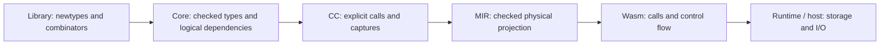

# State Primitives and Dependency Lowering

> **Withdrawn 2026-10-11.** The compiler no longer owns the State dependency
> protocol. `Prim.State`, `Prim.RealWorld`, the `runWorld`/`runRegion`
> intrinsics, the Core/CC/MIR State analysis, and the runtime storage
> source-binding contract were removed. Everything below is retained as dated
> historical evidence and is **not** an instruction to rebuild the removed
> machinery.

**Feature:** [F-02](../../../feature/F-02-portable-programs.md)
**Status:** Withdrawn. The primitive representation direction recorded below was
removed on 2026-10-11; no replacement has been selected.
**Prerequisites:** [primitive types](../../frontend/type-system/prim.md),
[Functional Core](../../frontend/semantics/functional-core.md),
[representation and evidence](representation-and-evidence.md), [CC](cc-ir.md),
[MIR](mir.md), [Core optimization](../opt/core.md),
[MIR optimization](../opt/mir.md), and
[primitive bindings](../wasm/primitive-ffi-and-stdlib.md).
**Summary:** State is a primitive logical dependency with no runtime payload.
Execution intrinsics establish boundaries; checked operations define successors.
Each lowering preserves invocation identity, execution order and scope until
MIR validates their physical projection. Libraries own Effect/ST types and
algorithms; runtime providers own storage and termination execution.

## Scope

This topic owns State/RealWorld semantics, execution primitive contracts,
dependency transport through Core, ANF/closure conversion and MIR, optimization
legality, and the conditions for zero-width projection and final erasure.
It does not introduce another IR between MIR and Wasm.

[Library-owned effects](library-owned-effects.md) owns the Effect/ST newtypes,
combinators, source adaptation, private adapters, ordinary command runner and
migration acceptance. The runtime and canonical ABI topics own executable
providers and host adaptation. State dependency evidence does not replace
observable-effect metadata or the ordinary type and representation system.

The complete transport contract includes calls, joins, loops, closures and
adapters. This is a correctness target, not a requirement to finish every
possible raw-State extension before accepting the actual Effect package.
Migration slices must name a public API/host reproducer. Additional low-level
State generality is tracked separately and must not relax the same invariants.

## Background

### What State represents

`State s` represents the dependency supplied to an action in region `s`.
The successor returned by an observable operation tells the compiler which
later operations follow it. It contains no application data, memory contents,
world snapshot, counter or runtime handle. The mutable data remains in the
cell, array or host resource used by that operation.

For example, writing a cell and then reading it creates this logical chain:

```text
s0 -- write cell 7 --> s1 -- read cell --> s2
```

The read must follow the write even if the write returns no useful payload.
The labels name compile-time dependency producers; no machine compares their
values or increments them during execution. Repeating the action executes the
calls again, rather than allocating a sequence of token objects.

This primitive differs from a library state monad of the form
`UserState -> (UserState, a)`: that monad transforms an ordinary value which
the program can inspect and return. Here the actual mutable state lives outside
the dependency value. `RealWorld` marks the region used for external effects;
it is not an object containing the world's state. ST uses a scoped region
marker to separate computations at the type level.

### Why introduce it

The migration has two responsibilities: let the library define actions and
their combinators, and give the compiler a contract for checking their
execution through optimization and representation changes. An ordinary newtype
solves the first responsibility. The selected State protocol solves the second
with an explicit predecessor/successor relation.

The important distinction is between constructing an action and executing it.
Constructing a closure that will write a cell must remain inert. Running it
twice must write twice. Reading after a write must observe that write. Dropping
an action's returned value must retain its executed write, host call or trap.
These requirements concern actual invocation and control flow, rather than
the spelling of `Effect` or the mere presence of a monad instance.

This is a selected compiler/library contract, not a claim that every correct
Effect implementation needs State. A suspended `Unit -> a` representation can
be correct when strict evaluation and sound observable-call metadata preserve
execution. Official PureScript's JavaScript adapter uses suspended functions.
Choosing that design would require a complete contract of its own. Here State
expresses sequencing and scoped region boundaries explicitly, and its physical
representation can be erased after checking them.

Neither a constant zero nor an incrementing integer supplies this contract by
itself. A constant can trigger an invocation, but carries no checked successor
relation. A counter adds runtime work without proving that the compiler retained
the right calls, operands and control edges. Zero-width dependencies avoid that
runtime work while retaining the relation during compilation.

### What belongs to the library, compiler and runtime

The library owns `Effect` and ST action newtypes, `pure`, `bind`, instances,
loops and wrappers. For example, it can define a hidden action constructor over
`State RealWorld -> Step RealWorld a`. Another library newtype using the same
protocol needs no new Effect-specific compiler rule.

The compiler owns the primitive State/region identities, unsafe execution
boundaries, operation contracts and their checked projection. It recognizes
these identities and contracts, rather than treating a library module named
`Effect` as privileged. The runtime owns the executable storage operation or
host interaction: it receives the cell/array, index and payload, not State.
An ordinary foreign binding connects that executable operation to its checked
source signature. A foreign binding does not make `Effect` a foreign type.



Moving storage implementation into runtime does not move source types or
optimization legality there. Once a compiler has deleted or reordered a call,
the runtime cannot recover the missing operation or its intended predecessor.
After checking and projection, the runtime needs no dependency interpreter.

### Relation to Haskell

GHC's IO representation is a newtype over a primitive State# transformer.
This motivates the selected shape; it does not specify this compiler's proof
algorithm or source restrictions. See [GHC.Internal.IO](https://downloads.haskell.org/ghc/latest/docs/libraries/ghc-internal-9.1401.0-555c/GHC-Internal-IO.html).
Our State is at kind `Type`; the nominal region, lack of constructors, and
checked execution boundaries must be stated independently of GHC's runtime.
The analogy concerns a library newtype around a primitive dependency-carrying
function. It does not establish that our dependency graphs, source restrictions
or per-pass verification algorithm are GHC's implementation.

Three facts must remain distinct:

- A logical dependency identifies where an operation belongs on an executed path.
- An observable operation can mutate storage, invoke a host service or trap,
  even when its result is unused and it has no physical State argument.
- Zero-width representation removes payload slots, not execution or its order.

## Model

### Vocabulary and primitive surface

The phrase "State intrinsic" covers several different responsibilities and
should not imply one runtime action mechanism:

| Name | Meaning | Owner |
| --- | --- | --- |
| `State s` | Primitive dependency type with a nominal region parameter and no physical payload. | Compiler primitive type catalog. |
| `RealWorld` | Primitive marker for the external-effect region. | Compiler primitive type catalog. |
| `Step s a` | Ordinary record alias containing successor State and result `a`. | Library source; the shared compiler contract checks its structural fields. |
| `runWorld`, `runRegion` | Explicit execution-boundary intrinsics. | Compiler intrinsic catalog and checked lowering. |
| Storage read/write/fill/trap | Executable operations exposed through checked foreign bindings. | Runtime provider and its ABI contract. |
| `Effect a`, ST action types | Ordinary library newtypes over the protocol. | Library source. |

The registered State execution intrinsics are `RunWorld` and `RunRegion`.
There is no State constructor intrinsic, no token increment intrinsic, no
intrinsic implementation of bind/loops and no intrinsic per runtime export.
The catalog entries are available through explicit bindings rather than
implicitly exporting unsafe runners from ordinary library modules.

Execution needs a primitive boundary in this design because ordinary library
code has no constructor for a root State. `runRegion` additionally uses the
compiler's rank-N region and result-escape checks. The intrinsic supplies that
checked boundary, not an action interpreter.
The library's runner still chooses when to call it. Mutable operations need
checked external contracts because their executable bodies are outside the
source verifier; they do not need to become compiler-defined library algorithms.

### Types and structural call boundary

```text
Prim.State.State     :: forall k. k -> Type   -- nominal region role
Prim.State.RealWorld :: Type                 -- region marker
Step s a = { state :: State s, value :: a }
```

The primitive declaration catalog supplies stable identities. State has no
constructor, equality operation, numeric payload or safe region-changing
coercion. RealWorld is not a mutable world object. The region kind remains
polymorphic for official ST region markers.

Step is an ordinary closed structural record with exactly the state/value
fields. Core extracts the complete callable boundary and validates the State
input and Step successor at the same region. Field correspondence is checked;
consumers must not infer it from an erased layout or a library constructor name.
Only validated boundaries receive a State call projection plan.

### Dependencies and source uses

A dependency is a scoped producer identity, not token bits. A formal callable
input is supplied by its caller; it is not a new execution root. Only a checked
execution primitive opens a root. An observable operation consumes the current
input and, on normal return, produces a successor. A pure pass-through action
may retain the input identity. A non-returning operation has no normal successor.

The checked sequential protocol imposes the following conditions:

| Source use | Contract |
| --- | --- |
| Bind another name to State | Preserve producer identity; an alias is not a fresh dependency. |
| Return unchanged State | Valid for proven pass-through behavior; not a replacement for a write/host successor. |
| Discard an action's payload | Valid; its observable operation and successor remain required. |
| Discard a successor and return an older predecessor | Invalid after an observable transition on that executed path. |
| Use State in mutually exclusive branches | Each executed arm threads its current dependency; the join selects that arm's successor. |
| Use aliases successively around observable calls | Aliasing does not authorize replay of a stale predecessor or an unchecked fork. |
| Capture raw State | Construction is inert; invocation must preserve its producer and validate it against the current path. |
| Execute an action repeatedly | Each dynamic invocation receives its own supplied input; reusable action closures are not single-use objects. |
| Return a function or nested action as payload | Keep the payload's complete type and callable convention; do not execute it or add outer parameters. |
| Store State in a container or pass it to an abstract consumer | Require a complete checked transport contract; never silently forget its provenance. |

These are obligations of the checked sequential protocol, not a general linear
PureScript type system. Unsafe source has no automatic replay-prevention or
purity guarantee. Unsupported raw-State transport must be diagnosed distinctly
from a malformed checked chain. Neither an implementation's one-capture limit
nor its local-helper restriction defines the language's final semantic rule.

### Execution and operation contracts

Proposed registry operations are named here by responsibility; exact Rust and
binding names must follow the single intrinsic catalog. Do not add implicit
bootstrap exports of unsafe operations.

```text
runWorld  :: forall a.
  (State RealWorld -> Step RealWorld a) -> a
runRegion :: forall a.
  (forall s. State s -> Step s a) -> a
```

runWorld starts one dynamic execution, supplies its root dependency, invokes
the supplied function once and discharges its returned state before yielding
the payload. It is an unsafe execution boundary used by the library unsafe
runner and command adapter, not a purity proof. runRegion introduces a fresh
scoped region, invokes the rank-N body once and checks that the region does
not escape in the result. No arbitrary initial State literal is exposed.
Nested and repeated executions retain distinct dynamic invocation boundaries.

Mutation and reads of mutable storage use state-aware checked primitives, for
example a private cell operation has the schematic shape:

```text
readCell  :: forall s a. Cell s a -> State s -> Step s a
writeCell :: forall s a. Cell s a -> a -> State s -> Step s Unit
```

Cell is library owned. Actual storage bindings use their existing checked
storage operands; a primitive scheme may not presume the identity or layout of
Cell. New storage allocation, mutable reads, writes and unsafe freezing all
participate in the dependency protocol. Pure array operations retain their
existing pure contracts; reading mutable backing storage must not be classified
as pure merely because immutable array indexing is pure.

Generic execution primitive descriptors and checked target binding contracts
own dependency inputs/results, observable effects and trap behavior. Source
schemes, kind/role checks, Core elaboration and verifiers consume these contracts.
Backend binding metadata keeps runtime provider/export identity, source module,
span and the checked Core scheme identity beside target-neutral CC. Extraction
must retain every runtime binding; boundary validation rejects missing,
duplicated or substituted records. Keeping a raw binding record does not mean
its call has been projected or checked against a physical instruction sequence.
Returning an ordinary record containing
the same input State is not enough to implement an observable primitive: its
checked operation must establish a successor dependency.

## Design

### Why the protocol crosses several passes

Each representation changes something the preceding representation could
express. Core retains checked regions and source call types; closure conversion
makes hidden captures and calls explicit; MIR removes logical State slots and
fixes executable layouts. A proof about the source chain alone does not show
that a later adapter invokes the same storage operation on the same cell.
Conversely, physical type correctness alone cannot distinguish a call on the
intended cell from one on another cell of the same type.

The protocol therefore follows the existing representation boundaries. The
extra obligation at each boundary is to preserve the same operations, operand
identities, execution multiplicity and chosen control paths while changing
their representation. It introduces no additional IR or runtime execution stage.
Ordinary typing, effect metadata and representation operations remain shared
with other library types.

Preserving this contract is necessary for the selected design; the present
amount of machinery is not itself a requirement. Reinterpreting the same source
in multiple private evaluators, repeatedly deriving an immutable module or
restricting all bodies to one local source form are implementation choices
which must be assessed against the shared contract. A new State rule or pass
must name the semantic fact it owns and the transformation that requires it.
Code that cannot do so is not justified merely by supporting Effect.

### One semantic owner, explicit lowering relations

The primitive catalog owns identities and roles. Checked source contracts own
operation inputs/results, region agreement, effects and normal-return behavior.
Core owns call-boundary extraction and body dependency production, tied to
immutable invocation nodes and source ranges.

Lowerings consume those facts and publish an explicit relation to their actual
output operations. CC and MIR verify that relation against immutable input;
they do not rediscover primitive semantics from names or invent fresh inputs.
A producer can be trusted for type facts already checked at its stage, but a
consumer claiming invocation correspondence must check actual calls, operands,
results and control placement. A valid standalone dependency graph is not proof
that the executable instructions implement it.

P9 freezes one CheckedSource authority for a logical CC module after deriving
and validating its State flows. The inventory and physical function witnesses
share that authority. A summary is keyed by stable function identity and retains
the expected dependency and execution graphs; its function body remains in the
same immutable source arena. Verification compares current witnesses with those
summaries and checks actual instructions/control against the source body.
It must not recompute the entire frozen module for every physical function or
optimizer checkpoint. Mutating a source copy creates a different arena and
requires new checked summaries; cached evidence never authorizes changed calls.

| Boundary | Required input | Output and discharge obligation |
| --- | --- | --- |
| Resolved HIR to typed Core | Stable primitive/external IDs, complete schemes, source origin | Typed calls, nominal regions and checked primitive contracts; no dependency inferred from Effect names. |
| Core optimization | Checked bodies and operation contracts | Preserve behavior; invalidate and regenerate affected body evidence after transformation. |
| Core to ANF/CC | Immutable source calls, lexical scopes, argument evaluation order | Explicit evaluations, invocation correspondence and producer transport. ANF is part of CC lowering, not an extra State execution stage. |
| Closure conversion | Ordinary free-local/capture structure plus dependency provenance | Captures and lifted formal inputs tied to actual producers; no synthetic execution root. |
| CC to MIR | Checked logical call/result/capture plans and immutable CC | Zero-width slots plus checked instruction/CFG correspondence; payload conversion and raw ABI calls remain explicit. |
| MIR optimization | Physical operations with immutable requirements and current evidence | Preserve or transfer evidence for every changed call/edge; reject stale evidence. |
| MIR to Wasm | Verified final physical projection and effectful calls/control | Encode existing behavior; no remaining State value representation or effect-moving optimization. |

### Transport and projection

Typed Core preserves source State applications, roles and primitive contracts.
Its state-operation verifier checks input/output shapes, region identity,
producer provenance, normal-return state and dependency scope. Ordinary functions
are checked from their bodies; an external or abstract callable needs a checked
state signature contract. MIR retains checked source requirements in an immutable
module inventory independent of mutable per-function evidence. Every retained
function must satisfy its source requirement; deleting an optional witness must
not disable verification. Unused whole functions may be pruned without changing
the requirements of surviving functions. Missing required evidence is an error, not a fresh
state or assumed-pure operation.

Core body evidence is tied to its immutable source arena. It derives transitions
from actual invocation nodes and tracks their argument and returned-field
provenance through ordinary aliases, record patterns and control-flow joins.
Verification checks invocation coverage and order, region/payload contracts and
branch placement in addition to standalone graph validity. A proven pure body
may pass its incoming dependency through unchanged; an unknown invocation stays
conservatively observable. Pure joins preserve aliases already evaluated before
the join. Core transformations invalidate old body evidence and recheck the
resulting source representation before later projection can consume it.

Lexical callback construction retains the producers of its free locals without
executing the body. Calling a known callback evaluates its argument first, then
checks its body in the captured lexical environment against the caller's current
dependency. It creates no new root. Nested callback parameters retain this same
provenance, and leaving the invocation restores the caller's local scope.
Pure joins may rebase captured aliases; observable transitions do not make an
older capture current again. Source verification derives executing invocation
identities through these scopes, including operations inside called callbacks.
An unsupported callback consumer, branch merge, container or cast must reject
state-carrying values before losing their producers into an opaque value.
Later representations must preserve the actual capture and invocation relation
and discharge it through checked zero-width capture and call projection.

CC makes the dependency chain explicit alongside ordinary evaluation order.
Each observable state operation defines an output dependency referring to its
input. Calls retain checked state inputs/results through dictionaries, erased
closures and higher-kinded instantiation. Conditional joins select the dependency
from the executed branch; loops carry it as a loop parameter. The returned
state must be downstream of the observable operations executed on that path.
Unknown calls and unsafe execution remain conservatively observable.

A lifted callback may receive its logical input through a checked closure
capture instead of an explicit State parameter. CC records which owning closure
parameter and capture index supply that input. Construction preserves the
capture's producer, and invocation checks it against the caller's current
dependency. The callee's local root is a formal input supplied by that call,
not a new execution boundary. Explicit and captured inputs share the checked
Step result contract; capture transport does not add a synthetic State parameter
to the ordinary call ABI. Branches rebase current captures together with other
aliases and preserve stale predecessors. Source correspondence verifies this
input relation as well as actual operations. Physical removal requires separate
checked capture-slot and invocation correspondence.

Zero-width capture projection removes only logical State operands from a
checked closure producer. Each surviving capture read uses the number of
ordinary slots before its original logical index. The captured callback keeps
its ordinary parameter convention and returns the checked Step payload. The
immutable source CFG anchors closure construction and surviving capture reads
to their original scope and order, with the same target, destination and
ordinary operands. A physically type-correct change of capture index or operand
is still an invalid dependency projection. Constructing a callback remains
inert even when its body traps; selected invocations retain normal successors
or their checked non-returning path.

Verification does not claim a general linear source type system. It rejects
malformed chains, region mixing and an unsupported fork that would discard or
replay a predecessor around observable operations. Branch-exclusive uses and
pure state pass-through are valid. A library closure may execute repeatedly;
each invocation threads the state supplied for that invocation. Support for a
raw-state transport shape must be checked across its actual fields, captures,
products and calls; unsupported shapes fail explicitly rather than materializing
a placeholder token or erasing the dependency.

MIR fixes physical representation and keeps a checked dependency projection
for instructions, calls, block joins and loop edges. Dependency identities are
not Wasm value types or integer locals. Their definitions/uses are explicit MIR
structure, not a name-based side table reconstructed by the encoder. MIR
verification establishes dominance, region agreement, call contract consistency,
and control-flow preservation of the dependency chain.

The existing representation planner owns the source/logical-to-physical mapping.
State maps to zero payload slots; Step's state field contributes no storage.
A structured choice returning only State retains its selector, arm calls and
control edges. Its physical join has no value parameter and incoming jumps
carry no payload argument. The immutable logical source still owns the chosen
successor dependency; projection verification checks these empty physical slots
alongside call placement and every control edge. Zero-width choice results must
never erase the choice's observable execution or introduce an integer token.
At a known state-call boundary, the result projects to the payload and requires
no Step record allocation. Common aggregate and erased transport may use an
ordinary payload container when required; it must not lose logical dependency
evidence or silently change callable conventions. No full GHC unboxed-tuple
syntax or global allocation-free claim is introduced.

Physical parameter removal occurs only through checked signature projection,
shared by producers, consumers, partial applications and adapters. State
parameters are zero-width while their logical invocation and dependency remain.
Core owns call-boundary extraction for arrows, fixed-arity closures and quantified
results. The representation planner consumes that boundary and the checked State
signature, retaining its source arena and region while projecting only payload
types into physical slots. A signature plan alone cannot discharge invocation dependencies.
For ordinary direct and indirect calls, MIR correspondence preserves every
non-State operand identity, order and occurrence from immutable CC. It removes
only operands whose checked CC declarations have State shape. Changing an
operand to another value of the same physical type still invalidates the
certificate. ABI conversions require their own checked correspondence rather
than relaxing this ordinary-call invariant.
A nullary physical host call stays a call inside the action body, not a global
initializer. Immutable checked source Core is not mutated into a physical type
model; the lowering carries its explicit relation to CC/MIR.

### Optimization and final erasure

Core and MIR transformations preserve dependency edges, dynamic multiplicity,
branch/loop placement and observable call/trap behavior. Unused payloads do not
permit removal of their operation. State pass-through for a pure action is
simplifiable; a state-producing host/mutation operation is never replaced by
its input State. Inlining preserves argument order and reconnects dependencies
using fresh local identities. CSE, code motion, dead-code elimination and loop
optimizations require evidence covering both dependencies and observable effects.

Zero-width representation does not make a state operation pure. Observable-effect
metadata remains necessary after physical projection and for calls outside the
state protocol. Dependencies do not promise rollback, thread synchronization or
replay prevention for arbitrary unsafe source code.

After the last MIR optimizer, verify the full dependency graph and the ordered
instruction/CFG projection. The encoder may erase logical state edges only when
that projection discharges them. It preserves instruction/control order and
performs no subsequent effect-moving optimization. No State constant zero,
state counter, token object, dedicated world heap or runtime version comparison
is emitted. Verified state ordering survives as executable calls and control flow.

### Observable runtime and host calls

Runtime storage operations are ordinary checked foreign bindings, not one HIR
intrinsic per export. The runtime contract describes ordinary operand roles,
payload adaptation and whether the operation returns normally. Validate element
use types before erasure and retain mutable array reference identity.

State-aware host calls use the canonical ABI's checked adapter subgraph. Its
source call, ordinary operands, payload recovery, cleanup and exit must remain
anchored to the same invocation. Only a completely checked adapter subgraph can
be contracted to one logical invocation for ordering checks. State is not a WIT
resource, canonical argument or runtime handle.

Signature/result projection must consume the authoritative checked boundary
plan. A structural Step-looking physical type alone does not discharge producer,
invocation or return obligations. Remove unused representation entries through
ordinary reachability/layout planning; do not broaden semantic admission to
make an inventory pass.

### Rejected alternatives

Reject constant or incrementing tokens, world heap objects, Effect-name checks,
whole-function combinator intrinsics, and runtime action interpreters introduced
solely to avoid a checked callable boundary. Also reject source-order guesses
without call identity, permissive fallback for lost provenance, and global
signature rewrites justified only by one supported capture case.

Temporarily rejecting unsupported transport is honest. Skipping optimization
can protect a partial contract, but is not a complete optimization design or
stack-safety proof. Tail/loop conversion must reconnect logical successors and
physical control rather than exclude all State-bearing functions permanently.

## Algorithms

1. Resolve stable primitive and external identities; validate complete schemes,
   region roles, rank-N scope and normal-return contracts before publishing them.
2. For each checked body, establish formal inputs, executed invocation identities
   and path-local producers. Preserve source spans for every failure origin.
3. Follow ordinary strict evaluation through ANF. Bind aliases to existing
   producers; distinguish callback construction from callback invocation.
4. Relate branch successors and loop-carried dependencies to actual control
   edges. Transport free-local producers through the ordinary closure layout.
5. Publish CC evidence and verify operation coverage against immutable Core;
   malformed or unsupported transport must not become an opaque valid result.
6. Build call/result/capture projection plans from checked logical boundaries.
   Plan raw runtime or canonical host adaptation using complete operand/payload
   contracts. Validate actual emitted subgraphs, including terminating paths.
7. Lower to MIR with zero physical State slots and immutable requirements for
   surviving functions. Validate operands, capture index remapping and CFG edges.
8. After each relevant optimizer, transfer or rebuild evidence and reverify.
   Inlining substitutes inputs with fresh local identities; tail/loop conversion
   maps successors onto backedges. Preserve dynamic multiplicity and traps.
9. Verify the final physical module before encoding. Erase discharged logical
   dependencies while retaining observable calls and control flow.

No error path may publish partially checked evidence. Pruning an unused whole
function may remove its requirement; deleting a retained function's witness
must not suppress verification.

## Code map

This table specifies ownership and required APIs, rather than an inventory of
existing special cases.

| Owner | Required types/operations |
| --- | --- |
| HIR primitive catalog | State/RealWorld identities, nominal role and `StateOperation::{RunWorld, RunRegion}` source schemes. |
| Core State contract | `signature(...)` extracts complete region/payload call contracts; execution checking validates root/region scopes. |
| Core dependency producer | Body checking produces invocation/provenance evidence tied to the immutable source arena; verification diagnoses missing, stale or unsupported relations. |
| Core-to-CC lowering | Explicit source-to-invocation/capture correspondence using ordinary ANF and closure conversion operations. |
| CC State contract | `StateCallProjection`, `StateResultProjection` and capture plans share region/result rules; function verification checks actual inputs, calls and returns. |
| Runtime ABI contract | Source operand roles, physical export signatures and normal-return properties; no compiler IR or Effect algorithms. |
| ABI adapter planner | Checked runtime/host subgraphs anchored to source call identity and actual application types. |
| MIR State projection/verifier | Shared immutable CheckedSource authority, inventory, logical-to-physical input/result/capture mappings and per-function instruction/control correspondence. |
| Optimizers | Transfer/invalidate evidence at common transformations; immutable requirements remain authoritative. |
| Encoder | Consume verified MIR layouts and ordered operations without reconstructing State semantics. |

Current local closure evaluators are implementation strategies, not independent
semantic owners. If retained, they must consume the shared contracts and agree
across equivalent source forms; the design does not require interpreting
arbitrary PureScript code to prove ordinary library combinators.

## Invariants and verification

| Invariant | Required verification |
| --- | --- |
| No fabricated root or region change | Primitive IDs, nominal roles, execution scopes, rank-N escape negatives. |
| Every required operation is represented | Invocation coverage against immutable source plus actual call/provider identity. |
| Correct predecessor/successor | Path-local producer checks, stale-use/fork negatives, branch selection and loop-carried inputs. |
| Correct lexical transport | Actual closure producer, ordinary captures, lifted input, invocation and source scope; direct/helper forms compose under the same contract. |
| Normal return versus trap | Runtime contract anchored to invocation; no successor or continuation after a non-returning call. |
| Sound physical projection | Ordinary operand identity/order, payload recovery, capture remapping, no State slots or token constants. |
| Optimizer preservation | Values and observable traces before/after transformations; changed graphs have current evidence. |
| Safe library behavior | Inert construction, strict arguments, repeated execution, ignored payloads, storage aliasing and region boundaries. |
| Stack-safe public loops | Mandatory Wasmtime execution at meaningful iteration counts, compared with the pinned official loop behavior. Short traces alone are insufficient. |
| Honest unsupported forms | Stage-specific source diagnostics; no success by dropping dependency metadata. |

Runtime execution, malformed-IR rejection and representation inspection are
separate evidence. The [implementation checklist](../../../implementation/backend/library-owned-effects.md)
records which obligations actually passed; this document grants no new support.

## Worked example

### Ordinary pure and bind

These schematic definitions belong in a library, with the constructor hidden
from clients. They are not compiler-generated combinators:

```purescript
type Step s a = { state :: State s, value :: a }
newtype Action s a = Action (State s -> Step s a)

pureAction :: forall s a. a -> Action s a
pureAction value = Action \state -> { state: state, value: value }

bindAction :: forall s a b. Action s a -> (a -> Action s b) -> Action s b
bindAction (Action first) next = Action \state0 ->
  case first state0 of
    { state: state1, value: value } ->
      case next value of
        Action second -> second state1
```

`pureAction` creates no observable transition and returns its supplied State.
`bindAction` constructs a closure. When that closure is invoked, it runs
`first`, gives its ordinary payload to `next`, and runs the returned action
with `state1`. It does not run either action merely by assembling the bind.
The compiler checks the generic callable protocol; it needs no knowledge of
these function names or the `Action` constructor.

### Logical sequencing and physical calls

Consider two storage calls inside an ordinary action:

```text
step1 = write cell 7 s0
step2 = read cell step1.state
return { state: step2.state, value: step2.value }
```

Core checks one region and the storage element/payload contracts. It records
`write(s0) -> s1` and `read(s1) -> s2`, with the actual source invocation IDs.
ANF evaluates operands in order; CC keeps both calls and their successor fields.
Returning s0 instead of s2 is a stale dependency even though both have the same
type. An unused read payload still does not make a mutable read pure.

MIR emits a write using the original cell reference, followed by a read and
payload recovery. State arguments and fields contribute no physical slots.
Verification checks that these actual calls correspond to the logical chain,
including operand identity, order and normal-return behavior. Wasm contains the
calls and their control flow without State parameters or a world object.

The physical behavior is schematically:

```text
runtime_write(cell, 7)
value = runtime_read(cell)
return value
```

Payload boxing/recovery and canonical ABI adaptation may still occur around
these calls. Erasing State does not promise that every action, record or
closure is allocation-free. It removes the dependency's own slots and the
known Step boundary's State field while preserving the useful result.

If a branch chooses between writes, only the executed arm supplies the join
input. Even if the branch returns only State, its physical join can have zero
value parameters while retaining the selector, arm calls and control edges.
If an arm traps, it has no normal edge or successor to that join.

### Execution roots and regions

A library runner binds explicitly to `runWorld` or `runRegion`; it does not
manufacture an initial State. `runWorld` invokes the action once with a logical
root in `RealWorld` and yields its payload. `runRegion` checks a rank-N action
whose fresh region cannot appear in the result. This separates region safety
from sequential ordering: matching region types is necessary, but returning an
old predecessor after a write remains invalid even in that same region.

A scoped region is a type and execution boundary, not a new runtime world
object. Storage allocation, ownership and lifetime follow their own runtime
contracts; the region runner does not by itself specify an arena allocator or
promise automatic resource cleanup.

## Boundaries and interfaces

The library can define unrelated newtypes over the same protocol without new
compiler rules. Private unsafe adapters and unsafe execution are explicit trust
boundaries; nominal regions and checked call conventions survive them, but they
are not blanket source purity proofs.

Runtime providers receive ordinary physical storage operands, not dependency
identities. The linker validates actual application reference types against
provider contracts. Host adapters obey canonical ABI requirements. Neither
runtime nor linker derives source sequencing by recognizing Effect or ST.

Core and CC evidence describes logical execution; MIR fixes representation and
checks its projection. Wasm consumes MIR, not a separate State IR. Logical
projection can remove zero-width slots before final encoding, but observable
metadata and source correspondence remain until their obligations are discharged.

## Open questions and future work

General raw-State transport needs a coherent shared invocation/capture contract
rather than successive local exceptions. An arbitrary higher-order consumer
must preserve or explicitly discharge producers; relaxing an unknown call to
an opaque result is not a solution. The precise safe exposure policy for raw
State at kind `Type` remains a design question distinct from public Effect use.

General optimizer graph transfers remain required. Tail conversion retains an
immutable checked pre-tail physical body, replays the shared conversion, and
verifies actual output against it. Scalar folding uses the same optimizer owner;
function-position compaction does not change stable call identities. This bounded
contract supports tail calls and self-recursion backedges without admitting
arbitrary CFG changes. Current single-root/capture restrictions, other pass
exclusions and signature-wide projection
must be assessed against these contracts, not promoted into normative rules.
See the [audit](../../../implementation/backend/library-owned-effects-audit-2026-10-11.md)
for reproduced failures and static concerns. No implementation gap authorizes
narrowing the complete transport model or postponing a concrete public API fix
behind unrelated generality.

Async scheduling, exceptions/recovery, concurrent memory ordering and independent
State fork/join optimization require separate designs. This synchronous protocol
provides no transaction, rollback or synchronization guarantee.

## References

- [Library-owned effects](library-owned-effects.md) and its
  [implementation evidence](../../../implementation/backend/library-owned-effects.md).
- [GHC.Internal.IO](https://downloads.haskell.org/ghc/latest/docs/libraries/ghc-internal-9.1401.0-555c/GHC-Internal-IO.html).
- [Pinned PureScript Effect JavaScript implementation](https://github.com/purescript/purescript-effect/blob/a192ddb923027d426d6ea3d8deb030c9aa7c7dda/src/Effect.js),
  the reference for suspended construction and explicit execution.
- [IR boundaries](../00-ir-boundaries.md), [CC](cc-ir.md), [MIR](mir.md),
  [Core optimization](../opt/core.md), [MIR optimization](../opt/mir.md).
- [Primitive bindings](../wasm/primitive-ffi-and-stdlib.md),
  [canonical ABI](../wasm/canonical-abi-and-wit.md), and
  [runtime linking](../wasm/linking-and-runtime.md).
