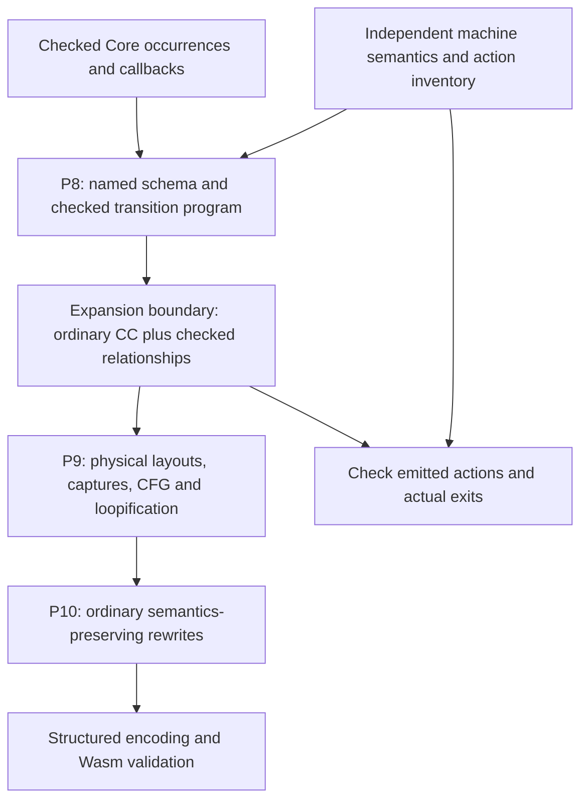

# Delimited Control Lowering Review — 2026-10-14

**Subject:** [Control machine](../../design/backend/fp/control-machine.md).
**Baseline:** `feat/effect-handlers`, `1e24e5d5`; clean checkout at review start.
**Scope:** Machine semantics, P8 construction, P9 representation lowering and
P10 verification/optimization responsibilities. No Rust implementation changes.
**Disposition:** DEC-21 accepts the construction/proof boundary recommended
below. Checked construction, operand-level CC expansion checking and immutable
machine planning are implemented; complete migration and AE/AC acceptance remain
open. See [the current implementation audit](#implementation-audit-2026-10-15).
The findings below describe the historical baseline; deleted recognizer files
can be inspected with `git show 1e24e5d5:<path>`.

## Findings

### L1 — High: machine meaning is reconstructed after early expansion

[`lower/control/mod.rs`](../../../crates/psrs-backend/src/cc/lower/control/mod.rs)
expands primitive occurrences into ordinary CC plus `ControlEvidence`.
[`builder.rs`](../../../crates/psrs-backend/src/cc/lower/control/builder.rs)
expands callback application into erased unary calls and casts; transitions
combine explicit parameters with mutable builder `context`/`boundary` fields.
The source evidence is valuable, but it describes a factory occurrence rather
than the whole generated executor action.

`cc/verify/control/traces.rs`
and `mir/control/traces.rs`
recover path events from two different instruction sets. Separate identity,
selected-case, refinement and exit analyses then recover the semantic operands.
This makes every change in expansion or optimization a potential new
recognition obligation. Sharing final relations alone does not remove it.

Measured at the baseline on 2026-10-14, counting `.rs` files recursively with
`len(read_text().splitlines())`, excluding other directories:

| Directory under `crates/psrs-backend/src/` | Files | Lines |
| --- | ---: | ---: |
| `cc/lower/control/` | 9 | 1,744 |
| `control/` | 9 | 1,511 |
| `cc/verify/control/` | 18 | 3,029 |
| `mir/control/` | 19 | 3,965 |

These are maintenance-surface measurements, not defect counts or compile-time
benchmarks. They exclude generic identity/CFG code, layouts and driver tests.
The ownership problem is visible in the code paths independently of line count.

### L2 — High: schema and action coverage have no complete authoritative plan

[`layout/control/mod.rs`](../../../crates/psrs-backend/src/cc/layout/control/mod.rs)
declares frame cases and fields positionally. Primitive-to-case mappings recur
in `layout/control/contracts.rs` and `lower/control/mod.rs`.
[`cc/control/helpers.rs`](../../../crates/psrs-backend/src/cc/control/helpers.rs)
infers queue/context/extent/status roles from helper signature positions and
variant fields. Lowering and verification also encode those offsets directly.

The shared execution relation intentionally delegates computation tags 1–5 to
other owners (`control/execution/mod.rs`, `transition`). This is not by itself a
missing check: clauses, steps, context entry, replay and ownership have checks.
It does mean completeness is a manually maintained composition across modules.
There is no checked transition inventory establishing that every required
case has one action and that each action's obligations have all been discharged.

**Required change:** one named machine schema and a complete action registry.
Physical layout, generation and verification consume it. Rules are independently
checked against the operational semantics; generating producer and checker from
the same unchecked field list is insufficient.

### L3 — High: optimization validity and whole-machine semantic validation are mixed

[`mir/opt/mod.rs`](../../../crates/psrs-backend/src/mir/opt/mod.rs) runs the MIR
verifier after individual rewrites. That is appropriate for IR invariants, but
the verifier also re-recognizes machine behavior from the rewritten code.
`mir/control/publication.rs`
reconstructs allocation-to-publication windows after Start/Once inlining.
Its current scope assumes private cells allocated in the same block; meanwhile
Check/Close remain recognizable because today's ordinary inliner accepts only
small single-block functions. These are current implementation shapes, not
general semantic properties of valid inlining.

`mir/branch_facts.rs`
enumerates paths and rejects internal cycles within a step region. CC traces
also fork paths through alternatives. Repeated reconverging branches can grow
the enumerated path set exponentially. No pathological compile-time benchmark
was run, so this is an algorithmic exposure, not an observed slowdown report.

**Required decision:** either explicitly discharge machine semantics at the
expansion boundary and trust semantics-preserving generic transforms, or build
transformation-aware semantic validation. Ordinary SSA/layout checking does not
prove semantic preservation. Continuing to extend a recognizer without choosing
its proof scope leaves both implementation cost and assurance claims unclear.

### L4 — Medium: the design's replay algorithm skipped saved work

The former `cloneSequence` pseudocode popped `todo` before inspecting the
current queue. For `Append(Cons(k, Empty), Cons(h, Empty))`, it replaced the
unvisited left queue with the right queue and omitted `k`.
[`lower/control/replay.rs`](../../../crates/psrs-backend/src/cc/lower/control/replay.rs)
correctly pops `todo` only in the Empty-queue case. The design now follows that
ordering. This is a documentation defect; no corresponding code defect is
claimed. The code and document should eventually be compared against an
independent bounded machine model rather than treated as mutual proof.

### L5 — Medium: semantics and costs need separate specifications

The machine defunctionalizes the sequencing spine; callbacks remain closures.
There is no analysis converting arbitrary potentially suspending functions.
The design now states that boundary explicitly.

Replay flattens and rebuilds the saved sequence, including callback-only queues.
A persistent queue supports sharing and multiple traversal; it does not establish
constant-time replay. Check also walks an ancestry chain. Tail Finish coalescing
affects observable expiry, so its semantic precondition must precede its cost
justification. Keep separate obligations for callback order, checkpoint validity,
activation freshness, expiry, native stack, traversal work and retained heap.
No replacement queue representation or runtime performance improvement is
established by this review.

### L6 — Medium: directory separation exceeds semantic encapsulation

The private `cc/lower/control`, `cc/control` and `mir/control` modules establish
useful code boundaries. Core-quoted `ControlContract` fields have restricted
visibility, helper identities distinguish same-signature functions, and lowering
borrows the representation table immutably. These protections should remain.

However, `RepresentationTable` exposes mutable public `control_helpers`,
`control_contracts`, `control_resumption` and `control_result_pair` fields. Its
read-only use during lowering is locally enforced by borrowing; there is no
separate frozen machine-plan API. This is an ownership/API limitation, not a
claim that public mutation bypasses verification: ordinary IR and malformed-IR
fixtures intentionally remain constructible and must still be verified.

The supposedly stage-independent `control/` relations import CC representations,
the CC representation table and even the CC erased-payload helper. The direction
of dependency therefore embeds CC schema knowledge in the shared semantic owner.
MIR consumers also repeatedly scan the helper vector and derive roles from CC
signature/field offsets. Moving functions into a shared directory has not yet
hidden these representation decisions behind a neutral schema view.

Finally, `Machine` owns a full `FunctionLowerer`, rather than a minimal emission
interface, and `recur` implicitly reads optional mutable builder context/extent
state. Branch construction manually replaces/restores those fields. The proposed
plan should supply a complete explicit state and separate source-operand
adaptation from machine-helper generation.

Encapsulate the immutable machine schema, checked plan construction and named
semantic queries. Keep mutable ordinary CC/MIR instructions under their existing
IR validation contracts; making every instruction private would not solve the
machine ownership problem.

## Recommended design boundary

Use a temporary checked construction plan within P8 and expand it to ordinary
CC. Do not add a whole-program Control IR or move interpretation into the host.



The transition program needs named operands, case refinements, projections,
ordered allocation/read/write/check/close/apply operations and explicit terminal
outcomes. `Advance` supplies all six named state components. `Publish` supplies
the actual result. `Reject` records its guard and permitted executed prefix.
Freshness and source/checkpoint provenance are obligations, not arbitrary
annotations the emitter can assert. Retain spans and action identities for
diagnostics. No runtime type reflection or concrete operation names are needed.

The complete registry must include at least these action families:

| Selection | Required behavior |
| --- | --- |
| Return / Empty / Root or Scoped | Publish one state/answer pair, or apply the current return clause and enter its target |
| Return / Cons | Apply the selected callback once and enter its result with the selected tail |
| Return / Append / each left case | Preserve left-to-right work and Finish ownership while exposing/reassociating the head |
| Return / Finish | Close that record's extent and restore that record's queue and parent |
| Perform / Root or Scoped | Capture current source work/checkpoint; consume the current clause's complete result |
| Bind | Push its callback and enter its own body |
| Resume | Check its saved checkpoint; replay with current execution/dispatch roles; append before consumer work |
| Handle / each queue case | Normalize Append; allocate a source extent or reuse an eligible leading Finish; enter source with Empty |
| OwnedResume | Pending guard, Running, load/root/clear, one callback, Consumed, transition |
| Clone / each queue and todo case | Preserve occurrence order and check each saved Finish before copying it |
| Rebuild / each reversed case | Share callbacks; fresh child activation per Finish; return matched queue/active pair |
| Raw resume, Run, Start, Once, Cancel, Check, Close | Construction, initialization, normal completion and rejection contracts for every helper/factory |
| Unknown tag or failed live/Pending guard | Reject with only the permitted prefix; no observable work after failure |

This registry specifies review scope; it is not a claim that a new registry or
complete proofs already exist.

## Alternatives and trust accounting

| Option | Consequence | Assessment |
| --- | --- | --- |
| Continue full CC/MIR reconstruction after every rewrite | Keep expanding shape, alias, path and inlining recognition | Retain as migration protection; poor long-term default without a complete validator design |
| Checked construction/expansion, then trusted ordinary transforms | Central semantic boundary; downstream passes preserve ordinary call, mutation, trap and identity semantics | Recommended, with explicit discharge and preservation tests |
| Retain first-class machine operations through P10 and expand late | Optimizers can preserve atomic semantics; late expansion needs its own physical lowering and invariant boundary | Coherent alternative, but broader MIR/optimizer changes; not selected here |
| Freeze generated helpers against optimization | Reduces recognizable forms by restriction | Does not solve semantic ownership or establish generic preservation |

The recommendation makes the emitter/boundary checker and ordinary P9/P10 passes
part of the trusted compiler implementation. It is not a formal correctness
proof. Source typing, payload adapters and closure protocols keep their existing
owners. Foreign borrowed-resource lifetime and caught-host-trap recovery remain
separate unresolved contracts; the plan does not discharge them.

The sequence representation has a primary precedent in
[Reflection without Remorse](https://okmij.org/ftp/Haskell/Reflection.html), which
explains type-aligned sequencing and association-sensitive costs. That supports
the sequencing choice, not this machine's lifecycle rules. For comparison,
[CompCert's account of semantic preservation](https://compcert.org/man/manual001.html)
composes pass-level proofs of behavior preservation. It illustrates the stronger
claim a verified compilation pipeline requires; this project has no such proof.

## Migration gates

1. Review the complete action table, queue relations, three extent roles and
   coalescing preconditions. Resolve proof discharge versus post-transform
   semantic validation before implementing the redesign; record a durable
   decision if changing the cross-stage assurance contract.
2. Implement the named schema and checked action program with one small vertical
   slice: Bind/Return/Cons. Check source payload adaptation, erased callbacks,
   explicit state transitions, emitter defects and optimized Wasm behavior.
3. Migrate scoped Handle/Perform/target completion and Finish coalescing together;
   then replay/checkpoint/activation; then owned transfer and factories. These
   groups must preserve the shared invariants across their entry/exit boundaries.
4. For each replaced checker, map every existing positive and negative case to
   its new owner. Distinguish malformed input at a checked boundary from a bug
   injected after a discharged boundary; test the latter as transform behavior,
   or retain a validator if arbitrary modified output must still be rejected.
   Do not silently delete negative coverage or trust an unchanged marker.
5. Compare bounded action traces with an independent small model, and execute
   value/order/lifetime/GC/stack tests on optimized Wasm. Test aliases, partial
   applications, imported wrappers and callback adapters through ordinary paths.
   Measure queue shape and replay length separately from Finish/ancestor depth.
6. Remove redundant recognizers only after replacement evidence and trust
   accounting are reviewed. Full AE/AC, foreign-boundary and reference-library
   requirements remain unchanged; green focused tests do not close them.

## Validation of this review

Fresh baseline at `1e24e5d5`, default locked stdlib:

```sh
PSRS_REQUIRE_WASMTIME=1 cargo test -p psrs-driver --lib tests::control
```

Observed: **185 passed, 0 failed, 0 ignored**; 693 filtered out. Log:
`/private/tmp/psrs-control-lowering-review-2026-10-14-baseline.log`.
This confirms the reviewed implementation's existing focused tests, not the
proposed architecture. The prior workspace's 71 failures are not remeasured here.
No workspace, Clippy, ignored scoreboard, upstream differential or package
conformance run was performed for these documentation-only changes.

## Implementation audit (2026-10-15)

The current checkout implements the accepted DEC-21 construction boundary.
This table preserves the full review scope; it does not redefine completion
around passing focused tests.

| Finding / gate | Current owner and evidence | Remaining obligation |
| --- | --- | --- |
| L1; gates 1–3 | Private `CheckedPlan` construction is the only input accepted by the machine emitter. `plan/boundary/` checks actual ordered CC operations, operands and exits. Persistent queues and the guest loop are unchanged. The independent bounded behavioral model now executes all 40 actions and compares their operands/state/effects. | Complete mapped regression coverage below; the bounded model is not an optimizer proof. |
| L2; action inventory | `control/execution/` independently enumerates 40 paths and terminal roles: 20 executor, 7 Clone, 4 Rebuild, 2 Check, 2 Close and one each for Run, Start, Once, Cancel and raw resume. The plan checker rejects missing, extra and duplicate paths and wrong terminal helper roles. A permanent test drops each of the 40 actions. | The registry proves required selections and terminal roles, not the full semantic operand relation. |
| L2; logical schema | `control/schema.rs` owns logical field types and helper signatures. CC placement resolves those roles; actual variants, products, private cells and helper signatures must agree. Plan checking validates scoped operands, exact arity, field/index domains and source-specific case refinements before emission. | Semantic equivalence for same-shaped operands belongs to the independent model and boundary tests. |
| L3; proof discharge | DEC-21 explicitly chooses checked construction followed by trusted ordinary P9/P10 transforms. Generic IR validity is not described as an equivalence proof. Optimized value/order/lifetime/GC/stack execution remains required. | Preserve and expand transform behavior tests; a complete translation validator is a stronger alternative, not a prerequisite silently selected by this review. |
| L4; gate 5 | `plan/model/interpret.rs` executes actual plans; `reference/` independently matches typed machine values and uses flat occurrence-list replay. Behavioral comparison covers all 40 actions and 1,805 depth-three queue expressions, repeated fresh replay, shared queue occurrences, callback/owner identity, ancestor expiry and failed-path prefixes. Twenty-two structurally checked semantic mutation classes are detected. | The requested bounded model is implemented. It does not prove arbitrary source callback bodies, optimizer equivalence, foreign lifetime or allocation-failure behavior. |
| L5; gate 5 | Mandatory optimized runtime tests distinguish ancestry depth, helper entries, loop iterations and retained post-GC heap. With ancestry zero and one request, saved callback lengths 0/1/4/16 produce 2/4/10/34 Clone/Rebuild iterations with two helper entries. With two requests and equal callbacks, Append adds two iterations to the second replay. Every observation retains source/artifact identities and verifies budgets C and C−1. The bounded model separately checks queue allocations. | The saved-length/queue-shape traversal observation is implemented; see [handoff §14](delimited-control-migration-handoff-2026-10-12.md#14-optimized-wasm-replay-traversal-costs-2026-10-15). These bounded target observations are not wall-clock benchmarks or a general heap/allocation proof. Persistence does not imply constant-time replay. |
| L6 | `FrozenControlPlan` privately owns immutable helper/source-contract bindings and schema placement, provides named helper lookup, rejects repeated publication and validates before publishing. Failed publication rolls back. `Machine` owns only an immutable table, its own value declarations, planned layout, symbols and span; shared `ControlEmitter` handles checked reference adaptation. Host-handle captures in control callbacks are rejected; nested canonical borrows are unsupported captures. | Complete AC-04 buffer-lifetime evidence remains; immutable planning does not by itself establish every foreign lifetime. |
| Gates 4 and 6 | The recognizers have been retired. New construction and malformed-IR tests cover plan scope, schema roles, all named actions and CC operand/effect mismatches. `control_regressions` also restores dispatch, Bind/Resume, Finish, clause-result and helper-contract cases. | The [retired regression mapping](delimited-control-retired-regressions.md) assigns an owner to all 185 names. That audit is not gate closure. Deleted MIR-only negatives stay outside DEC-21 where recorded. |
| Full AE/AC / foreign / library acceptance | AE-01–AE-11 and AC-01–AC-05 Verified. AE-11 closed on 2026-10-16. | The D-04 runtime board is 273/413 as of 2026-10-17. See [handoff §20](delimited-control-migration-handoff-2026-10-12.md#20-effectst-and-ae-11-acceptance-2026-10-16). |

The API transition also replaces ordinary test table literals with
`RepresentationTable::from_parts`; mutable ordinary layouts and instructions
remain available for malformed-IR tests. No opaque certificate authorizes
modified instructions. Executed command results and snapshot limits for the
slices that produced them are in handoff [§12](delimited-control-migration-handoff-2026-10-12.md#12-complete-plan-coverage-and-immutable-planning-2026-10-15), [§13](delimited-control-migration-handoff-2026-10-12.md#13-independent-bounded-behavioral-model-2026-10-15), and [§14](delimited-control-migration-handoff-2026-10-12.md#14-optimized-wasm-replay-traversal-costs-2026-10-15). The current snapshot is [§15](delimited-control-migration-handoff-2026-10-12.md#15-run-construction-and-the-root-regression-slice-2026-10-15).
